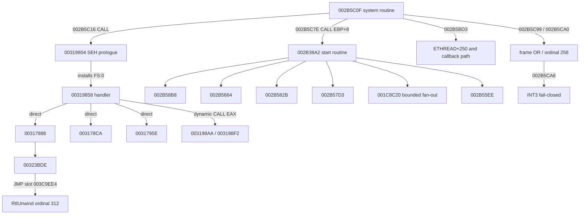

# NFSMW iOS port status

## Phase 2A host

The separate `ios/` CMake project builds a minimal SDL3 application using SDL `release-3.4.16`, an iOS 15 deployment target, UIKit, and SDL's Metal view API. It does not alter the Android root CMake target or Gradle configuration. Generated game code and disc assets remain outside tracked source.

Verified on 2026-11-04:

- Xcode 27.2 (27B52), iPhoneOS and iPhoneSimulator SDK 27.2, Apple Clang 21.0.4.
- The SDL host compiled and linked for the iPhone 18 Pro simulator, launched, and emitted UIKit lifecycle events for background and foreground transitions.
- Simulator logs: `Darwin host page size=16384`; `video driver=uikit`; a non-null Metal layer; first drawable size `2622x1206` pixels.
- The same host compiled and linked for `arm64-apple-ios15.0` with signing disabled. The executable is a Mach-O arm64 binary. It was not installed on a physical iPhone.
- Xcode reported no valid code-signing identities. Physical-device launch is therefore unverified and was not attempted.
- Metal view/layer creation is verified. No Metal frame was rendered, and no Vulkan surface or swapchain was created.

### Rebuild commands

From the repository root, configure and build the simulator target:

```sh
cmake -S ios -B .local/ios-port/ios-simulator -G Xcode \
  -DCMAKE_SYSTEM_NAME=iOS \
  -DCMAKE_OSX_SYSROOT=iphonesimulator \
  -DCMAKE_OSX_ARCHITECTURES=arm64 \
  -DCMAKE_OSX_DEPLOYMENT_TARGET=15.0

cmake --build .local/ios-port/ios-simulator --config Debug \
  --target mostwanted_ios -- -sdk iphonesimulator
```

Configure a separate physical-device build directory, reusing SDL's already-fetched source, then build without signing:

```sh
cmake -S ios -B .local/ios-port/ios-device -G Xcode \
  -DCMAKE_SYSTEM_NAME=iOS \
  -DCMAKE_OSX_SYSROOT=iphoneos \
  -DCMAKE_OSX_ARCHITECTURES=arm64 \
  -DCMAKE_OSX_DEPLOYMENT_TARGET=15.0 \
  -DFETCHCONTENT_SOURCE_DIR_SDL3="$PWD/.local/ios-port/ios-simulator/_deps/sdl3-src"

cmake --build .local/ios-port/ios-device --config Debug \
  --target mostwanted_ios -- -sdk iphoneos CODE_SIGNING_ALLOWED=NO
```

The simulator app bundle is `.local/ios-port/ios-simulator/Debug-iphonesimulator/mostwanted_ios.app`; the device bundle is `.local/ios-port/ios-device/Debug-iphoneos/mostwanted_ios.app`. These outputs are ignored and must stay out of commits.

The first simulator install attempt reported `Missing bundle ID`; setting `com.racas.mostwanted.ios` in the Xcode target fixed it. Final simulator install and launch succeeded. The final simulator and arm64 device builds completed without errors. SDL's optional `PkgConfig` and `LibUSB` probes were unavailable and did not prevent the build.

## Phase 2B results

Phase 2A's four local commits were reconciled against `origin/feature/ios-port` and pushed with a normal fast-forward before this work. `main` was not changed. Phase 2B adds an optional Vulkan bootstrap target; it is off by default so the existing SDL host build remains unchanged.

Phase 2B implementation commits: Darwin memory `03304f1730fc9e7801949a45e58cb6666ada683d`; Vulkan bootstrap `ac25c7a81567c69960f7cbf486f8962e0d9c7282`.

### Darwin memory

**MEMORY_DARWIN_BACKEND: BLOCKED.** Darwin backing and aliasing work; complete 4 KB guest-page semantics do not. The iOS backend uses an unlinked `mkstemp` file under `TMPDIR`, `ftruncate`, shared file mappings, and `MAP_NORESERVE` for the 4 GB guest address space. Both 64 MB physical windows map the same backing object. Initialization failure cleans up mappings and file descriptors; repeated `Init` and `Shutdown` are covered.

On a 16 KB host, `Commit` and `Decommit` fail closed unless the rounded guest range covers whole host pages. This preserves neighboring page contents and state, but means ordinary 4 KB system allocations and some image-section commits fail. For example, `AllocSystem(0x400, 64)` cannot commit its 4 KB page; early thread setup then cannot initialize its KPCR. Do not attempt Xbox runtime startup or game boot with this backend.

The remaining blocker is the guest access model: translated code uses direct `X86_MEM*` pointers and `memmove`/`memcpy`, while kernel code exposes raw `G<T>()` references and `HostPtr()` pointers. There is no shared seam through which every access can be checked. A safe 4 KB implementation needs either comprehensive access mediation for scalar, vector, atomic, bulk-copy, GPU, and audio paths, or a redesigned guest mapping that preserves independent 4 KB state on 16 KB hosts. Hardware protection alone cannot do this. Current tests cover host-page refusal and state preservation, but do not establish complete guest access permissions.

The macOS CTest target and the iOS Simulator memory-test app both passed. The simulator reported a 16 KB host page. Checks cover 4 GB reservation/footprint, alias coherence, commit/decommit, fail-closed neighboring-page behavior, zero-fill/recommit, address bounds, 64 KB reservation alignment, allocator rollback, failed initialization, and repeated cleanup. Simulator evidence is not physical-iPhone evidence.

macOS memory-test commands:

```sh
cmake -S ios/memory-tests -B .local/ios-port/memory-macos -G Xcode \
  -DCMAKE_OSX_SYSROOT=macosx -DCMAKE_OSX_ARCHITECTURES=arm64
cmake --build .local/ios-port/memory-macos --config Debug \
  --target mostwanted_memory_tests -- -quiet
ctest --test-dir .local/ios-port/memory-macos -C Debug --output-on-failure
```

The iOS Simulator app was built, installed, and run on the iPhone 18 Pro simulator with these commands:

```sh
cmake -S ios -B .local/ios-port/ios-sim -G Xcode \
  -DCMAKE_SYSTEM_NAME=iOS \
  -DCMAKE_OSX_SYSROOT=/Applications/Xcode.app/Contents/Developer/Platforms/iPhoneSimulator.platform/Developer/SDKs/iPhoneSimulator27.2.sdk \
  -DCMAKE_OSX_ARCHITECTURES=arm64 -DCMAKE_OSX_DEPLOYMENT_TARGET=15.0
cmake --build .local/ios-port/ios-sim --config Debug \
  --target mostwanted_memory_tests -- -quiet
xcrun simctl install 43A6197F-AD68-48D4-84DB-6A147D89B8DC \
  .local/ios-port/ios-sim/Debug-iphonesimulator/mostwanted_memory_tests.app
xcrun simctl launch --console-pty --terminate-running-process \
  43A6197F-AD68-48D4-84DB-6A147D89B8DC com.racas.mostwanted.memorytests
```

### Vulkan bootstrap

**IOS_VULKAN_BOOTSTRAP: PASS on iOS Simulator.** The optional `mostwanted_vulkan_ios` target pins MoltenVK v1.4.2 and its SHA-256 in `ios/vulkan/CMakeLists.txt`; the dependency archive and extracted XCFramework stay in the ignored build directory. The simulator and physical ARM64 targets both compiled and linked. The physical-device build was unsigned and was not installed or run.

On the iPhone 18 Pro simulator, logs showed 18 instance extensions and 114 device extensions. SDL enabled `VK_KHR_surface` and `VK_EXT_metal_surface`; `SDL_Vulkan_CreateSurface` created the UIKit Metal surface. The selected device was `Apple iOS simulator GPU`, Vulkan 1.1.357, with a graphics/presentation queue and three swapchain images at `2622x1206`. The app submitted and presented a blue frame; a simulator screenshot confirmed it.

The simulator exposes and the bootstrap enables `VK_KHR_portability_subset`. It does not expose `VK_KHR_portability_enumeration` for this direct static-linked MoltenVK path, so no instance portability flag was enabled. Device features logged: sampler anisotropy, non-solid fill, depth clamp, dynamic rendering, and timeline semaphore support; BC texture compression is unavailable. The existing Android Vulkan backend can fall back to CPU BC decode and fences on Vulkan 1.1; its basic API, swapchain, sampled-depth, and presentation gates passed on the simulator. This does not verify D3D8 translation or Xbox game rendering.

MoltenVK v1.4.2 is the latest tagged release used here, pinned by archive hash `562a15a29bc358446a56a4091c5f7e08f604184187c1d34f712148b61ef17276`. Upstream now marks MoltenVK deprecated and community-maintained on a best-effort basis, which is a long-term maintenance risk ([release](https://github.com/KhronosGroup/MoltenVK/releases/tag/v1.4.2), [upstream notice](https://github.com/KhronosGroup/MoltenVK)). The runtime guide documents iOS 15 support and public Metal APIs ([MoltenVK runtime guide](https://github.com/KhronosGroup/MoltenVK/blob/main/Docs/MoltenVK_Runtime_UserGuide.md)).

Configure and build the simulator targets with the bootstrap enabled; CMake downloads the pinned package when it is absent from the build directory:

```sh
cmake -S ios -B .local/ios-port/ios-sim -G Xcode \
  -DCMAKE_SYSTEM_NAME=iOS \
  -DCMAKE_OSX_SYSROOT=/Applications/Xcode.app/Contents/Developer/Platforms/iPhoneSimulator.platform/Developer/SDKs/iPhoneSimulator27.2.sdk \
  -DCMAKE_OSX_ARCHITECTURES=arm64 -DCMAKE_OSX_DEPLOYMENT_TARGET=15.0 \
  -DMOSTWANTED_BUILD_VULKAN_BOOTSTRAP=ON
cmake --build .local/ios-port/ios-sim --config Debug \
  --target mostwanted_ios mostwanted_memory_tests mostwanted_vulkan_ios -- -quiet
xcrun simctl install 43A6197F-AD68-48D4-84DB-6A147D89B8DC \
  .local/ios-port/ios-sim/Debug-iphonesimulator/mostwanted_vulkan_ios.app
xcrun simctl launch --console-pty --terminate-running-process \
  43A6197F-AD68-48D4-84DB-6A147D89B8DC com.racas.mostwanted.vulkan
```

For a physical ARM64 compile/link only, configure with `-DCMAKE_OSX_SYSROOT=iphoneos -DCMAKE_OSX_ARCHITECTURES=arm64 -DMOSTWANTED_BUILD_VULKAN_BOOTSTRAP=ON`, then build with `-- -quiet CODE_SIGNING_ALLOWED=NO`. Do not install this output on a physical iPhone as part of Phase 2B.

The verified unsigned device configure and build commands were:

```sh
cmake -S ios -B .local/ios-port/ios-device -G Xcode \
  -DCMAKE_SYSTEM_NAME=iOS \
  -DCMAKE_OSX_SYSROOT=/Applications/Xcode.app/Contents/Developer/Platforms/iPhoneOS.platform/Developer/SDKs/iPhoneOS27.2.sdk \
  -DCMAKE_OSX_ARCHITECTURES=arm64 -DCMAKE_OSX_DEPLOYMENT_TARGET=15.0 \
  -DMOSTWANTED_BUILD_VULKAN_BOOTSTRAP=ON \
  -DFETCHCONTENT_SOURCE_DIR_SDL3="$PWD/.local/ios-port/ios-sim/_deps/SDL3-src"
cmake --build .local/ios-port/ios-device --config Debug \
  --target mostwanted_ios mostwanted_memory_tests mostwanted_vulkan_ios \
  -- -quiet CODE_SIGNING_ALLOWED=NO
```

### Android regression

**ANDROID_REGRESSION: PARTIAL.** Android CMake and Gradle files are unchanged. The modified shared runtime sources passed NDK 27.2 ARM64 `-fsyntax-only` compilation. `bash ./gradlew :app:assembleDebug` stopped before project configuration with `Unsupported class file major version 69` under the installed Java 25 runtime. The project requests NDK 28.2.13676358; only NDK 27.2.12479018 is installed. The required `third_party/SDL`, `assets/default.xbe`, and `generated/game/x86_func_mapping.cpp` are also absent, so a full Android game build was not available. No game assets or generated code were added.

The commands and result were:

```sh
/Users/abbypangeran/Library/Android/sdk/ndk/27.2.12479018/toolchains/llvm/prebuilt/darwin-x86_64/bin/aarch64-linux-android29-clang++ \
  -std=c++20 -fsyntax-only -DANDROID -fno-strict-aliasing -fsigned-char \
  -include native/compat/crt.h -Inative/compat -Isdk/harness/compat -Isdk/runtime \
  sdk/runtime/kernel/memory.cpp sdk/runtime/kernel/boot.cpp sdk/runtime/kernel/xboxkrnl.cpp
bash ./gradlew :app:assembleDebug
```

The NDK syntax-only command passed. Gradle failed before project configuration with `BUG! exception in phase 'semantic analysis' in source unit '_BuildScript_' Unsupported class file major version 69` under Temurin 25.0.3.

## Phase 2C-1 guest memory results

Verified on 2026-11-04. The Phase 2C-1 architecture record is in [`GUEST_MEMORY_ARCHITECTURE.md`](GUEST_MEMORY_ARCHITECTURE.md).

| Gate | Result | Evidence |
| --- | --- | --- |
| `GUEST_ACCESS_INVENTORY` | **PASS** | Runtime, recompiler, generated code, kernel/HLE, boot, I/O, graphics, audio, threads, atomics, and direct-pointer access categories have documented handling or explicit gaps. The inventory found `X86_MEM*` in 128 generated units, raw `X86_PTR` in 65, and atomics in 18; counts overlap. |
| `MEMORY_ARCHITECTURE_PROTOTYPE` | **PASS — isolated prototype only** | Checked 4 KB logical-page operations and access rejection pass on 16 KB macOS and iOS Simulator hosts. This is not runtime integration. |
| `BOOT_ALLOCATION_PROBE` | **BLOCKED** | Prototype allocation shapes pass, but real runtime `AllocSystem(0x400, 64)`, ETHREAD-sized allocation, and unaligned image-section commit remain blocked. Real runtime guarded stack allocation passes. No Xbox runtime or game boot was attempted. |
| `ANDROID_REGRESSION` | **PARTIAL** | Java 21 Gradle task configuration passes. `assembleDebug` reaches Android CMake configuration, then fails because generated game code is unavailable. No Android C++ compilation or device run occurred. |

### Prototype checks

The prototype owns a 256 KB temporary backing file and two shared aliases, with 64 logical 4 KB page entries mapped onto a 16 KB host. It validates whole spans through its access API, serializes operations against decommit/protection changes, and never returns a raw guest pointer. The standalone prototype and macOS runtime allocator CTest targets each passed (`1/1`). The iOS Simulator memory-test app passed runtime and prototype checks; logs confirmed `Darwin host page size=16384`, all prototype checks passed, and the app printed `memory tests: finished`. The SDL indirect-input Info.plist warning was nonfatal.

AppleClang/LLVM coverage for `guest_memory.cpp`: 95.00% lines, 83.33% regions, 100.00% functions, and 64.52% branches. Line and region coverage exceed the project 80% threshold; branch coverage remains below it.

Prototype limitations: logical permissions only; host aliases remain read/write. Raw pointer accesses can bypass checks. `CheckExecute` is not wired into CPU fetch. All aliases share permission state, so alias-specific protection is absent. `FetchAdd32` is serialized only for API users. Decommit clears contents/state but retains backing storage. The allocation probes model shapes only and do not invoke Xbox runtime allocators. See the architecture record for all unimplemented access paths.

Run standalone macOS prototype tests:

```sh
cmake -S ios/guest-memory-prototype -B .local/ios-port/guest-memory-prototype-macos -G Xcode
cmake --build .local/ios-port/guest-memory-prototype-macos --config Debug \
  --target guest_memory_prototype_tests -- -quiet
ctest --test-dir .local/ios-port/guest-memory-prototype-macos -C Debug --output-on-failure
```

Run macOS runtime allocator checks:

```sh
cmake -S ios/memory-tests -B .local/ios-port/memory-macos -G Xcode \
  -DCMAKE_OSX_SYSROOT=macosx -DCMAKE_OSX_ARCHITECTURES=arm64
cmake --build .local/ios-port/memory-macos --config Debug \
  --target mostwanted_memory_tests -- -quiet
ctest --test-dir .local/ios-port/memory-macos -C Debug --output-on-failure
```

Build and run the combined memory checks on the iPhone 18 Pro simulator:

```sh
cmake -S ios -B .local/ios-port/ios-sim -G Xcode \
  -DCMAKE_SYSTEM_NAME=iOS \
  -DCMAKE_OSX_SYSROOT=/Applications/Xcode.app/Contents/Developer/Platforms/iPhoneSimulator.platform/Developer/SDKs/iPhoneSimulator27.2.sdk \
  -DCMAKE_OSX_ARCHITECTURES=arm64 -DCMAKE_OSX_DEPLOYMENT_TARGET=15.0 \
  -DMOSTWANTED_BUILD_VULKAN_BOOTSTRAP=ON
cmake --build .local/ios-port/ios-sim --config Debug \
  --target mostwanted_memory_tests -- -quiet
xcrun simctl install 43A6197F-AD68-48D4-84DB-6A147D89B8DC \
  .local/ios-port/ios-sim/Debug-iphonesimulator/mostwanted_memory_tests.app
xcrun simctl launch --console-pty --terminate-running-process \
  43A6197F-AD68-48D4-84DB-6A147D89B8DC com.racas.mostwanted.memorytests
```

Runtime checks intentionally report the current backend limitations: `AllocSystem(0x400, 64)` and the ETHREAD-sized allocation are refused under 16 KB host-page rules; 64 KB-aligned guarded stack allocation succeeds; unaligned `Commit(0x30000, 0x5000)` is refused. Prototype equivalents for the KPCR/ETHREAD, guarded stack/TLS, and image-section shapes pass through the checked API. This does not establish actual boot readiness.

### Android Java 21 regression check

Used JDK 21.0.13 for this command only; no global Java setting changed. Project Gradle 8.7 configured successfully and requested NDK 28.2.13676358. Android SDK Platform 34, that NDK, and CMake 3.31.6 were added under the existing local Android SDK. The Java 25 `Unsupported class file major version 69` failure is resolved.

CMake 3.31.6 was installed with:

```sh
JAVA_HOME=/opt/homebrew/opt/openjdk@21/libexec/openjdk.jdk/Contents/Home \
/Users/abbypangeran/Library/Android/sdk/cmdline-tools/latest/bin/sdkmanager \
  --sdk_root=/Users/abbypangeran/Library/Android/sdk 'cmake;3.31.6'
```

Gradle task configuration passed:

```sh
JAVA_HOME=/opt/homebrew/opt/openjdk@21/libexec/openjdk.jdk/Contents/Home \
ANDROID_HOME=/Users/abbypangeran/Library/Android/sdk \
bash ./gradlew --no-daemon :app:tasks
```

Output: `BUILD SUCCESSFUL`.

Full app build attempt:

```sh
JAVA_HOME=/opt/homebrew/opt/openjdk@21/libexec/openjdk.jdk/Contents/Home \
ANDROID_HOME=/Users/abbypangeran/Library/Android/sdk \
PATH=/opt/homebrew/opt/openjdk@21/libexec/openjdk.jdk/Contents/Home/bin:$PATH \
bash ./gradlew --no-daemon :app:assembleDebug
```

Gradle reached `:app:configureCMakeRelease[arm64-v8a]`, using NDK Clang 19.0.1, then stopped at the repository's missing-input guard:

```text
CMake Error at CMakeLists.txt:33 (message):
  No recompiled code: put the game in assets/ or iso/ and run build.bat, it
  writes generated/game
```

Gradle result: `BUILD FAILED` during CMake configuration; the warning about SDK XML version 4 was nonfatal.

No ISO, generated code, or copyrighted assets were added to tracked source. Android CMake and Gradle files were not changed. Therefore this verifies Gradle/JDK setup and the missing-input blocker, but not Android native compilation, packaging, or runtime behavior.

### Phase 2C-2 recommendation

**GO** for Phase 2C-2 work on comprehensive access mediation: convert recompiler emissions and every kernel/HLE, boot, I/O, graphics, audio, and diagnostic pointer path to checked spans or lifetime-pinned access. **NO-GO** for Xbox runtime startup or game boot until raw guest-pointer paths are eliminated or validated, real runtime allocation probes pass on 16 KB hosts, and protection/decommit races are covered. Keep runtime, simulator, physical-device, and game-boot evidence separate.

Phase 2C-1 commits:

- Architecture inventory and choice: `7f46bc69a5fa82fc4ab88d7067b4cc8a656b9316`
- Isolated translated-page prototype: `6ff32dedc7556345bf08bb88c91faaa2281a3e79`
- Prototype and runtime-shape tests: `351ef1e82c25a6d6c084b1bc423a17d201ce29f1`

## Phase 2C-2 production memory checkpoint

Verified on 2026-11-05. The earlier Phase 2B and 2C-1 statements above describe those checkpoints; the current Darwin memory behavior is described here and in `GUEST_MEMORY_ARCHITECTURE.md`.

| Gate | Result | Evidence and limit |
| --- | --- | --- |
| `GUEST_MEMORY_RUNTIME` | **PARTIAL** | Production checked read/write, bulk, atomic, software permission, 4 KB commit/decommit, and real allocator probes pass on 16 KB Darwin hosts. Full page-table/frame translation and all runtime callers are not integrated. |
| `RECOMPILER_ACCESS_MEDIATION` | **BLOCKED** | `X86_MEM*`, `X86_PTR`, x87/SIMD, atomics, and REP helpers still use raw guest pointers. No generated-code fixture was attempted because Stages A/B are partial. |
| `HOST_ACCESS_COVERAGE` | **BLOCKED** | `Base()` is null on Apple and `Boot()` stops before raw access. Kernel `G<T>()`/`HostPtr()`, boot image loading, I/O, graphics, audio, and asynchronous retained pointers remain unconverted. |
| `IOS_MEMORY_REGRESSION` | **PARTIAL** | macOS CTest and iOS Simulator execution pass; unsigned physical ARM64 app compiles and links. Full-component branch coverage is 55.64%, below the 80% target. Physical device execution was not attempted. |
| `ANDROID_REGRESSION` | **PARTIAL** | NDK 28.2 ARM64 syntax compilation and full `:app:assembleDebug` native build/package pass. Android execution was not attempted. |

The test uses the actual `mem::Init`, `AllocSystem(0x400, 64)`, ETHREAD-sized allocation, `AllocStack`, and `ReserveImage` implementations. It verifies KPCR/ETHREAD-sized field access through checked operations, TLS and guard behavior, independent adjacent 4 KB pages, recommit zero-fill, alias coherence, 10-byte/16-byte spans, invalid bounds, concurrent atomic increments, and reads racing with protection/decommit. These are allocator and access probes; a guest thread was not started. The existing isolated prototype also runs in the simulator app.

Build and run commands from the repository root:

```sh
cmake --build .local/ios-port/memory-macos --config Debug --target mostwanted_memory_tests -- -quiet
ctest --test-dir .local/ios-port/memory-macos -C Debug --output-on-failure
cmake --build .local/ios-port/ios-sim --config Debug --target mostwanted_memory_tests -- -quiet
xcrun simctl install 43A6197F-AD68-48D4-84DB-6A147D89B8DC \
  .local/ios-port/ios-sim/Debug-iphonesimulator/mostwanted_memory_tests.app
xcrun simctl launch --console-pty --terminate-running-process \
  43A6197F-AD68-48D4-84DB-6A147D89B8DC com.racas.mostwanted.memorytests
cmake --build .local/ios-port/ios-device --config Debug \
  --target mostwanted_memory_tests -- -quiet CODE_SIGNING_ALLOWED=NO
/Users/abbypangeran/Library/Android/sdk/ndk/28.2.13676358/toolchains/llvm/prebuilt/darwin-x86_64/bin/aarch64-linux-android29-clang++ \
  -std=c++20 -fsyntax-only -DANDROID -fno-strict-aliasing -fsigned-char \
  -include native/compat/crt.h -Inative/compat -Isdk/harness/compat -Isdk/runtime \
  sdk/runtime/kernel/memory.cpp sdk/runtime/kernel/boot.cpp
```

Results: macOS CTest `1/1 Passed`; simulator app exit 0 with `memory tests: finished` and the new concurrency and alias checks marked `PASS`; unsigned device target linked; NDK syntax check exit 0. The device build directory was reconfigured with the exact iPhoneOS 27.2 SDK and `-DFETCHCONTENT_SOURCE_DIR_SDL3="$PWD/.local/ios-port/ios-sim/_deps/SDL3-src"` after its stale Xcode project initially failed with `Undefined symbols for architecture arm64: "_RunGuestMemoryPrototypeTests"`. Reconfiguration resolved that build-file-list error. No physical-device install or game boot occurred.

LLVM coverage command and result:

```sh
LLVM_PROFILE_FILE=.local/ios-port/memory-coverage/final2-%p.profraw \
  .local/ios-port/memory-coverage/Debug/mostwanted_memory_tests
xcrun llvm-profdata merge -sparse .local/ios-port/memory-coverage/final2-*.profraw \
  -o .local/ios-port/memory-coverage/final2.profdata
xcrun llvm-cov report .local/ios-port/memory-coverage/Debug/mostwanted_memory_tests \
  -instr-profile=.local/ios-port/memory-coverage/final2.profdata sdk/runtime/kernel/memory.cpp
```

Full `memory.cpp`: 75.55% lines, 70.83% regions, 85.42% functions, 55.64% branches. This includes legacy allocator, platform, and failure paths. The 80% branch target was not met; rollback failure injection and generated instruction paths are not covered.

Debug microbenchmark prints nanoseconds per round. On the iOS Simulator: local scalar 2, checked scalar read+write 107; local 4 KB write+read 265, checked 4 KB write+read 366. On macOS: 1, 107, 217, and 302 respectively. The local operations use observable copy-in/copy-out into a local 4 KB buffer as a lower-bound proxy because Darwin no longer exposes the previous raw guest pointer. These figures show measurable checked-access cost, but are not a reliable direct-pointer slowdown ratio or a release-performance claim.

Android full build used the validated local XBE and generated output through ignored `assets/default.xbe` and `generated/game` symlinks pointing into `.local/ios-port/`. Nothing under those paths was staged or committed. With local Java 21 and NDK 28.2.13676358:

```sh
JAVA_HOME=/opt/homebrew/opt/openjdk@21/libexec/openjdk.jdk/Contents/Home \
ANDROID_HOME=/Users/abbypangeran/Library/Android/sdk \
bash ./gradlew --no-daemon :app:assembleDebug
```

Result: initial `BUILD SUCCESSFUL in 11m 14s`, 37 tasks (10 executed, 27 up-to-date), including `:app:buildCMakeRelease[arm64-v8a]` and `:app:assembleDebug`. The final code rebuild also passed in 29s (5 executed, 32 up-to-date). Nonfatal diagnostics were SDK XML version 4 versus reader version 3 and SDL's deprecated `ASensorManager_getInstance`. No Android device installation or runtime test was performed.

**Next milestone, Phase 2C-3:** convert a narrow recompiler fixture and startup-critical host helpers to checked access, including 10/16-byte, atomic and REP semantics; then audit every pointer escape and fault path before enabling `Boot()`. Runtime startup is **not safe to attempt** at this checkpoint. Android/Linux 16 KB host-page behavior remains unproven, and the production implementation still uses software state over linear backing rather than the selected page-table/frame architecture.

## Vulkan and MoltenVK findings

SDL 3.4.16's UIKit Vulkan backend requires `VK_KHR_surface` and supports `VK_EXT_metal_surface`; it creates its own UIKit Metal view and `CAMetalLayer` during `SDL_Vulkan_CreateSurface`. The bootstrap uses that path and does not create a second view. The Android Vulkan backend remains platform-specific: `native/vulkan.cpp` waits for `SDL_PROP_WINDOW_ANDROID_WINDOW_POINTER`, so its surface path is not reused on iOS.

References: [SDL iOS guide](https://wiki.libsdl.org/SDL3/README-ios), [SDL UIKit Vulkan implementation at 3.4.16](https://github.com/libsdl-org/SDL/blob/release-3.4.16/src/video/uikit/SDL_uikitvulkan.m), [MoltenVK runtime guide](https://github.com/KhronosGroup/MoltenVK/blob/main/Docs/MoltenVK_Runtime_UserGuide.md).

## Phase 2B Darwin memory findings (historical)

At the Phase 2B checkpoint, `sdk/runtime/kernel/memory.cpp` retained the 4 GB guest VA layout with sparse reservation and physical aliases. Darwin used an unlinked temporary file instead of Linux `memfd_create`. `Commit`/`Decommit` rejected sub-host-page ranges. Phase 2C-2 supersedes that limitation through checked software page state, but does not establish game readiness. No game boot was attempted.

## Generated x86 trap sites

These 16 unimplemented guest instructions were found in ignored generated files under `.local/ios-port/generated/game/`; generated code and copyrighted assets were not copied into tracked source.

| Guest PC | Instruction | Generated file |
| --- | --- | --- |
| `0x002CDC13` | `pxor xmm7, xmm7` | `x86_recomp.91.cpp` |
| `0x002CDC20` | `psraw xmm1, 0x0F` | `x86_recomp.91.cpp` |
| `0x002CDC25` | `pxor xmm0, xmm1` | `x86_recomp.91.cpp` |
| `0x002CDC29` | `psubw xmm0, xmm1` | `x86_recomp.91.cpp` |
| `0x002CDC2D` | `paddw xmm0, xmm2` | `x86_recomp.91.cpp` |
| `0x002CDC31` | `pmulhuw xmm0, xmm3` | `x86_recomp.91.cpp` |
| `0x002CDC35` | `pxor xmm0, xmm1` | `x86_recomp.91.cpp` |
| `0x002CDC39` | `psubw xmm0, xmm1` | `x86_recomp.91.cpp` |
| `0x0037F956` | `bound esp, qword ptr [edx+0x52]` | `x86_recomp.118.cpp` |
| `0x003801ED` | `outsd` | `x86_recomp.118.cpp` |
| `0x00384966` | `bound esp, qword ptr [edx+0x52]` | `x86_recomp.118.cpp` |
| `0x00397BDA` | `outsd` | `x86_recomp.120.cpp` |
| `0x00397BEB` | `insd` | `x86_recomp.120.cpp` |
| `0x003C03EA` | `das` | `x86_recomp.125.cpp` |
| `0x003C03EC` | `into` | `x86_recomp.125.cpp` |
| `0x003C044B` | `aas` | `x86_recomp.125.cpp` |

`x86_trap` in `sdk/runtime/cpu/dispatch.cpp` logs `guest trap at <PC>: <reason>`, flushes the guest stack, then aborts. Once runtime startup is integrated, capture the simulator/device log and match the reported PC against this table. A match proves that site is reachable on that run. An empty match is meaningful only if the run reaches a defined startup milestone (for example, the main menu) with complete logs. Since the handler aborts, each run can report only the first trap it reaches; no reachability run has been performed yet.

## Phase 2A next milestone (historical)

Design and implement comprehensive guest-access mediation or an equivalent safe 4 KB-on-16 KB memory model, then add tests for actual guest permissions and boot-thread allocations. Only after that gate, introduce Xbox runtime startup and use the existing `x86_trap` log to detect reachable trap sites. Keep simulator execution, physical-device execution, and game boot as separate acceptance checks.

## Phase 2C-3 checked recompiler checkpoint

Verified on 2026-11-05 from branch `feature/ios-port`, starting HEAD `8841aa36558d807da6a1e0d816987e5af334ef46`. This checkpoint uses a synthetic XBE generated locally by the fixture builder; no game executable, assets, or generated game C++ were added to tracked source.

| Gate | Result | Evidence and limit |
| --- | --- | --- |
| `RECOMPILER_CHECKED_FIXTURE` | **PASS (scoped whitelist)** | Real `xbe_recomp` output compiled and ran against production `mem::` APIs: MOV/MOVZX/MOVSX, 64-bit MMX MOVQ, memory ADD/SUB/INC, success/fault paths, and correct flags. |
| `CPU_FAULT_PROPAGATION` | **PASS (diagnostic stop)** | Generated uncommitted read, denied write, and blocked opcode reached production logging and `SIGABRT` in isolated child processes. Not Xbox exception delivery. |
| x87/SIMD | **BLOCKED** | 10-byte FLD and 16-byte MOVUPS are rejected by checked mode; no x87/SIMD guest instruction executes. |
| Atomics | **BLOCKED** | Implicit memory XCHG, locked XADD, and other atomic shapes are rejected; alignment and guest concurrency semantics are not established. |
| REP/string | **BLOCKED** | REP MOVSD is rejected; DF, overlap, multi-page partial progress, and fault boundaries are not established. |
| `HOST_STARTUP_ACCESS` | **PARTIAL** | Apple scalar kernel helpers, KPCR/ETHREAD setup, bounded/counting strings, and selected Rtl bulk helpers are checked and tested. XBE copies and raw pointer callers remain. |
| macOS ARM64 | **PASS** | `mostwanted_memory_tests`: CTest `1/1`; coverage report below. |
| iOS Simulator ARM64 | **PASS** | App launched on iPhone 18 Pro simulator; production memory tests, generated fixture, and fault outcomes printed PASS through `memory tests: finished`. |
| iOS device ARM64 compile/link | **PASS** | Unsigned iPhoneOS app linked as Mach-O ARM64. No physical-device install or execution. |
| Android regression | **PASS (build)** | Java 21 / NDK 28.2.13676358 `:app:assembleDebug` passed; generated Ninja source list includes the new runtime files. No Android runtime execution. |

### Checked fixture and fault semantics

Checked mode is opt-in with `[xbe] checked_memory = true`; it defaults off. It supports scalar MOV, MOVZX/MOVSX, MMX MOVQ, memory ADD/SUB/INC, conditional branches, and RET. Unsupported operand forms and locked instructions use `x86_checked_trap`, which avoids the existing guest-stack scan. Faults carry guest PC, address, read/write direction, and `AccessStatus`; `mem::Read`/`Write` validate the full span before touching guest data. The production handler logs and aborts to stop guest execution deterministically. It does not synthesize Xbox exception records or recover the guest thread.

The fixture verifies 4 KB guest-page boundaries on a 16 KB Darwin host, unaligned scalar spans, signed and unsigned extension, 64-bit MMX transfers, overflow, uncommitted/no-access/read-only pages, faulting PCs, no partial cross-page stores, and RMW results/flags. The generated fault handler test separately exercises uncommitted reads, permission-denied writes, and blocked instructions through the production handler. Unlocked RMW read/write is not one atomic transaction.

### Host helpers and remaining raw paths

Apple-only checked helpers now cover R8/R16/R32/R64 and W8/W16/W32/W64, complete KPCR/ETHREAD initialization with rollback, counted ANSI and bounded C strings with full descriptor-span validation, and RtlZeroMemory/RtlFillMemory/RtlMoveMemory. RtlFillMemoryUlong validates the whole dword span before writing; RtlCompareMemory rejects cursor overflow. The ULONG fill does not pin across per-word writes, so concurrent decommit can still cause partial progress. Darwin thread naming uses the Apple pthread API. Android/Windows/Linux retain direct scalar, thread initialization, and string paths. Android's existing recompiler output remains the default because checked emission defaults off.

Still unconverted: `kernel::G<T>()`, `HostPtr()`, XBE header/section copies in `boot.cpp`, `XeLoadSection` host copies, other RTL string copy/conversion and interlocked exports, `X86_MEM*`/`X86_PTR` paths outside the checked subset, file/network buffers, GPU/texture/vertex/render buffers, audio buffers, and pointers retained by asynchronous operations. Relevant code remains in `sdk/runtime/kernel/{boot,files,objects,rtl,xboxkrnl}.cpp`, `sdk/runtime/gpu`, `sdk/runtime/xdk`, `src/d3d`, and `src/sound`. Apple `Boot()` still rejects a null base before these paths. The complete access inventory and architecture decision remain above.

### Platform and coverage evidence

The Darwin test binary now covers the production memory implementation plus `guest_strings.cpp`: `memory.cpp` 75.19% lines, 70.38% regions, 85.71% functions, and 55.92% branches; `guest_strings.cpp` 100% lines and functions, 74.07% regions, and 61.11% branches. Combined branch coverage is 56.14%. Active checked read/write, access status, 4 KB page, string, allocation, and fault branches are exercised. The generated child-process tests also exercise production memory-fault logging, denied writes, checked helper overflow, and unsupported-instruction stops, but are not included in this coverage binary. Remaining gaps include rollback failure injection, rare host mapping errors, and non-Apple platform branches. The 80% branch target remains unmet.

Release fixture benchmark on this Mac ARM64 host: empty generated call 1.1 ns; generated checked scalar load+store 32.0 ns; measured delta 30.9 ns per call, about 62.57 million checked scalar operations/s. Checked `mem::Copy` measured 60.43 GiB/s; a local-buffer `memcpy` proxy measured 79.27 GiB/s and is not direct guest memory. Measurements are microbenchmarks, not a device performance claim.

Nonfatal diagnostics observed: Zydis CMake minimum-version deprecation and missing optional Doxygen; SDL configure could not find optional PkgConfig/LibUSB; simulator logged `You need UIApplicationSupportsIndirectInputEvents in your Info.plist for mouse support`; Android tooling warned that SDK XML version 4 exceeds its version-3 reader. These did not fail the builds or tests.

Intermediate failures were fixed before this checkpoint. The first generated fixture CTest reported failures for memory SUB/INC flags because checked RET did not save local flags; checked RET now emits `X86_SAVE_FLAGS()`. The first standalone macOS Xcode build reported `Undefined symbols for architecture arm64: "kernel::ReadCString(unsigned int, unsigned long)"` and `ReadAnsiString`; explicitly regenerating the Xcode project included the newly added `guest_strings.cpp` and resolved the link failure. The first macOS syntax check reported `no matching function for call to 'pthread_setname_np'`; Darwin now uses its one-argument form, and macOS/iPhoneOS syntax checks pass. An earlier unchecked raw-output probe exited 139 when it dereferenced the intentionally null Apple base, confirming that unchecked generated memory must remain blocked.

### Exact commands

From repository root:

```sh
cmake -S ios/recompiler-fixtures -B .local/ios-port/recompiler-fixtures-xcode -G Xcode
cmake --build .local/ios-port/recompiler-fixtures-xcode --config Debug --target checked_recompiler_tests checked_fault_handler_tests -- -quiet
ctest --test-dir .local/ios-port/recompiler-fixtures-xcode -C Debug --output-on-failure
cmake --build .local/ios-port/recompiler-fixtures-xcode --config Release --target checked_recompiler_tests checked_fault_handler_tests -- -quiet
ctest --test-dir .local/ios-port/recompiler-fixtures-xcode -C Release -V

cmake -S ios/memory-tests -B .local/ios-port/memory-macos -G Xcode
cmake --build .local/ios-port/memory-macos --config Debug --target mostwanted_memory_tests -- -quiet
ctest --test-dir .local/ios-port/memory-macos -C Debug --output-on-failure

cmake -S ios -B .local/ios-port/ios-sim -G Xcode \
  -DCMAKE_SYSTEM_NAME=iOS \
  -DCMAKE_OSX_SYSROOT=/Applications/Xcode.app/Contents/Developer/Platforms/iPhoneSimulator.platform/Developer/SDKs/iPhoneSimulator27.2.sdk \
  -DCMAKE_OSX_ARCHITECTURES=arm64 -DCMAKE_OSX_DEPLOYMENT_TARGET=15.0 \
  -DMOSTWANTED_CHECKED_FIXTURE_DIR="$PWD/.local/ios-port/recompiler-fixtures-xcode/fixture/generated" \
  -DFETCHCONTENT_SOURCE_DIR_SDL3="$PWD/.local/ios-port/ios-sim/_deps/sdl3-src"
cmake --build .local/ios-port/ios-sim --config Debug --target mostwanted_memory_tests -- -quiet
xcrun simctl install 43A6197F-AD68-48D4-84DB-6A147D89B8DC .local/ios-port/ios-sim/Debug-iphonesimulator/mostwanted_memory_tests.app
xcrun simctl launch --console-pty --terminate-running-process 43A6197F-AD68-48D4-84DB-6A147D89B8DC com.racas.mostwanted.memorytests

cmake -S ios -B .local/ios-port/ios-device -G Xcode \
  -DCMAKE_SYSTEM_NAME=iOS \
  -DCMAKE_OSX_SYSROOT=/Applications/Xcode.app/Contents/Developer/Platforms/iPhoneOS.platform/Developer/SDKs/iPhoneOS27.2.sdk \
  -DCMAKE_OSX_ARCHITECTURES=arm64 -DCMAKE_OSX_DEPLOYMENT_TARGET=15.0 \
  -DMOSTWANTED_CHECKED_FIXTURE_DIR="$PWD/.local/ios-port/recompiler-fixtures-xcode/fixture/generated" \
  -DFETCHCONTENT_SOURCE_DIR_SDL3="$PWD/.local/ios-port/ios-sim/_deps/sdl3-src"
cmake --build .local/ios-port/ios-device --config Debug --target mostwanted_memory_tests -- -quiet CODE_SIGNING_ALLOWED=NO

JAVA_HOME=/opt/homebrew/opt/openjdk@21/libexec/openjdk.jdk/Contents/Home \
ANDROID_HOME=/Users/abbypangeran/Library/Android/sdk \
bash ./gradlew --no-daemon :app:assembleDebug
```

Coverage commands:

```sh
cmake -S ios/memory-tests -B .local/ios-port/memory-coverage -G Xcode \
  -DCMAKE_CXX_FLAGS="-fprofile-instr-generate -fcoverage-mapping"
cmake --build .local/ios-port/memory-coverage --config Debug --target mostwanted_memory_tests -- -quiet
LLVM_PROFILE_FILE=.local/ios-port/memory-coverage/phase2c3-%p.profraw \
  .local/ios-port/memory-coverage/Debug/mostwanted_memory_tests
xcrun llvm-profdata merge -sparse .local/ios-port/memory-coverage/phase2c3-*.profraw \
  -o .local/ios-port/memory-coverage/phase2c3.profdata
xcrun llvm-cov report .local/ios-port/memory-coverage/Debug/mostwanted_memory_tests \
  -instr-profile=.local/ios-port/memory-coverage/phase2c3.profdata \
  sdk/runtime/kernel/memory.cpp sdk/runtime/kernel/guest_strings.cpp
```

Apple thread-source syntax checks:

```sh
xcrun --sdk macosx clang++ -std=c++20 -fsyntax-only -Isdk/runtime -Isdk/harness/compat -Inative/compat sdk/runtime/kernel/threads.cpp
xcrun --sdk iphoneos clang++ -target arm64-apple-ios15.0 -std=c++20 -fsyntax-only -Isdk/runtime -Isdk/harness/compat -Inative/compat sdk/runtime/kernel/threads.cpp
xcrun --sdk iphoneos clang++ -target arm64-apple-ios15.0 -std=gnu++20 -fsyntax-only -fno-strict-aliasing -fsigned-char -I native/compat -I sdk/harness/compat -I native -I src -I sdk/runtime -I .local/ios-port/checked-recompiler-census -I third_party/SDL/include -include native/compat/crt.h sdk/runtime/kernel/boot.cpp sdk/runtime/kernel/xboxkrnl.cpp
```

### Generated trap reachability

The existing “Generated x86 trap sites” table above records 16 static unimplemented-instruction sites. It does not count divide-error checks or `int3` traps, which also call `x86_trap`. During a future gated startup run, capture complete logs from `x86_trap` and `x86_checked_trap`, record each guest PC/reason, and match PCs against the 16-site table. A matching PC proves reachability. No match is meaningful only after a defined milestone is reached with complete logs. Both handlers stop execution, so each process can identify only its first fatal trap; do not skip blocked instructions to continue startup.

**Phase 2C-3 recommendation (historical): NO-GO for restricted Xbox runtime startup.** The Phase 2C-4 results below supersede that checkpoint. Simulator execution, device compilation, physical-device execution, and game boot remain separate claims.

## Phase 2C-4: checked XBE preparation and instruction census

Verified 2026-11-05 on branch `feature/ios-port`, starting from `606881c15cc6c8d12ff9fea6add68783deeb6eda`. Generated XBE data, generated recompiler C++, logs, and the local game image stayed under ignored `.local/ios-port/`; no game asset or generated game source was added to tracked files.

| Gate | Result | Evidence and limit |
| --- | --- | --- |
| `CHECKED_XBE_LOADER` | **PASS** | Synthetic XBE and local Black Edition XBE prepared by checked writes; entry, header, preloaded bytes, zero tails, and reference counts verified; no guest code executed. |
| `XBE_FAILURE_HANDLING` | **PASS** | Malformed XBE cases rejected; injected preparation and section-load write failures rolled back reservations/newly committed pages without damaging a shared-host-page neighbor. |
| `STARTUP_POINTER_AUDIT` | **PASS (inventory)** | Sequence and earliest remaining raw pointer paths documented below. Inventory completion does not mean those remaining paths are safe. |
| `CHECKED_GAME_INSTRUCTION_CENSUS` | **PASS (static)** | Actual checked recompiler output analyzed; 129 generated translation units passed C++ syntax-only compilation. No game code ran. |
| macOS ARM64 | **PASS** | Production memory and XBE loader CTests passed in Debug and Release; actual XBE CLI preparation passed. |
| iOS Simulator ARM64 | **PASS** | iPhone 18 Pro simulator ran production memory, generated fixture, fault, and synthetic loader tests through `memory tests: finished`. |
| iPhoneOS ARM64 | **PASS (compile/link)** | Unsigned test app linked as Mach-O ARM64 with code signing disabled. Not installed or run on a physical device. |
| Android | **PASS (build)** | Java 21.0.13 and NDK 28.2.13676358 `:app:assembleDebug` passed. No Android runtime execution. |

### Checked XBE loader results

The ignored local image `.local/ios-port/default.xbe` was 4,739,072 bytes, title ID `4541007B`, entry `0x002B3916`, and SHA-1 `f636a16af04171089f879a4bed646e185c734233`. The checked loader accepted all 15 sections, including 12 preloaded sections, prepared the actual guest image, verified the committed entry address, then released the reservation. The header matched the file apart from loader-updated section reference counts. Each preloaded section's raw data, virtual zero tail, and reference count matched expected state.

The parser rejects a truncated header, out-of-bounds section table, truncated section, overflowing raw offset, image or section address overflow, overlapping virtual sections, unterminated kernel thunk table, and overflowing TLS range. Identity and entry mismatches fail before reservation. An injected third checked-write failure occurs after header and section bytes/zero-fill have been written; rollback leaves no image reservation or committed pages. A second synthetic section shares a 16 KB host page with a preloaded neighbor. After decommitting its guest page, injected data-write and reference-count-write failures verify that section bytes are cleared, only the new page is decommitted, the reference count stays zero, and the neighboring preloaded page remains intact. The valid load/reload/unload reference-count sequence also passes. These checks ran in the macOS harness and simulator; the real Black Edition XBE was parsed and prepared only in the macOS harness.

`xbe::PrepareImage` is separate from `Boot()`: it checks expected SHA-1 and entry, reserves guest space, writes the header and preloaded sections through `mem::Write`, zero-fills virtual tails with `mem::Fill`, writes reference counts through checked scalar access, and releases the reservation after a failed write. `Parse` now bounds section/header/file/image/TLS/certificate metadata, checks the preloaded executable entry, and requires a terminated kernel thunk table in file-backed bytes. The existing Apple `Boot()` null-base guard remains unchanged.

### Startup pointer-escape ledger

This sequence is the path that would be reached if the Apple `Boot()` guard were removed. It was inspected statically; the real `Boot()` sequence did not run.

| Earliest stage | Code and access | Current status |
| --- | --- | --- |
| Apple host entry | `kernel::Boot()` calls `mem::Init()`, then sees `mem::Base() == nullptr`, logs, shuts memory down, and returns before parsing the XBE. | **Guarded.** No later row is currently reachable on Apple through `Boot()`. |
| XBE preparation | `xbe::Image::Parse` and `xbe::PrepareImage`; checked writes/fill only. | **Checked and tested** in isolation against synthetic and actual XBE. No guest instruction or kernel initialization. |
| Loaded callback | `app::kGame.loaded()` runs after image preparation and before kernel initialization. The target game descriptor sets `.loaded = nullptr`. | **No callback for this title.** |
| Kernel data initialization | `InitKernelData` initializes kernel data with checked `W8/W16/W32`; `PutAnsi` writes descriptor and NUL-terminated string together with one `mem::Write` and returns failure. The detached clock updater uses checked `W32` stores. | **Checked access, not runtime-tested.** Other scalar helper faults abort through the current fault policy rather than returning a status. |
| Dispatch and thunk patching | `dispatch::Init` builds host-side mapping tables. The import loop reads and patches the parser-validated, terminated kernel thunk table using checked `R32/W32`. | **No direct pointer escape.** Invalid guest access still stops via the checked fault handler. |
| File-system setup | `MountDefaults` maps host directories and creates the configured directories. It does not access guest memory. | **Host filesystem side effects only.** No game file was opened by this audit. |
| Previous launch data | `startup_data::ImportLaunchData` reads exactly 4 KiB into a bounded host buffer, validates allocation ownership, writes the data and pointer with `mem::Write`, and removes the source only after both writes succeed. | **Checked and failure-injected.** Failed reads/writes preserve `launch.bin`, keep the pointer unchanged, and release the new allocation. |
| Persisted display | After a successful launch-data import, `startup_data::ImportPersistedDisplay` validates header, marker, pixel/picture limits, and exact file length; writes pixels and the full surface metadata block through checked memory; publishes state only after both writes succeed. | **Checked and failure-injected.** Failed import preserves the file and old state, releases the allocation, and retains neighboring bytes. On a cold start with no imported launch page, display data is left untouched, preserving the prior quick-reboot pairing. |
| Guest thread allocation | `CreateThread` allocates stack/TLS/KPCR/ETHREAD and calls `InitializeThreadGuestMemory`; the isolated synthetic preparation checkpoint verifies KPCR/ETHREAD contents and cleanup without starting a host thread. | **Structure helper tested.** Full thread creation remains outside the isolated boot path. |
| Guest execution boundary | `StartThread` registers/spawns the host thread, initializes context, then enters generated code through `CallGuest`. | **Prohibited in this phase.** Checked-mode execution still stops at unsupported instructions. |
| First game entry sequence | Checked generated code supports MOV/MOV/SUB/ADD and CMP at `0x002B3928`; the following JNB uses the CMP result. The next linear blocker is PUSH at `0x002B393F`, followed by LEA, AND, and CALL sites. | **Static only.** No runtime reachability claim; each unsupported instruction still traps. |
| Guest kernel exports | `XeLoadSection`/`XeUnloadSection` validate section-header addresses against the parsed table, serialize multi-call changes against guest page changes, and use checked fill/write/reference-count operations with rollback of newly committed pages on load failure. Other object, critical-section, string, and context exports still use `G<T>()` or `HostPtr()`. | **Section helpers compiled and tested through the loader API, not executed as kernel exports.** Remaining exports are unsafe on Darwin. |
| Guest I/O and device work | Contiguous synchronous `NtReadFile`/`NtWriteFile` data uses checked staging; its IOSB uses one checked 8-byte publication after access preflight. Scatter/gather IOSB/data, socket buffers, event/APC metadata, guest objects, critical sections, waits, and GPU/audio paths retain raw or retained-pointer behavior. | **Partial and blocked.** The IOSB is not pinned across host I/O, so protection/decommit can still race after file side effects. Callback and object paths below remain outside the checked boundary. |

`sdk/runtime/kernel/rtl.cpp` also retains raw string copy/conversion and interlocked paths. `sdk/runtime/kernel/xboxkrnl.cpp` has raw object, critical-section, context, and crypto paths. The Phase 2C-1 inventory above lists the graphics, audio, network, and recompiler families. The Phase 2C-5 section at the end records the current file-level raw-pointer inventory. Do not remove the Apple guard until all paths reachable on the selected startup route have checked semantics and rollback/lifetime tests.

### Checked-game instruction census

The actual local XBE was regenerated with `[xbe] checked_memory = true`; it was not executed. Recompiler log reports 28,848 functions, 1,237,217 unique guest instruction PCs, 1,369,241 generated instruction emissions across functions, 132,024 duplicate emissions, 90 overlapping decodes, and 3,705,446 generated code bytes out of 3,902,736. There were 451 jump tables and 13 callback entries. The checked output has 702,875 `x86_checked_trap` emissions at 641,426 distinct PCs and 666,366 supported emissions at 595,791 distinct PCs. The rejected-emission histogram contains 234 mnemonics. Counts are static code-generation counts, not runtime frequency.

The rejected instruction operand-shape histogram is based on top-level Intel-syntax operands (memory base/index registers are part of the memory operand):

| Operand shape | Emissions |
| --- | ---: |
| Register | 329,223 |
| Immediate | 160,709 |
| Memory | 75,688 |
| Memory + register | 68,372 |
| Immediate + register | 46,469 |
| Immediate + memory | 11,767 |
| Other | 4 |
| No explicit operand | 10,623 |
| Immediate + memory + register | 20 |

Primary access category is a syntax/operation heuristic; it assigns each rejected emission once and is not a full x86 semantic decoder. In particular, stack operations include their implicit stack access, and indirect call targets are counted with stack writes.

| Primary access category | Emissions |
| --- | ---: |
| Implicit stack write | 283,474 |
| Implicit stack read | 70,954 |
| No explicit memory operand | 204,354 |
| Address-only LEA | 48,798 |
| Explicit memory read | 67,957 |
| Indirect-control memory read | 688 |
| Explicit memory write | 16,966 |
| Explicit memory read-modify-write | 4,605 |
| Implicit REP/string | 4,406 |
| Atomic/locked memory | 282 |
| Prefetch hint | 339 |
| Memory-order/cache control | 49 |
| Implicit XLAT read | 3 |

The family counts include 77,895 x87 emissions; 16,441 SIMD/MMX emissions (explicit XMM/MMX operands plus EMMS/SFENCE); and 4,406 implicit string operations, including 2,896 REP-prefixed forms (2,778 REP, 115 REPE, 3 REPNE). The 282 atomic/locked memory cases are LOCK-prefixed memory instructions plus memory XCHG, which is implicitly locked. They do not include ordinary unlocked read-modify-write instructions.

All rejected emissions grouped by mnemonic:

```text
aas=1, adc=263, addps=1115, addss=631, and=10279, bound=2, bsf=4, bswap=28
bt=1, bts=1, call=88893, cdq=1164, cld=22, cli=4, cmovb=3, cmovbe=1
cmovl=11, cmovle=4, cmovnb=1, cmovnbe=14, cmovnl=6, cmovnle=26, cmovz=7, cmp=49168
cmpsb=30, cmpsd=66, cmpsw=19, cmpxchg=21, comiss=70, cpuid=5, cvtpi2ps=4, cvtsi2ss=104
cvtss2si=29, cvttss2si=316, das=1, dec=5944, div=319, divss=29, emms=114, f2xm1=9
fabs=216, fadd=4575, faddp=1267, fchs=1066, fcmovnbe=2, fcom=1044, fcomi=2, fcomip=23
fcomp=4575, fcompp=119, fcos=36, fdiv=679, fdivp=166, fdivr=215, fdivrp=22, fiadd=20
fidiv=37, fidivr=2, fild=2465, fimul=28, fist=16, fistp=48, fisub=12, fisubr=7
fld=20395, fld1=67, fldcw=15, fldl2e=6, fldlg2=5, fldln2=6, fldpi=2, fldz=51
fmul=10055, fmulp=324, fnclex=2, fnsave=2, fnstcw=15, fnstsw=6343, fpatan=10, fprem=1
fptan=1, frndint=14, frstor=2, fscale=18, fsin=48, fsqrt=185, fst=1550, fstp=16068
fsub=3162, fsubp=484, fsubr=500, fsubrp=24, ftst=6, fucomip=1, fucompp=598, fwait=63
fxam=3, fxch=1198, fxtract=1, fyl2x=19, hlt=1, idiv=552, imul=2981, in=3
insd=1, int=2, int3=193, into=1, jmp=29306, lahf=29, lea=48798, leave=1343
lodsb=1, maxps=26, maxss=7, minps=26, minss=5, mov=1, movaps=2931, movd=254
movdqa=4, movdqu=2, movhlps=12, movhps=383, movlhps=42, movlps=494, movntps=16, movntq=208
movq=329, movsb=441, movsd=1731, movss=2277, movsw=76, movups=628, mul=84, mulps=1313
mulss=632, neg=1311, nop=686, not=262, or=6447, out=1, outsd=2, packssdw=12
packsswb=3, packuswb=22, paddb=4, paddd=21, paddsw=350, paddusb=5, paddw=231, pand=109
pcmpeqd=14, pcmpeqw=8, pinsrw=8, pmaddwd=25, pmaxsw=33, pminsw=33, pmovmskb=12, pmulhuw=2
pmulhw=197, pmullw=104, pop=69603, popad=4, popfd=4, por=116, prefetchnta=279, prefetcht0=60
pshufw=28, pslld=3, psllq=45, psllw=5, psrad=11, psraw=102, psrld=29, psrlq=70
psrlw=4, psubd=4, psubsw=164, psubw=24, punpckhbw=12, punpckhdq=32, punpckhwd=28, punpcklbw=54
punpckldq=34, punpcklwd=43, push=194573, pushad=4, pushfd=4, pxor=69, rcl=2, rcr=11
rdtsc=3, rol=20, ror=5, rsqrtss=6, sahf=10, sar=2951, sbb=985, scasb=3
setb=25, setl=53, setle=42, setnbe=2, setnl=44, setnle=43, setnz=704, sets=6
setz=698, sfence=43, sgdt=1, shl=5691, shld=39, shr=4187, shrd=19, shufps=466
sqrtss=9, std=17, sti=3, stosb=294, stosd=1609, stosw=133, subps=962, subss=476
test=53765, ucomiss=28, unpckhps=118, unpcklps=162, wbinvd=6, xadd=279, xchg=19, xlat=3
xor=21708, xorps=167
```

The original 16 static `x86_trap` sites remain in the separate table above. Do not add them to the 702,875 checked-mode rejections. To detect reachability in a future approved startup run, capture complete `x86_trap` and `x86_checked_trap` logs, match each reported guest PC against the original table, and record the startup milestone reached. Since the handlers stop the process, a single run identifies only its first fatal trap. No game boot or instruction reachability run occurred in Phase 2C-4.

The checked-memory emitter remains viable for staged startup: the real entry function's first linear instructions use supported checked MOV/SUB/ADD, then first reject memory CMP at `0x002B3928`, followed by stack/control and address-generation work. Add and test that startup sequence first. Full game coverage requires broader semantics across 234 rejected mnemonics; the census alone does not justify a wholesale memory-addressing rewrite because many rejects are register/immediate/control instructions. Keep checked memory operand lowering shared, then add explicit classes for stack/control, flags, REP/string direction and partial-fault semantics, locked atomics, and 10/16-byte x87/SIMD access.

**Controlled kernel initialization: NO-GO.** Earliest remaining raw startup pointers are `launch.bin` and persisted-display reads, followed by broad kernel/HLE/device paths; the actual entry also blocks on memory CMP. Do not lift the Apple `Boot()` guard or start Xbox guest threads in this phase.

### Phase 2C-4 exact commands

From repository root. Generated game files and real XBE paths below are local ignored development outputs.

```sh
# macOS ARM64 production memory/XBE tests, both configurations
cmake --build .local/ios-port/memory-macos --config Debug --target mostwanted_memory_tests --parallel 8
ctest --test-dir .local/ios-port/memory-macos -C Debug --output-on-failure
cmake --build .local/ios-port/memory-macos --config Release --target mostwanted_memory_tests --parallel 8
ctest --test-dir .local/ios-port/memory-macos -C Release --output-on-failure
.local/ios-port/memory-macos/Debug/mostwanted_memory_tests "$PWD/.local/ios-port/default.xbe"

# checked-mode actual game generation; no output is executed
.local/ios-port/recompiler-fixtures-xcode/Debug/xbe_recomp \
  .local/ios-port/checked-game.toml \
  "$PWD/.local/ios-port/default.xbe" \
  "$PWD/.local/ios-port/checked-recompiler-census" \
  --xdk "$PWD/sdk/xdk" > .local/ios-port/checked-recompiler-census.log 2>&1

# generated C++ syntax check, all 129 translation units
find .local/ios-port/checked-recompiler-census -name 'x86_*.cpp' -print0 | \
  xargs -0 -n 16 -P 8 xcrun --sdk macosx clang++ -std=c++20 -fsyntax-only -fno-strict-aliasing \
    -fsigned-char -Wno-unused-label -Wno-unused-variable -Wno-parentheses-equality \
    -Isdk/runtime -I.local/ios-port/checked-recompiler-census

# generated fixture and fault handler, Debug and Release
cmake --build .local/ios-port/recompiler-fixtures-xcode --config Debug \
  --target checked_recompiler_tests checked_fault_handler_tests --parallel 8
ctest --test-dir .local/ios-port/recompiler-fixtures-xcode -C Debug --output-on-failure
cmake --build .local/ios-port/recompiler-fixtures-xcode --config Release \
  --target checked_recompiler_tests checked_fault_handler_tests --parallel 8
ctest --test-dir .local/ios-port/recompiler-fixtures-xcode -C Release --output-on-failure

# iOS Simulator ARM64; simulator UDID is local to this Mac
cmake --build .local/ios-port/ios-sim --config Debug --target mostwanted_memory_tests --parallel 8
xcrun simctl install 43A6197F-AD68-48D4-84DB-6A147D89B8DC \
  .local/ios-port/ios-sim/Debug-iphonesimulator/mostwanted_memory_tests.app
xcrun simctl launch --console-pty --terminate-running-process \
  43A6197F-AD68-48D4-84DB-6A147D89B8DC com.racas.mostwanted.memorytests

# regenerate iPhoneOS project with the available SDL checkout, then compile/link unsigned ARM64
cmake -S ios -B .local/ios-port/ios-device -G Xcode \
  -DCMAKE_SYSTEM_NAME=iOS \
  -DCMAKE_OSX_SYSROOT=/Applications/Xcode.app/Contents/Developer/Platforms/iPhoneOS.platform/Developer/SDKs/iPhoneOS27.2.sdk \
  -DCMAKE_OSX_ARCHITECTURES=arm64 -DCMAKE_OSX_DEPLOYMENT_TARGET=15.0 \
  -DMOSTWANTED_CHECKED_FIXTURE_DIR="$PWD/.local/ios-port/recompiler-fixtures-xcode/fixture/generated" \
  -DFETCHCONTENT_SOURCE_DIR_SDL3="$PWD/.local/ios-port/ios-sim/_deps/sdl3-src"
cmake --build .local/ios-port/ios-device --config Debug --target mostwanted_memory_tests --parallel 8 -- CODE_SIGNING_ALLOWED=NO

# Android Java 21 / NDK 28.2.13676358
JAVA_HOME=/opt/homebrew/opt/openjdk@21/libexec/openjdk.jdk/Contents/Home \
ANDROID_HOME=/Users/abbypangeran/Library/Android/sdk \
PATH=/opt/homebrew/opt/openjdk@21/libexec/openjdk.jdk/Contents/Home/bin:$PATH \
bash ./gradlew --no-daemon :app:assembleDebug
```

### Resolved errors and nonfatal diagnostics

- Before the alias-copy fix, optimized macOS CTest printed `FAIL: multi-chunk overlapping copy across physical aliases preserves source order and prefix`; an `-O3` probe reproduced repeated source bytes. Volatile overlap-ordered alias access fixed it; Debug and Release now pass.
- The first iPhoneOS build without `CODE_SIGNING_ALLOWED=NO` failed with `Signing for "mostwanted_memory_tests" requires a development team.` The retry disabled signing as requested.
- The first unsigned retry linked a stale generated Xcode project and failed with `Undefined symbols for architecture arm64: "_RunXbeImageLoader"`. Explicit CMake regeneration fixed the source list. Its first configure used a nonexistent `ios-device/_deps/sdl3-src`; the final configure points to the existing simulator SDL source checkout.
- An initial Android invocation selected Java 25 and failed with `SDK location not found. Define a valid SDK location...`. The final command sets Java 21 and `ANDROID_HOME`; build passed. Android also emitted nonfatal SDK XML v4 versus reader v3 warnings.
- The first Phase 2C-4 CTest run after expanding the synthetic XBE failed only the `truncated raw section rejected` assertion because the larger valid fixture now contained the old test's chosen eight-byte range. The malformed case now starts one byte before EOF with a two-byte section; final Debug and Release CTests pass.
- An early fixture build failed parser validation with `entry point is not in a preloaded executable section`; the synthetic section was marked preloaded and the thunk table fixture was moved to bounded header data. Debug/Release fixture CTests now pass.
- The simulator logged `You need UIApplicationSupportsIndirectInputEvents in your Info.plist for mouse support`; memory, loader, fixture, and fault tests still completed. No device install or game execution was attempted.

The old Phase 2C-3 coverage report is retained as historical evidence. No new whole-file coverage target was pursued in this phase; semantic loader rollback, malformed-file, checked-access, and platform tests were prioritized.

## Phase 2C-5 startup data, checked CMP, and preparation boundary

Verified 2026-11-05 on `feature/ios-port`, starting at `7d8f5820f8551bf8fc43b7e752ab708be9804f18`. Work stayed in the requested checkout. Generated XBE data, generated C++, logs, and build products remained under ignored `.local/ios-port/`; the pre-existing `.DS_Store` was not staged.

| Gate | Result | Evidence and limit |
| --- | --- | --- |
| `LAUNCH_DATA_CHECKED_IMPORT` | **PASS** | Exact 4 KiB host-buffer read, allocation ownership, checked page and pointer writes, source preservation on injected read/allocation/write failures, cleanup, repeat import, missing and malformed file cases. |
| `PERSISTED_DISPLAY_CHECKED_IMPORT` | **PASS** | Header, arithmetic, pixel and picture bounds, exact file length, checked pixel and metadata writes, state publication, replacement cleanup, neighbor preservation, and injected failures covered. |
| `CHECKED_CMP_FIXTURE` | **PASS** | Actual generated CMP variants execute against independent reference flags; destination preservation, JNB/JP/signed-JL branches, and checked-memory fault state are verified. Debug and Release CTests pass. |
| `NON_EXECUTING_KERNEL_PREPARATION` | **BLOCKED** | Isolated synthetic XBE preparation and KPCR/ETHREAD checked initialization/cleanup pass. The complete production preparation chain is not isolated: `InitKernelData` starts an unjoined worker, dispatch consumes production generated globals, filesystem mappings have no reset seam, and thunk patching has no synthetic fixture. No guest code ran. |
| `STARTUP_REACHABILITY_LEDGER` | **PASS (static)** | Current generated entry blocks and guest-memory dependencies recorded below. This is not runtime reachability evidence. |
| macOS ARM64 | **PASS** | Memory/import/XBE tests pass in Debug and Release; CMP and fault-handler fixtures pass in Debug and Release. |
| iOS Simulator ARM64 | **PASS** | Memory/import/XBE test app built without a generated guest fixture, launched on iPhone 18 Pro simulator, and logged `memory tests: finished`. CMP and fault-handler fixtures pass macOS Debug and Release CTests. |
| iPhoneOS ARM64 | **PASS (compile/link)** | Unsigned `mostwanted_memory_tests` and `mostwanted_vulkan_ios` targets linked with code signing disabled. No physical-device install or run. |
| Android | **PASS (build)** | Java 21 / NDK 28.2.13676358 `:app:assembleDebug` passed on the final shared-source revision in 1m 5s. No Android runtime execution. |

### Startup import and CMP behavior

`startup_data::ImportLaunchData` and `ImportPersistedDisplay` replace the boot-time `HostPtr()` reads with bounded file buffers and checked writes. Launch data is exactly 4096 bytes; the guest pointer is published only after both checked writes succeed. Persisted display is imported only after launch data imports successfully, preserving the existing quick-reboot pairing and avoiding stale display imports on cold start. The display importer bounds pixels to 8 MiB and the path string to 1040 bytes, checks the 28-byte header and exact total file length using 64-bit arithmetic, writes pixels before the 64-byte surface structure, then publishes state and releases any previous allocation. Failed imports preserve their files and previous display state. A failure to remove a source after a successful import is reported as a warning while the valid imported state remains published.

The checked recompiler now admits only the existing non-locked binary RMW operand class for CMP. It computes CF, PF, AF, ZF, SF, and OF at the operand width, sign-extends narrow immediates as x86 requires, performs a checked memory read in source order, does not write the destination, and retains the instruction PC/address/status on faults. AF is now preserved in `X86Context` alongside the other saved flags; ADD/SUB/INC update it too. Fixtures cover byte/word/dword register, memory and immediate forms; carry, signed overflow, zero, negative, parity and nibble borrow; unaligned and SIB addressing; read-only/uncommitted/cross-page/overflow faults; JNB/JP decisions; and signed JL decisions including SF/OF overflow. The checked whitelist did not expand to PUSH, LEA, AND, CALL, or other unsupported operations.

### Non-executing preparation checkpoint

`CheckSafePreparationCheckpoint` in `ios/memory-tests/xbe_image_tests.cpp` parses and prepares a synthetic XBE, verifies its entry is mapped, allocates a temporary stack/KPCR/ETHREAD, calls the production checked `InitializeThreadGuestMemory`, verifies structure fields, and frees those test resources. It calls neither `Boot()` nor `StartThread`, `CallGuest`, or a callback that can enter guest code. Stage A import tests run separately against dedicated temporary directories.

This is not the full preparation sequence. `InitKernelData` launches a detached clock worker with no stop/join API, so a test cannot deterministically release guest memory while that worker may still write. `dispatch::Init` reads `X86CodeBase`, `X86CodeEnd`, `X86FuncMappings`, and `X86Continuations` production globals rather than receiving a synthetic mapping set. `MountDefaults` also mutates process-global mappings and creates host directories without a reset path. The production `Boot()` guard remains, and these steps were not invoked. Do not treat the safe checkpoint as permission to begin guest execution.

### Current startup pointer and host-buffer inventory

The early `Boot()` load paths now use checked helpers, but guest execution would still enter shared runtime code containing unchecked guest references or pointers. The file-level scan found these remaining source locations:

- `sdk/runtime/kernel/kernel.h` defines raw `G<T>()` and `HostPtr()`; `rtl.cpp` retains raw string/copy/conversion and interlocked operations; `xboxkrnl.cpp` retains raw object, critical-section, context and crypto operations; `files.cpp` hands guest buffers to host file APIs. `threads.cpp` keeps a non-Apple direct-memory fallback; Apple thread setup uses the checked whole-structure helper. `guest_strings.cpp` also retains a non-Apple `HostPtr()` fallback; its Apple path uses checked reads.
- `sdk/runtime/xdk/d3d8.cpp`, `dsound.cpp`, `xapi.cpp`, and `xnet.cpp`, plus `sdk/runtime/xdk/hle.h`, read or write guest objects through `HostPtr()`/`G<T>()`. D3D's save-side persisted-display caller passes a raw guest pixel pointer into `SavePersistedDisplay`.
- `sdk/runtime/gpu/render_thread.cpp`, `texture.cpp`, and `vertex.cpp`, plus `src/d3d/d3d8.cpp`/`render_thread.cpp`, retain graphics buffers or pointers. `sdk/runtime/gpu/d3d12.cpp` also contains raw accesses but is a Windows-only backend and is not compiled into the iOS target. Deferred render work can outlive a call unless its source is copied or pinned.
- `src/sound/buffers.cpp`, `device.cpp`, `mixer.cpp`, and `streams.cpp` retain raw audio buffers across device/mixer work.
- `src/game/fe_mouse.cpp`, `game.cpp`, `game_font.cpp`, `hud_layout.cpp`, `options_menu.cpp`, and `prompts.cpp` use `kernel::G<T>()`/`HostPtr()` in game hooks, menus, fonts, HUD data, and prompt text.
- `sdk/runtime/xdk/crt_math.cpp` reads x87 math arguments from guest stack memory through raw `X86_MEMF64`.
- Default-mode generated code still has direct `X86_MEM*`/`X86_PTR` emissions. The actual checked-mode output uses checked scalar helpers for its supported whitelist and emits traps for unsupported instruction shapes; it does not make the runtime/HLE paths above safe.

Scalar `R8/R16/R32/R64` and `W8/W16/W32/W64` are checked on Apple and abort on access failure; they are not the remaining pointer escapes. The kernel thunk patch loop uses those checked scalar helpers, but has not run in an isolated startup-preparation test. Every raw path that could be called by the selected game route still needs an owner-specific checked/copy/pin conversion and rollback or lifetime test before the Apple guard can change.

### Checked generated entry audit

Fresh checked-mode output was generated under `.local/ios-port/phase2c5-checked-game/`; all 129 generated translation units passed syntax-only compilation. Static inspection of `sub_002B3916` shows:

| Guest PCs | Generated operations | Dependency / status |
| --- | --- | --- |
| `0x002B3916–0x002B3923` | Load ECX from `[0x00010118]`, load EAX from `[0x00010108]`, subtract ECX, add `0x10000`. | Checked 32-bit reads; register arithmetic updates flags. |
| `0x002B3928–0x002B392C` | `cmp eax,[ecx]`; `jnb 0x002B392E`; if the branch is not taken, store EAX to `[ecx]`. | CMP is newly supported, JNB consumes its carry result, and the conditional store is checked. Read/write address depends on guest ECX. |
| `0x002B392E–0x002B3939` | Read `[0x003ED3FC]`, subtract `[0x003ED3EC]`, then read `[0x003ED3F0]`. | Checked 32-bit guest-memory reads. |
| `0x002B393F–0x002B3948` | `push esi`, `lea eax,[eax+ecx+0x0F]`, `push edi`, `and eax,0xFFFFFFF0`, `push 0xFFFFFFFC`. | First blocker is PUSH at `0x002B393F`; LEA and AND are also rejected. PUSH needs checked stack writes and ESP semantics. |
| `0x002B396A` | `call 0x002B5CA7`. | Direct guest call remains blocked; target and any host-export calls beneath it were not executed or audited as reachable. |

The `CMP` memory read reports guest PC `0x002B3928`, the ECX-derived address, and the checked access status. Its generated fault fixture confirms the CMP does not mutate architectural registers or flags when that read fails. Static block ordering does not prove any of these instructions were reached at runtime. Before the first rejected PUSH, no host API call appears in this generated sequence; later guest/HLE dependencies remain unknown until separately audited.

### Phase 2C-5 exact verification commands

Build and run macOS ARM64 import, loader, and synthetic preparation tests:

```sh
cmake -S ios/memory-tests -B .local/ios-port/memory-macos -G Xcode \
  -DCMAKE_OSX_SYSROOT=macosx -DCMAKE_OSX_ARCHITECTURES=arm64
cmake --build .local/ios-port/memory-macos --config Debug --target mostwanted_memory_tests --parallel 8 -- -quiet
ctest --test-dir .local/ios-port/memory-macos -C Debug --output-on-failure
cmake --build .local/ios-port/memory-macos --config Release --target mostwanted_memory_tests --parallel 8 -- -quiet
ctest --test-dir .local/ios-port/memory-macos -C Release --output-on-failure
```

Build and run actual generated CMP and fault-handler fixtures:

```sh
cmake --build .local/ios-port/recompiler-fixtures-xcode --config Debug \
  --target checked_recompiler_tests checked_fault_handler_tests --parallel 8 -- -quiet
ctest --test-dir .local/ios-port/recompiler-fixtures-xcode -C Debug --output-on-failure
cmake --build .local/ios-port/recompiler-fixtures-xcode --config Release \
  --target checked_recompiler_tests checked_fault_handler_tests --parallel 8 -- -quiet
ctest --test-dir .local/ios-port/recompiler-fixtures-xcode -C Release --output-on-failure

mkdir -p .local/ios-port/phase2c5-checked-game
.local/ios-port/recompiler-fixtures-xcode/Debug/xbe_recomp \
  .local/ios-port/checked-game.toml "$PWD/.local/ios-port/default.xbe" \
  "$PWD/.local/ios-port/phase2c5-checked-game" --xdk "$PWD/sdk/xdk"
find .local/ios-port/phase2c5-checked-game -name 'x86_*.cpp' -print0 | \
  xargs -0 -n 16 -P 8 xcrun --sdk macosx clang++ -std=c++20 -fsyntax-only \
    -fno-strict-aliasing -fsigned-char -Wno-unused-label -Wno-unused-variable \
    -Wno-parentheses-equality -Isdk/runtime -I.local/ios-port/phase2c5-checked-game
```

The iPhone 18 Pro simulator memory-test app was rebuilt with `MOSTWANTED_CHECKED_FIXTURE_DIR` empty and launched from `.local/ios-port/ios-sim`; it contains no generated guest fixture and logged `memory tests: finished`. Generated CMP and fault fixtures were verified by macOS Debug and Release CTests. The device project uses the iPhoneOS 27.2 SDK and local SDL checkout; the unsigned memory-test and Vulkan bootstrap targets are rebuilt with `CODE_SIGNING_ALLOWED=NO`. Android uses the verified local Java/SDK paths:

```sh
cmake -S ios -B .local/ios-port/ios-sim -G Xcode \
  -DCMAKE_SYSTEM_NAME=iOS \
  -DCMAKE_OSX_SYSROOT=/Applications/Xcode.app/Contents/Developer/Platforms/iPhoneSimulator.platform/Developer/SDKs/iPhoneSimulator27.2.sdk \
  -DCMAKE_OSX_ARCHITECTURES=arm64 -DCMAKE_OSX_DEPLOYMENT_TARGET=15.0 \
  -DMOSTWANTED_BUILD_VULKAN_BOOTSTRAP=ON \
  -DMOSTWANTED_CHECKED_FIXTURE_DIR= \
  -DFETCHCONTENT_SOURCE_DIR_SDL3="$PWD/.local/ios-port/ios-sim/_deps/sdl3-src"
cmake --build .local/ios-port/ios-sim --config Debug --target mostwanted_memory_tests --parallel 8 -- -quiet
xcrun simctl install 43A6197F-AD68-48D4-84DB-6A147D89B8DC \
  .local/ios-port/ios-sim/Debug-iphonesimulator/mostwanted_memory_tests.app
xcrun simctl launch --terminate-running-process \
  43A6197F-AD68-48D4-84DB-6A147D89B8DC com.racas.mostwanted.memorytests

cmake -S ios -B .local/ios-port/ios-device -G Xcode \
  -DCMAKE_SYSTEM_NAME=iOS \
  -DCMAKE_OSX_SYSROOT=/Applications/Xcode.app/Contents/Developer/Platforms/iPhoneOS.platform/Developer/SDKs/iPhoneOS27.2.sdk \
  -DCMAKE_OSX_ARCHITECTURES=arm64 -DCMAKE_OSX_DEPLOYMENT_TARGET=15.0 \
  -DMOSTWANTED_BUILD_VULKAN_BOOTSTRAP=ON \
  -DMOSTWANTED_CHECKED_FIXTURE_DIR="$PWD/.local/ios-port/recompiler-fixtures-xcode/fixture/generated" \
  -DFETCHCONTENT_SOURCE_DIR_SDL3="$PWD/.local/ios-port/ios-sim/_deps/sdl3-src"
cmake --build .local/ios-port/ios-device --config Debug \
  --target mostwanted_memory_tests mostwanted_vulkan_ios --parallel 8 -- -quiet CODE_SIGNING_ALLOWED=NO

JAVA_HOME=/opt/homebrew/opt/openjdk@21/libexec/openjdk.jdk/Contents/Home \
ANDROID_HOME=/Users/abbypangeran/Library/Android/sdk \
PATH=/opt/homebrew/opt/openjdk@21/libexec/openjdk.jdk/Contents/Home/bin:$PATH \
bash ./gradlew --no-daemon :app:assembleDebug
```

### Resolved failures and limits

- The first Android compile found `kPersistMagic` had become private to the importer while `SavePersistedDisplay` still referenced it. The constant is now shared from `startup_data.h`; the initial full Java 21/NDK 28.2.13676358 build passed in 8m 5s, and the final-source rebuild passed in 1m 5s.
- The first simulator rebuild used a stale generated Xcode project and failed to link `_RunStartupDataTests`. Explicit CMake reconfiguration refreshed the source list; the current simulator app built, installed, and launched.
- An initial Android invocation omitted `ANDROID_HOME` and stopped during Gradle configuration. The final command above exports the existing SDK path and Java 21.
- The simulator build reported unavailable optional `PkgConfig`/`LibUSB`; SDL configured and linked its enabled iOS backends. This did not block the build.
- No physical iPhone installation, real Xbox guest instruction, `Boot()` path, `StartThread`, `CallGuest`, merge, or release was performed.

**Next-stage recommendation: NO-GO for kernel initialization or game execution.** Keep the Apple `Boot()` null-base guard. CMP is covered, but the entry path next reaches unsupported stack/control operations, the complete kernel-preparation sequence is not isolated, and runtime/HLE raw guest pointers remain.

## Phase 2C-6 deterministic preparation and checked stack instructions

Verified on `feature/ios-port`, starting from `206e41ed239760cf404fc4ab270b0d2ae1a43b93`. The Apple `Boot()` null-base guard remains. No real game instruction ran; neither `StartThread` nor `CallGuest` was invoked. Generated game output and build products stayed under ignored `.local/ios-port/`; no game asset or generated game source was added to the change.

| Gate | Result | Evidence and limit |
| --- | --- | --- |
| `KERNEL_CLOCK_LIFECYCLE` | **PASS** | Synchronous kernel-data initialization is separate from a joinable clock worker. Tests cover repeated starts/stops, update failure, concurrent stop, shutdown races, stale-write prevention, and stop-before-memory teardown. |
| `DISPATCH_PREPARATION` | **PASS** | Synthetic function/continuation metadata is bounded and validated; checked thunk patching covers invalid/unterminated data and rollback after a write mutates then fails. No mapped guest function ran. |
| `FILESYSTEM_PREPARATION` | **PASS (scoped; see limit)** | Each filesystem context owns its maps; temporary-root tests cover five drive mappings, rollback, remount, cleanup, traversal and symlink escape checks. A symlink can still be replaced between path validation and open. |
| `NON_EXECUTING_KERNEL_PREPARATION` | **PASS** | Two complete synthetic setup/teardown passes cover checked memory, XBE parse/prepare, synchronous kernel data, dispatch, import resolution/patching, temporary filesystem setup, and KPCR/ETHREAD/stack/TLS preparation. Injected XBE, kernel-data, and thunk-write failures roll back. No worker, guest thread, or guest callback remains after teardown. Optional launch/display data was not included in this combined harness; its checked import tests remain separately covered by Phase 2C-5. |
| `CHECKED_ENTRY_INSTRUCTIONS` | **PUSH: PASS; LEA: PASS; AND: PASS; CALL: BLOCKED** | Generated synthetic fixtures pass semantic and fault checks in Debug and Release. The actual XBE output was regenerated and statically inspected: PUSH/LEA/AND now emit checked forms at the target entry addresses. Direct CALL remains a checked trap; see the required B4 fixture plan below. |
| macOS ARM64 memory tests | **PASS** | Debug and Release CTests passed 1/1 each, including the preparation harness and injected failures. |
| Recompiler fixture tests | **PASS** | `checked_recompiler_tests` and `checked_fault_handler_tests` passed 2/2 in both Debug and Release. These are synthetic guest snippets, not game code. |
| iOS Simulator ARM64 | **PASS** | The memory-test app ran on the iPhone 18 Pro simulator and logged `memory tests: finished`; generated fixture execution was excluded from this app. |
| iPhoneOS ARM64 | **PASS (compile/link)** | The memory-test target compiled and linked unsigned for ARM64 with signing disabled. It was not installed on a physical iPhone. |
| Android `:app:assembleDebug` | **PASS (build)** | Java 21 and NDK 28.2.13676358 built successfully in 2m 11s using the fresh ignored Phase 2C-6 generated directory; the final-source rebuild after the lifecycle/rollback fixes passed in 45s. The first attempt against stale ignored `generated/game` failed at link because it lacked the newly emitted count constants; the local retry passed. Android runtime was not exercised. SDK XML v4 and an SDL sensor deprecation warning were nonfatal. |

### Preparation and instruction findings

`InitKernelData()` now performs only synchronous, checked guest-memory initialization. `StartKernelClock()` separately starts one owned worker after preparation; stop joins it before memory shutdown. A memory lifecycle gate prevents a new worker from racing with initialization or shutdown. The update callback stops on its first failed checked write, and tests verify repeated initialization/teardown does not leave a writer attached to a later mapping.

Dispatch consumes an explicit bounded metadata table rather than walking a zero-terminated generated array. Initialization rejects missing, duplicate, out-of-range, and oversized metadata and supports reset/reinitialization. Kernel thunk patching validates the file-backed thunk span, ordinal range and termination before accepting the table; a failed write restores the original slot, including a slot whose injected writer changed bytes before returning failure. `Boot()` checks every preparation stage and retains rollback on failure.

Filesystem tests use a value-owned context rooted in temporary directories. Failed setup removes only directories created by that attempt and leaves the previous mappings intact. Resolution rejects path components and symlinks that escape the mapped root. There is a residual time-of-check/time-of-use window if another process replaces a symlink after resolution but before the host file API opens the path; descriptor-relative opens would be needed if concurrent untrusted writers are in scope.

The actual checked-mode entry output at `0x002B393F–0x002B3948` now emits checked `PUSH ESI`, address-only `LEA EAX,[EAX+ECX+0x0F]`, `PUSH EDI`, `AND EAX,0xFFFFFFF0`, and sign-extended `PUSH -4`. Checked PUSH commits ESP only after a successful write; memory-source PUSH remains rejected. LEA does not dereference guest memory or change flags. AND updates defined flags and leaves undefined AF unchanged; fault fixtures verify guest-state preservation. CDQ, IDIV and XOR remain checked traps later in the same function. The direct CALL at `0x002B396A` remains blocked. The audit was static output inspection only and does not establish runtime reachability.

### Direct CALL design plan (B4; implementation remains blocked)

Before enabling direct CALL, add actual generated synthetic fixtures and require all of the following:

1. A caller/callee fixture proves the 32-bit return address is written little-endian at `ESP - 4`, ESP changes only after a successful checked write, and the callee returns to the exact generated continuation.
2. Nested caller/callee fixtures prove LIFO return-address order and correct continuation dispatch across multiple generated functions, including any emitted continuation/resume path.
3. `RET` and `RET imm16` fixtures prove stack advancement and callee-cleanup semantics, and reject a return address that is not a valid mapped function/continuation for the active call.
4. Injected write/read faults at uncommitted, read-only, guard, and boundary-crossing stack addresses prove guest registers/ESP remain consistent with the chosen x86 fault point; production fault-handler tests verify the reported guest PC/address/direction.
5. Invalid target and continuation cases trap without null dispatch, stale continuation use, or host-stack escape. Audit the direct target and its reachable helper dependencies in generated output before the fixture can authorize support.

The current generator still emits a checked trap for CALL. Existing `RET` behavior and `CallGuest` host-return handling are not evidence for checked guest CALL correctness. No CALL fixture was enabled and no game code ran.

### Current startup pointer-safety ledger

This table distinguishes preparation exercised in the synthetic harness from paths that require game execution or later services. The Apple guard keeps all later Boot rows unreachable on Apple.

| Path | Phase 2C-6 status |
| --- | --- |
| Apple `Boot()` entry | **Guarded.** `mem::Base()` is null on Apple; Boot exits before XBE or generated-code access. |
| XBE image, kernel data, dispatch and thunk preparation | **Checked and exercised** by the synthetic non-executing harness with rollback cases. |
| Clock worker | **Owned and joined.** Its checked writes are covered by lifecycle and failure tests; startup remains guarded. |
| Temporary filesystem mappings | **Scoped and tested.** Path traversal and symlink escape checks pass, with the replacement race above. No user save directory was used by tests. |
| KPCR, ETHREAD, stack and TLS setup | **Prepared and checked** in the harness; no host guest thread was started. |
| `SavePersistedDisplay` save side | **Raw pointer remains.** `src/d3d/d3d8.cpp` can pass guest pixels through `HostPtr()` to `SavePersistedDisplay`; this is not exercised during preparation. |
| File and socket buffers | **Raw pointers remain** in `files.cpp` and `xnet.cpp` when runtime exports are called. Copy direction, access bounds and lifetime are not covered by this preparation checkpoint. |
| Guest objects and critical sections | **Raw access remains** in `xboxkrnl.cpp` and related HLE paths through `G<T>()`/`HostPtr()`. |
| Deferred GPU/audio pointers | **Raw or retained pointers remain** in graphics and sound services; asynchronous lifetime is not validated here. |
| Guest thread start and kernel callbacks | **Not entered.** `StartThread`, `CallGuest`, direct CALL, and real guest instructions remain outside scope. |

### Phase 2C-6 verification commands

The following were run from the repository root. Simulator and device commands use the existing ignored build directories; no physical-device installation was performed.

```sh
# macOS ARM64 preparation harness, Debug and Release
cmake --build .local/ios-port/memory-macos --config Debug --target mostwanted_memory_tests --parallel 8
ctest --test-dir .local/ios-port/memory-macos -C Debug --output-on-failure
cmake --build .local/ios-port/memory-macos --config Release --target mostwanted_memory_tests --parallel 8
ctest --test-dir .local/ios-port/memory-macos -C Release --output-on-failure

# checked instruction and fault fixtures, Debug and Release
cmake --build .local/ios-port/recompiler-fixtures-xcode --config Debug --target checked_recompiler_tests checked_fault_handler_tests --parallel 8
ctest --test-dir .local/ios-port/recompiler-fixtures-xcode -C Debug --output-on-failure
cmake --build .local/ios-port/recompiler-fixtures-xcode --config Release --target checked_recompiler_tests checked_fault_handler_tests --parallel 8
ctest --test-dir .local/ios-port/recompiler-fixtures-xcode -C Release --output-on-failure

# simulator run and unsigned iPhoneOS ARM64 compile/link
xcrun simctl launch --console-pty --terminate-running-process 43A6197F-AD68-48D4-84DB-6A147D89B8DC com.racas.mostwanted.memorytests
cmake --build .local/ios-port/ios-device --config Debug --target mostwanted_memory_tests --parallel 8 -- CODE_SIGNING_ALLOWED=NO

# Android, Java 21 and NDK 28.2.13676358; fresh local generated code is not tracked
JAVA_HOME=/opt/homebrew/opt/openjdk@21/libexec/openjdk.jdk/Contents/Home \
ANDROID_HOME=/Users/abbypangeran/Library/Android/sdk \
PATH=/opt/homebrew/opt/openjdk@21/libexec/openjdk.jdk/Contents/Home/bin:$PATH \
bash ./gradlew -PxbeGenerated="$PWD/.local/ios-port/phase2c6-entry-audit" :app:assembleDebug
```

**Next-stage decision: NO-GO for guest execution.** The synthetic preparation gate passes, but the Apple `Boot()` guard stays in place, direct CALL remains blocked, later instructions remain unsupported, and file/socket/object/critical-section/display/GPU/audio paths still expose raw or retained guest pointers. This checkpoint does not authorize guest execution, physical-device installation, merge, or release.

## Phase 2C-7 checked CALL/RET and runtime access boundaries

Verified on `feature/ios-port`, starting at `9bcb8e81e9c94eec3fd758fd836217f88edd85e3`. The Apple `Boot()` null-base guard is unchanged. The real Black Edition XBE was regenerated under ignored `.local/ios-port/phase2c7-entry-audit/` and statically inspected only; no real XBE instruction ran.

| Gate | Result | Evidence and limit |
| --- | --- | --- |
| `CHECKED_DIRECT_CALL` | **PASS (narrow support)** | Actual `xbe_recomp` output from the synthetic XBE tests direct relative 32-bit CALLs to mapped function entries. The checked helper writes the little-endian return address through `mem::Write` before changing ESP, records nested expected returns, and rejects unmapped or continuation targets before stack mutation. Indirect CALL, `CALL $+5`, and unsupported operand/target classes remain traps. Unchecked emission is unchanged. |
| `CHECKED_RET_CONTINUATIONS` | **PASS (covered paths)** | Generated fixtures cover nested LIFO calls, the caller's generated post-call block, `RET`, `RET imm16`, corrupted return words, a valid synthetic `X86Resume` continuation, stale continuation rejection, and uncommitted CALL-write/RET-read faults. Fault fixtures check exact guest PC, address, direction, and status; production handlers log and abort. Xbox SEH recovery and real-game continuation behavior were not executed. |
| `RUNTIME_POINTER_MIGRATION` | **PARTIAL** | Persisted-display CPU snapshot and contiguous `NtReadFile`/`NtWriteFile` buffers now use checked memory APIs. See raw paths and limits below. |
| `ENTRY_SEQUENCE_AUDIT` | **PASS (static only)** | Regenerated checked output confirms blockers before the entry CALL and inside its target. This is not runtime reachability evidence. |
| macOS ARM64 memory tests | **PASS** | Debug and Release CTests passed 1/1 each, including display allocation failure and checked file-transfer tests. |
| Recompiler fixtures | **PASS** | Debug and Release CTests passed 2/2 each using generated synthetic-XBE code and production dispatch/memory helpers. |
| iOS Simulator ARM64 | **PASS** | The memory/preparation app installed and ran on the iPhone 18 Pro simulator; it logged `memory tests: finished` with no `FAIL` assertions. Generated fixture execution was excluded from this app. |
| iPhoneOS ARM64 | **PASS (unsigned compile/link)** | `mostwanted_memory_tests` built with signing disabled. It was not installed on a physical iPhone. |
| Android | **PASS (build)** | `:app:assembleDebug` passed with Java 21 and NDK 28.2.13676358, using the fresh ignored Phase 2C-7 generated directory. Android runtime was not exercised. Android's SDK XML v4 compatibility message was nonfatal. |

### Checked CALL/RET scope

Checked mode accepts only direct relative 32-bit CALL instructions whose destination is a mapped generated function entry and is not an `X86Resume` continuation. Runtime dispatch repeats the check before writing the stack. After a successful checked stack write, the callee runs with a tracked expected return address; checked RET reads and validates that word before advancing ESP, then applies the optional 16-bit callee cleanup. Nested frames unwind in LIFO order. `CallGuest` uses a tracked host sentinel so checked guest RETs return to the host without dispatching the sentinel as guest code. `x86_resume` validates that its destination is a currently listed continuation before dispatch.

The synthetic return path resumes at the generated caller's instruction following CALL; that is an in-function fallthrough, not an `X86Resume` table entry. A separate generated function validates the runtime's listed-continuation path. The fixture rejects a direct CALL to a continuation before touching ESP. Full guest exception/SEH behavior remains unverified. Indirect CALL, `CALL $+5`, unmapped direct targets, and targets classified as continuations remain blocked. The default unchecked emitter retains its prior CALL/RET behavior.

### Regenerated real-game entry audit

In checked output, `0x002B3916` now emits checked code through `PUSH` at `0x002B393F`, `LEA` at `0x002B3940`, `PUSH` at `0x002B3944`, `AND` at `0x002B3945`, and `PUSH -4` at `0x002B3948`. The next instruction is unsupported `POP ECX` at `0x002B394A`; later blockers before the direct CALL are `CDQ` at `0x002B3953`, `IDIV ECX` at `0x002B3954`, and `XOR ESI,ESI` at `0x002B395C`. Therefore the CALL at `0x002B396A` is not statically reachable along this checked entry path.

The CALL target `0x002B5CA7` is a mapped generated function. If entered in isolation, its first blocker is `TEST EAX,EAX` at `0x002B5CAD`. Later emitted traps include `SHR ECX,2` at `0x002B5CC0`, memory-source PUSH instructions beginning at `0x002B5CCA`, indirect CALL `[0x003C9E68]` at `0x002B5CE0`, `TEST ECX,ECX` at `0x002B5CE8`, and `POP EBP` at `0x002B5D11`. `RET 0x18` at `0x002B5D12` is emitted as checked RET, but is not reachable through the current checked target path. The CALL's fallthrough is `0x002B396F` inside the same caller; the generated exception-continuation table contains only `0x000279CA`, an unrelated EH continuation. After a hypothetical return, more blocked direct calls occur at `0x002B397A` and `0x002B3980`, followed by blocked POPs at `0x002B3985–0x002B3986`.

### Converted runtime APIs and remaining raw paths

- `SavePersistedDisplay` now receives a guest virtual address. Its save helper validates the 32-bit range, 1–8 MiB pixel bound, and 1040-byte picture bound; it copies pixels with one checked `mem::Read`, then publishes a complete temporary file using flush, sync, and atomic replacement. Allocation, guest-read, write, or publication failure preserves the previous save. An injected `std::bad_alloc` test confirms allocation failure returns an error instead of escaping the caller.
- This converts only the CPU snapshot. Both D3D persist callers first call `g_backend->Sync(data, bytes)`. On iOS, `native/vulkan.cpp::VulkanBackend::Sync` still copies readback rows through `kernel::HostPtr(data)` and raw `memcpy`; the Windows D3D12 backend has the same raw readback pattern. GPU readback is unconverted and untested, and the complete display-save route is therefore still unsafe for guest execution.
- Contiguous synchronous `NtReadFile` and `NtWriteFile` now use bounded staging (64 MiB, inferred from the modeled Xbox RAM size). The complete guest span is preflighted, writes snapshot guest bytes before the host callback, and reads publish with one checked guest write after the host callback. Race tests cover concurrent decommit, permissions, overflow, partial host reads, host short-write counts, and no partial guest publication. This does not claim a maximum native Xbox request size was established.
- `NtReadFileScatter`/`NtWriteFileGather` retain their raw scatter/gather path. IOSB/event/APC structures and other file exports still use raw guest access. Network buffers, guest objects/critical sections, RTL/interlocked paths, deferred audio/GPU buffers, and default-mode generated memory instructions also remain raw or retained. No guest object/critical-section change was made because atomic ownership could not be tested in this bounded phase.

### Filesystem race and execution decision

Tests use process-owned temporary directories and do not create or follow attacker-controlled links. The symlink replacement race remains. App-container paths on iOS are private to the app, but Android's configured `/storage/emulated/0/MostWanted` and removable-storage game directories are shared locations when `MANAGE_EXTERNAL_STORAGE` is granted. A concurrent writer can replace a path component between validation and open/rename. A portable repair would need descriptor-relative operations for the full file lifecycle plus separate Windows reparse-point handling; that exceeds this phase, so shared-path use remains unsafe under a concurrent untrusted writer.

**Future restricted execution decision: NO-GO.** The entry stops at `POP ECX` before reaching the checked CALL, and the callee stops at `TEST EAX,EAX`. The synthetic preparation harness does not invoke production `Boot()` or combine launch/display imports with later startup stages; GPU/file/object/audio/network paths also remain unconverted. Preserve the Apple `Boot()` guard. No physical-device installation, real guest execution, merge to `main`, or customer release occurred.

## Phase 2C-8 checked entry-chain instructions and GPU readback

Verified on 2026-11-06 on `feature/ios-port`. Phase commits: `35b6d17` (entry-chain integer instructions), `8b42dc9` (callee instruction forms), and `4f74c0f` (checked Vulkan readback). The Apple `Boot()` null-base guard remains. Current Black Edition output was regenerated under ignored `.local/ios-port/phase2c8-final-entry-audit/` with the current Debug `xbe_recomp` and inspected statically. Generated real-game functions were not executed, and no XBE, ISO, or generated game C++ was committed.

| Gate | Result | Evidence and limits |
| --- | --- | --- |
| `CHECKED_ENTRY_CHAIN` | **PASS** | Actual recompiler-generated synthetic fixtures execute `POP ECX`, `CDQ`, signed `IDIV ECX`, and `XOR ESI,ESI` through production checked-memory helpers. Tests cover stack guard/cross-page faults, register and flag preservation, signed dividends, `INT32_MIN`, zero divisor, quotient overflow, and undefined-flag preservation. IDIV failures stop at the guest PC with diagnostics; this does not implement Xbox `#DE` delivery. |
| `CHECKED_CALLEE_INSTRUCTIONS` | **PASS for tested forms only** | The three supported callee instruction classes below each pass their synthetic generated-code fixtures; no broader instruction or operand coverage is claimed. |
| `TEST EAX,EAX` | **PASS** | Synthetic code tests representative values, defined arithmetic flags, and preservation of undefined AF. Memory-source TEST remains rejected. |
| `SHR ECX,2` | **PASS** | Synthetic code tests the entry's immediate-count form plus counts 1, 0, 31, and 32 masking, result and defined flags, and preservation of undefined flags. `SHR r32,CL` and memory-destination SHR remain rejected. |
| Memory-source dword `PUSH` | **PASS for tested flat-memory forms** | Fixtures cover `[EBP+disp]`, absolute memory, `[ESP]`, and `[ESI]`, including source-read and stack-write faults. 16-bit and segment-overridden forms remain rejected. |
| `GPU_GUEST_READBACK` | **PASS for helper; Vulkan runtime unverified** | The isolated helper tests completed/padded rows, destination-padding preservation, partial output, invalid/oversized/overflowing layouts, injected `std::bad_alloc`, read-only/uncommitted pages, and concurrent decommit. Vulkan `Sync` and `DeliverLate` now use this boundary; Android `assembleDebug` compiled it. No real Vulkan GPU readback was run. |
| `STARTUP_RUNTIME_SAFETY` | **NO-GO** | Static output now emits checked code through the direct call at `0x002B396A`. The called function's next unsupported instruction is indirect `CALL [0x003C9E68]` at `0x002B5CE0`; callback target and reachable kernel/HLE access graph remain unresolved. The `Boot()` guard stays. |
| macOS ARM64 memory tests | **PASS** | Debug and Release CTests passed `1/1` each after the deterministic decommit-test fix. |
| Generated recompiler/fault fixtures | **PASS** | Debug and Release CTests passed `2/2` each, executing synthetic generated code only. |
| iOS Simulator ARM64 | **PASS** | Fresh memory-test app build and iPhone 18 Pro simulator run passed 372 assertions with no `FAIL`; generated instruction fixtures were excluded from the app. |
| iPhoneOS ARM64 | **PASS (unsigned compile/link)** | The `mostwanted_memory_tests` target built with signing disabled. It was not installed on a physical iPhone. |
| Android | **PASS (build)** | `:app:assembleDebug` passed with Java 21 and NDK 28.2.13676358, compiling `native/vulkan.cpp` and `checked_gpu_transfer.cpp`. The APK was not installed or run. SDK XML v4 and SDL sensor deprecation warnings were nonfatal. |

### Checked entry and callee scope

The regenerated entry block at `0x002B3916` now has checked `POP ECX` at `0x002B394A`, `CDQ` at `0x002B3953`, `IDIV ECX` at `0x002B3954`, and `XOR ESI,ESI` at `0x002B395C`, followed by the checked direct CALL at `0x002B396A` to mapped function `0x002B5CA7`. POP reads the full stack dword before changing ECX or ESP. CDQ sign-extends EAX into EDX. IDIV forms the signed EDX:EAX dividend, uses truncation toward zero, and checks divide-by-zero and signed quotient range before updating EAX/EDX. Its fatal diagnostic is not Xbox exception delivery. XOR updates CF/OF/SF/ZF/PF and preserves undefined AF.

The isolated callee fixture validates `TEST EAX,EAX` defined flags while preserving undefined AF; immediate 32-bit SHR count masking, result, CF/SF/ZF/PF, OF handling, and count-zero preservation; and read-before-write ordering for memory-source dword PUSH. The supported PUSH forms use flat guest memory and default/DS/SS addressing. Read or stack-write faults preserve guest state and report guest PC, address, direction, and access status. Unsupported instruction shapes remain traps.

Static inspection of the regenerated callee shows checked `TEST EAX,EAX` at `0x002B5CAD`, `SHR ECX,2` at `0x002B5CC0`, and memory pushes at `0x002B5CCA`, `0x002B5CCD`, `0x002B5CD0`, and `0x002B5CD3`. The next blocker is indirect `CALL [0x003C9E68]` at `0x002B5CE0`. Later blocked instructions include `TEST ECX,ECX` at `0x002B5CE8` and `POP EBP` at `0x002B5D11`; checked `RET 0x18` at `0x002B5D12` is not statically reachable through this path. After a hypothetical return, caller direct calls at `0x002B397A` and `0x002B3980`, then POPs at `0x002B3985–0x002B3986`, are additional blockers. These are code-generation observations, not runtime reachability evidence.

### GPU transfer boundary and remaining raw access

`kernel::checked_gpu_transfer::MakeLayout` validates nonzero dimensions, source pitch, destination capacity, guest address range, checked row/total arithmetic, and a 64 MiB per-span staging bound. `Transfer` first validates the entire guest destination, invokes the synchronous readback callback into host-owned storage, rejects short output, then reacquires the memory lock and revalidates the complete write span before copying rows with `mem::Write`. Guest row padding remains untouched. No guest pointer crosses GPU work; retained packed pixels publish only after all guest rows succeed. The decommit fixture completes decommit before the callback returns, then verifies the second full-span check prevents any row publication.

`VulkanBackend::Sync` waits for GPU submission completion before using the helper. `DeliverLate` copies only after its fence is complete. On submission failure, the readback buffer is retired so it is not destroyed while an already-submitted command may still be in flight. Checked signatures are used by `Sync` and `RecordLate`, but broader Vulkan input paths such as `MemSig`, `Changed`, `LatchCpuChanges`, texture/vertex uploads, and other rendering buffers still use raw or retained pointers. Windows D3D12 readback in `sdk/runtime/gpu/d3d12.cpp` remains unchanged and raw. The Vulkan integration is compile-verified only; simulator helper tests are not GPU-driver readback tests.

| Runtime path | Phase 2C-8 status |
| --- | --- |
| Apple `Boot()` and real-game entry | Guarded; no game instruction was run. Checked fixture support is limited to the tested instruction forms. |
| Contiguous synchronous `NtReadFile`/`NtWriteFile` data | Checked staging and memory transfer remain covered by Phase 2C-7 tests. IOSB/status, event, APC metadata and related exports still contain raw accesses. |
| `NtReadFileScatter`/`NtWriteFileGather` | Raw scatter/gather path remains blocked. |
| Guest objects, critical sections, and waits | Raw guest structure access remains in object and kernel exports; not converted or invoked by the preparation harness. |
| Thread, APC, and DPC callbacks | `StartThread`, `RunApcs`, DPC dispatch, and callback exports can reach `CallGuest`; callback targets and lifetimes are not bounded by this phase. |
| Vulkan output readback | Checked transfer helper is tested and Vulkan call sites compile; actual GPU runtime remains unverified. |
| Vulkan input, D3D12, audio, network, and other deferred buffers | Raw or retained guest pointers remain; not converted here. |
| Filesystem paths | Tests remain in owned temporary roots. The documented symlink-replacement time-of-check/time-of-use race remains for shared paths with concurrent writers. |

### Restricted-execution prerequisites

**NO-GO for restricted or real guest execution.** A future restricted experiment requires, at minimum: (1) a complete static instruction and call graph for the exact entry route, with the indirect call target resolved and checked or rejected before side effects; (2) checked or lifetime-pinned access for every reachable file status/event/APC, object, critical-section, wait, scatter/gather, graphics, and audio buffer, or a validated pre-access guard proving a path cannot run; (3) scoped guest callback dispatch and no guest thread start before all gates pass; (4) failure-injected rollback and decommit/lifetime tests for the combined startup preparation; and (5) target-platform compile and simulator verification for that exact bounded route. Separate authorization would still be required for any later execution experiment. Passing synthetic instruction fixtures alone is insufficient. Keep the Apple `Boot()` guard.

### Phase 2C-8 verification commands

From the repository root. All generated XBE outputs and build directories below are ignored local artifacts. The simulator memory-test build used an empty `MOSTWANTED_CHECKED_FIXTURE_DIR`; it did not include generated game functions.

```sh
# Production memory tests, Debug and Release
cmake --build .local/ios-port/memory-macos --config Debug --target mostwanted_memory_tests --parallel 8
ctest --test-dir .local/ios-port/memory-macos -C Debug --output-on-failure
cmake --build .local/ios-port/memory-macos --config Release --target mostwanted_memory_tests --parallel 8
ctest --test-dir .local/ios-port/memory-macos -C Release --output-on-failure

# Synthetic generated instruction and fault-handler fixtures
cmake --build .local/ios-port/recompiler-fixtures-tracka --config Debug --target checked_recompiler_tests checked_fault_handler_tests --parallel 8
ctest --test-dir .local/ios-port/recompiler-fixtures-tracka -C Debug --output-on-failure
cmake --build .local/ios-port/recompiler-fixtures-tracka-release --config Release --target checked_recompiler_tests checked_fault_handler_tests --parallel 8
ctest --test-dir .local/ios-port/recompiler-fixtures-tracka-release -C Release --output-on-failure

# Regenerate actual Black Edition output for inspection only
.local/ios-port/recompiler-fixtures-xcode/Debug/xbe_recomp \
  .local/ios-port/checked-game.toml "$PWD/.local/ios-port/default.xbe" \
  "$PWD/.local/ios-port/phase2c8-final-entry-audit" --xdk "$PWD/sdk/xdk" \
  > .local/ios-port/phase2c8-final-entry-audit.log 2>&1

# Simulator memory/preparation app; no generated fixture or game execution
cmake -S ios -B .local/ios-port/phase2c8-sim -G Xcode \
  -DCMAKE_SYSTEM_NAME=iOS \
  -DCMAKE_OSX_SYSROOT=/Applications/Xcode.app/Contents/Developer/Platforms/iPhoneSimulator.platform/Developer/SDKs/iPhoneSimulator27.2.sdk \
  -DCMAKE_OSX_ARCHITECTURES=arm64 -DCMAKE_OSX_DEPLOYMENT_TARGET=15.0 \
  -DMOSTWANTED_CHECKED_FIXTURE_DIR= \
  -DFETCHCONTENT_SOURCE_DIR_SDL3="$PWD/.local/ios-port/ios-sim/_deps/sdl3-src"
cmake --build .local/ios-port/phase2c8-sim --config Debug --target mostwanted_memory_tests --parallel 8
xcrun simctl install 43A6197F-AD68-48D4-84DB-6A147D89B8DC \
  .local/ios-port/phase2c8-sim/Debug-iphonesimulator/mostwanted_memory_tests.app
xcrun simctl launch --console-pty --terminate-running-process \
  43A6197F-AD68-48D4-84DB-6A147D89B8DC com.racas.mostwanted.memorytests

# Unsigned iPhoneOS ARM64 compile/link; no physical install
cmake -S ios -B .local/ios-port/ios-device -G Xcode \
  -DCMAKE_SYSTEM_NAME=iOS -DCMAKE_OSX_SYSROOT=iphoneos \
  -DCMAKE_OSX_ARCHITECTURES=arm64 -DCMAKE_OSX_DEPLOYMENT_TARGET=15.0 \
  -DMOSTWANTED_CHECKED_FIXTURE_DIR= \
  -DFETCHCONTENT_SOURCE_DIR_SDL3="$PWD/.local/ios-port/ios-sim/_deps/sdl3-src"
cmake --build .local/ios-port/ios-device --config Debug --target mostwanted_memory_tests --parallel 8 -- CODE_SIGNING_ALLOWED=NO

# Android ARM64 build only
JAVA_HOME=/opt/homebrew/opt/openjdk@21/libexec/openjdk.jdk/Contents/Home \
ANDROID_HOME=/Users/abbypangeran/Library/Android/sdk \
PATH=/opt/homebrew/opt/openjdk@21/libexec/openjdk.jdk/Contents/Home/bin:$PATH \
bash ./gradlew --no-daemon -PxbeGenerated="$PWD/.local/ios-port/phase2c8-final-entry-audit" :app:assembleDebug
```

Phase integration is limited to the pushed `feature/ios-port` branch; no merge to `main`, physical-device install, real guest execution, IPA, sideload, or customer release occurred.

## Phase 2C-9 checked indirect dispatch and runtime boundaries

This checkpoint advances the checked instruction and readback rows above. The baseline was `3649a1f2dd065c1eda90850c6fc4836b23b8b539` on `feature/ios-port`. The actual Black Edition XBE was regenerated into ignored local output and inspected statically only. No real XBE instruction ran, and the Apple `Boot()` guard remains.

| Gate | Result | Evidence and limit |
| --- | --- | --- |
| `CHECKED_INDIRECT_CALL` | **PASS (narrow support)** | `xbe_recomp`-generated fixtures cover an absolute-memory `CALL dword ptr [disp32]`, generated-entry target, nested direct/indirect calls, RET/RET imm16, target and stack faults, protection/decommit races, and architectural state preservation. Target read uses checked memory before checked return-address write; ESP changes only after that write. Only mapped generated function entries are admitted. |
| `INDIRECT_TARGET_PROVENANCE` | **PASS (static, dynamic value unknown)** | The XBE bytes, loader thunk patch, guest address mapping, and current source write sites were inspected below. Initial and expected post-patch values classify as a kernel thunk; dynamically written values remain possible and are reclassified on every call. |
| `RUNTIME_CALLBACK_BOUNDARIES` | **PARTIAL; remaining paths blocked** | Contiguous file IOSB publication now uses a checked atomic helper with focused success, invalid-span, and concurrent-protection tests. Event handles, queued APCs, guest object/critical-section fields, wait objects, scatter/gather, and other callbacks are not converted. The helper tests do not inject a protection race through the complete `files.cpp` export. |
| `VULKAN_READBACK_RUNTIME` | **PASS (iOS Simulator GPU)** | The simulator Vulkan app rendered an offscreen 4×4 RGBA8 pattern, waited for a fence, copied through the real staging/readback path and `checked_gpu_transfer`, and matched pixels plus row-padding sentinels in guest memory. Source pitch was 32 bytes; guest pitch was 64 bytes. |
| `STARTUP_EXECUTION_READINESS` | **NO-GO** | The patched target at the audited CALL is a kernel thunk, which the checked policy rejects before stack mutation. Earlier unsupported/runtime paths, callback dispatch, raw HLE pointers, and file side-effect/IOSB race still prevent guest execution. Preserve the Apple `Boot()` guard. |

### Checked CALL and real-game target analysis

Checked code generation admits only the 32-bit absolute-memory form with no base or index register and the supported default/DS addressing. The helper reads the operand through `x86_mem_read` with the original guest PC, classifies the result, and permits only a mapped generated-function entry. A continuation, kernel thunk, registered host thunk, null, uninitialized table, unmapped code address, or unknown target traps before writing the return address. The default unchecked Android emitter is unchanged.

An outer `dispatch::CallLease` keeps the dispatch table shared-locked through checked calls, legacy `x86_icall`, and `x86_resume` so `Reset`/`Init` cannot invalidate a resolved function while it runs. Nested calls reuse the outer lease. The legacy dispatcher still admits its existing kernel/host callback classes; the stricter generated-entry-only policy applies to checked CALL. A generated concurrency fixture holds a lease while another thread calls `Reset`, then verifies reset completes only after release. This relies on the existing lifecycle boundary that dispatch initialization/reset occurs outside guest execution; resetting the table from inside a leased guest call would deadlock and is not a supported lifecycle operation.

The checked helper reads the target operand before checking/writing the guest stack, matching the required memory-operand-before-push ordering. The emulator policy deliberately rejects disallowed target classes before the guest return-address push; this is stricter than executing an arbitrary x86 CALL target and prevents an unsupported HLE/callback target from mutating guest stack state. Operand-read faults report the original instruction PC and read address; stack-write faults preserve ESP/register/flag state. Fatal checked traps still do not provide Xbox exception delivery. See the [Intel SDM, Volume 2, CALL](https://cdrdv2-public.intel.com/789581/325383-sdm-vol-2abcd.pdf) for the architectural instruction semantics.

For the real call `0x002B5CE0: CALL dword ptr [0x003C9E68]`, the ignored XBE `.local/ios-port/default.xbe` has SHA-1 `f636a16af04171089f879a4bed646e185c734233`. Guest VA `0x003C9E68` maps to file offset `0x003BA148`; its initial dword is `0x800000FF`, the import-ordinal encoding for ordinal 255. The loader's thunk patch pass writes the resolved kernel thunk at this slot after image preparation; ordinal 255 resolves to `0xFE0003FC` (`PsCreateSystemThreadEx`). The XBE loader prepares the image as writable guest memory and this implementation has no relocation pass that makes the slot immutable. No other static source write to this literal slot was found. Guest instructions and raw host/HLE memory paths may still change it, so the runtime value is not inferred solely from the initial XBE bytes.

At the call site, the resolver distinguishes a generated function entry, generated continuation, kernel thunk, registered host thunk, null target, uninitialized table, in-code unmapped address, and unknown target. Only the first is allowed. The expected patched value is therefore rejected before stack mutation; any dynamic replacement is read and classified at runtime. `PsCreateSystemThreadEx` reaches thread start and `CallGuest` callback code if invoked through an authorized path, but checked indirect CALL does not authorize that kernel path.

The regenerated checked output emits the indirect helper at `0x002B5CE0`. It also emits `TEST ECX,ECX` at `0x002B5CE8`, a short in-function JMP at `0x002B5D0C` to `0x002B5D11`, `POP EBP` at `0x002B5D11`, and checked `RET 0x18` at `0x002B5D12`. After a hypothetical return, caller `POP EDI` and `POP ESI` at `0x002B3985–0x002B3986` are now supported. These instruction emissions do not make the call reachable: the expected kernel-thunk target is rejected, and no game code was run.

The additional TEST, POP, and same-function short-JMP forms have generated semantic and fault fixtures. JMP targets are required to resolve inside the current generated function; unsupported forms remain checked traps. Debug and Release fixture suites each pass 2/2 CTests.

### Runtime ownership and access ledger

| Path | Owner and access timing | Retention and invalidation behavior |
| --- | --- | --- |
| Contiguous `NtReadFile`/`NtWriteFile` data | Caller owns the guest buffer. The synchronous export snapshots write data or stages host-read data, then uses checked guest memory APIs. | No guest data pointer is retained across host I/O. A complete-span access check runs before and after host work. |
| Contiguous IOSB | Caller owns the 8-byte guest status block. `files.cpp` preflights write access, then `WriteStatusBlock` publishes status and byte count with one `mem::Write`. | The IOSB page is not pinned across file I/O. Concurrent protection/decommit can make final publication fail after the file cursor, host stream, or file contents changed; the helper test covers atomic memory publication but not that export-level interleaving. Event/APC completion is skipped on publication failure. |
| File event | The event value is a kernel handle resolved to a host-owned shared object after IOSB publication. | The handle value is not retained as a guest memory pointer; file completion signals the host object. Other guest dispatcher-object paths still access raw guest fields. |
| File APC and guest callback | `Complete` copies the routine, context, and IOSB guest addresses into a thread-owned APC queue; `RunApcs` later calls `CallGuest`. | Guest callback target and arguments are retained after the issuing call. No page pin, checked target-class policy, or decommit/protection handling is established for this path. Thread start, DPC, timer, and other callbacks are also blocked. |
| Guest objects, critical sections, and waits | Guest owns object fields; `G<T>()`/`HostPtr()` and scalar helpers access some fields directly while the kernel export runs or waits. | No complete checked/pinned lifetime boundary or rollback contract. Concurrent decommit/protection and invalid guest structure addresses remain unsafe. |
| `NtReadFileScatter` / `NtWriteFileGather` | Caller owns the segment list and data pages. Current code traverses them through raw `HostPtr()` and uses raw IOSB stores. | No checked span validation, pinning, or safe partial-completion contract; remain blocked. Socket, deferred graphics/audio, texture/vertex, and Windows D3D12 paths remain separately raw or retained. |

### Verification evidence

All generated files and build directories below are ignored local artifacts. The Phase 2C-9 Black Edition output was inspected only.

| Check | Result |
| --- | --- |
| macOS ARM64 memory tests | Debug and Release CTests passed 1/1 each (`phase2c9-memory-red`, `phase2c9-memory-release`). |
| Synthetic generated instruction and fault fixtures | Debug and Release CTests passed 2/2 each (`phase2c9-fixtures-red`, `phase2c9-fixtures-release`). |
| iOS Simulator memory/preparation app | `mostwanted_memory_tests` ran to `memory tests: finished`; checked IOSB full-span publication and concurrent protection assertions passed. No real generated game code was included. |
| iOS Simulator Vulkan runtime | `VULKAN_READBACK_PASS: 4x4 RGBA8, source_pitch=32, guest_pitch=64, fence-complete, padding-preserved` on the iPhone 18 Pro simulator GPU using MoltenVK. Probe memory was allocated and released through the guest allocator; existing memory state is not shut down. |
| iPhoneOS ARM64 compile/link | `mostwanted_ios` and `mostwanted_vulkan_ios` built with signing disabled. No physical-device install or IPA. |
| Android | `:app:assembleDebug` passed with Java 21 and NDK 28.2.13676358, using fresh ignored `.local/ios-port/phase2c9-entry-audit` generated output. Android runtime was not exercised. SDK XML v4 compatibility warnings were nonfatal. |

The first Android attempt used a stale ignored generated map and failed because the mapping-count symbols were missing. The rerun used the fresh Phase 2C-9 generator output and passed. No XBE, ISO, or generated game source was staged.

**Integration and release status:** Phase work remains on `feature/ios-port`; this checkpoint does not merge to `main`, install to a physical iPhone, execute real guest code, create an IPA, or release to customers. **Next action:** keep the Apple `Boot()` guard and treat guest execution readiness as NO-GO until callback lifetime, IOSB transaction behavior, remaining HLE pointer paths, and the exact reachable instruction/call route are bounded and tested.

## Phase 2C-10 checked kernel ABI and inactive thread preparation

Baseline: `3c074bc5dbffe5d197fb604c893b753d54f86488` on `feature/ios-port`. Implementation and tests: `2edb0b03d14801a6210a4a46154036068e81017f`. The real Black Edition output was inspected statically; the tests use an actual recompiler-generated synthetic XBE. The Apple `Boot()` guard remains. No real XBE instruction, guest callback, thread activation, or physical-device install ran.

| Gate | Result | Evidence and limit |
| --- | --- | --- |
| `CHECKED_KERNEL_THUNK_ABI` | **PASS (fixture-only ordinal 255)** | Generated synthetic-XBE indirect CALL reaches only `0xFE0003FC` when the fixture bridge is enabled and the registered name is exactly `PsCreateSystemThreadEx`. The bridge validates a generated-code return address and 40 readable argument bytes, preserves checked frame and return-word behavior, and verifies 10-argument stdcall cleanup (`ESP = S + 40`), EAX, flags, and fault behavior. The test handler is not the production export. Other kernel/host thunk classes remain rejected. |
| `THREAD_PREPARE_NO_START` | **PASS** | The production `PrepareSystemThreadEx` path builds stack/TLS/KPCR/ETHREAD state and publishes optional outputs while leaving the thread prepared, absent from the active-thread list, and without a host worker. Cancellation closes its handle, clears still-owned output values, unbinds ETHREAD, and releases guest allocations. Allocation-stage and publication failures, invalid sizes/pages, duplicate output-reference use, distinct repeated preparations, and repeated cancellation are covered. |
| `KERNEL_255_PREPARATION` | **PASS (test-only service bridge)** | Synthetic ordinal-255 calls reach the non-starting test handler, which calls the production preparation routine with all ten arguments. Handle/ID publication and cancellation pass; worker-launch count stays unchanged. The production `PsCreateSystemThreadEx` export remains connected to its normal explicit activation call and was not invoked. |
| `IOSB_TRANSACTION_LIFETIME` | **PARTIAL** | Export-level `NtReadFile`/`NtWriteFile` tests cover valid data/status/event publication, invalid IOSB rejection before file or event side effects, and a barrier-controlled IOSB host-page decommit after read I/O. The last case returns access violation after guest read data and the host file cursor have advanced; the next read observes EOF. There is no host-side rollback or IOSB pin. Scatter/gather exports still use raw IOSB publication. |
| `CALLBACK_READINESS_AUDIT` | **PASS (static inventory only)** | The thread-start, file APC, timer APC, and DPC routes, retained values, dispatch, cancellation, and page-lifetime limits are recorded below. This audit does not authorize dispatch. Detached worker shutdown is unresolved and blocks execution. |
| `PLATFORM_REGRESSION` | **PASS** | macOS ARM64 memory/preparation CTests: Debug 1/1, Release 1/1. Generated instruction/CALL/RET/ABI/fault fixtures: Debug 2/2, Release 2/2. iOS Simulator memory/preparation app ran to completion with no failed assertions. Unsigned iPhoneOS ARM64 `mostwanted_ios` and `mostwanted_memory_tests` compiled and linked. Android `:app:assembleDebug` passed with Java 21 and NDK 28.2.13676358. |
| `GUEST_EXECUTION_READINESS` | **NO-GO** | The fixture handler does not activate threads or execute callbacks. Real callback target/page lifetime, detached-worker quiescence, raw runtime/HLE pointers, IOSB side effects, scatter/gather, and later graphics/audio/filesystem boundaries remain unresolved. Keep the Apple `Boot()` guard. |

### Checked ordinal-255 ABI and preparation behavior

The checked bridge exists only in builds defining `MOSTWANTED_CHECKED_KERNEL_ABI_TESTS`; it is not compiled into the Android or production iOS host. It admits the exact registered kernel thunk `kKernelThunkBase + 255 * 4` only while the fixture enables the bridge and ordinal 255 is registered under the exact name `PsCreateSystemThreadEx`. The current indirect target is still read through checked memory. The expected test call must have a return address in the generated-code span and all ten argument dwords readable before the handler runs. The bridge performs one checked return-address write, calls the fixture handler under the dispatch-table lease, then verifies the return word and exact 10-argument stdcall cleanup. Fixture cases reject the initial ordinal encoding, a wrong ordinal/name, invalid target, bad return span, unmapped/denied arguments, modified return word, and bad stack cleanup. It does not enable arbitrary kernel or host thunks and does not route through unrestricted legacy `x86_icall`.

The fixture handler's success branch calls `PrepareSystemThreadEx`, not the production `PsCreateSystemThreadEx` export. That production-relevant helper validates stack/TLS arithmetic, allocates and initializes guest stack/TLS/KPCR/ETHREAD state, binds the ETHREAD, and publishes optional handle/ID outputs while holding the guest-memory lock. Output spans must be readable and writable so rollback can compare and clear only values this operation published; write-only output spans fail before publication, with preparation resources rolled back. A test-only failpoint after each allocation stage and before output publication verifies rollback. Cancellation is allowed only from the prepared state; it closes the operation's handle, clears output locations only when they still contain values published by that operation, removes the matching pointer binding, and frees stack/system-pool allocations. The checked fixture confirms no active thread, worker launch, or guest callback is produced. `StartThread` remains a separate operation; the production Xbox exports call it explicitly after successful preparation to preserve Android behavior.

Host worker launch now reports allocation and OS thread-creation failure, and a failed launch removes the active registration so the caller can cancel the still-prepared thread. The workers remain detached, however. There is no stop/join or runtime-wide quiescence operation for guest threads, DPC, timer, audio, or vblank workers. Closure ownership and launch-failure rollback do not solve shutdown. This is an explicit blocker for eventual iOS execution; this phase did not start workers to test shutdown.

### Static startup and callback dependency map

The audited static route is `0x002B3916 → 0x002B396A → 0x002B5CA7 → 0x002B5CE0 → PsCreateSystemThreadEx`. The bytes at guest `0x003C9E68` start as `0x800000FF`; XBE import patching resolves ordinal 255 to `0xFE0003FC`. The checked fixture tests this mapping synthetically. The real XBE's entry code was not executed.

At `0x002B3916`, six pushed values feed the call to `0x002B396A`: `0, 0, 0x002B38A2, 0, 0, 0` (rightmost push becomes argument 0). In the downstream `0x002B5CA7` sequence, ten arguments are pushed to the import slot at `0x002B5CE0`:

| `PsCreateSystemThreadEx` argument | Static source |
| --- | --- |
| 0, handle output | `&[ebp+0x0C]` |
| 1 | `0` |
| 2, stack size | incoming argument 1 or fallback `[0x00010130]` (runtime-derived value) |
| 3, TLS size | `[0x004EDC74]` (runtime-derived value; caller writes it earlier at `0x002B394E`) |
| 4, thread-ID output | `0` |
| 5, start routine | `0x002B38A2` |
| 6, start context | `0` |
| 7, suspended | incoming argument 4, statically zero on this route |
| 8 | `0` |
| 9, system routine | `0x002B5C0F` |

The static routine VAs and zero context are established by the generated instructions; the effective stack size and TLS contents are runtime-derived. The thread object now retains the supplied `system_routine`, `start_routine`, and `start_context` directly. Activation waits for suspension to clear, then calls the system routine with `(start_routine, start_context)`, or the start routine with `(start_context)` when no system routine is supplied.

The candidate start routine `0x002B38A2` begins with a checked direct call to `0x002B58B8`; that call form is supported. At this callee entry, generated output reads import-derived values from `0x003C9E34` and `0x003C9E3C` and guest memory at `0x8001003C`, then reaches the first unsupported instruction, `NOT AL` at `0x002B58CB`. Later in that helper, protection-service targets are loaded through `0x003C9D30` (`MmQueryAddressProtect`) and `0x003C9D28` (`MmSetAddressProtect`); the call through the first slot is at `0x002B5942`, followed by an indirect register call through EDI at `0x002B5955`. The start routine's later direct call to `0x002B5664` is statically present, but its helper first reaches `CALL [0x003C9E38]` (`HalRegisterShutdownNotification`) at `0x002B567B`; it also references `IoCreateSymbolicLink` through `0x003C9DDC`. These later sites are not established as reachable.

The candidate system routine `0x002B5C0F` has checked `PUSH 0x18` and a checked direct call to `0x00319804`; neither is its first blocker. The generated code reads `FS:[0x28]`, guest stack fields, and globals `0x003ED5B8`, `0x003ED3F0`, `0x003ED3EC`, and `0x003ED3FC`. Its first unsupported instruction is `REP MOVSD` at `0x002B5C4E`; later unsupported string operations are `REP MOVSB` at `0x002B5C55`, `REP STOSD` at `0x002B5C6B`, and `REP STOSB` at `0x002B5C72`. The routine later emits dynamic `CALL [EBP+8]` at `0x002B5C7E`, `CALL [0x003C9E64]` (`PsTerminateSystemThread`) at `0x002B5CA0`, and `INT3` at `0x002B5CA6`. No routine was executed.

Each callback path ultimately uses legacy `CallGuest`/`x86_icall`. Its dispatch lease protects the selected dispatch entry only for the synchronous call; it does not keep queued callback targets or guest pages valid while they wait.

| Callback path | Retained target and arguments | Dispatch, invalidation, and shutdown boundary |
| --- | --- | --- |
| Thread start | `Thread` retains start/system routine VAs and context from the export arguments. | Apple validates class-specific function tickets and code/stack spans before its disabled callback gate; no guest thread is activated. The context remains unresolved and unpinned. Android retains its legacy callback dispatch. |
| File completion APC | `Complete` queues `(routine, context, IOSB, 0)` after IOSB publication using the `FileAPC` class. The APC record stores the bounded IOSB address without holding a page lease while queued. | Apple dispatch validates and leases the readable 8-byte IOSB only for callback validation/execution; a stale/decommitted span rejects without calling the guest target. Context remains unresolved and is not dereferenced by the host. |
| Timer APC | Timer expiry queues `(context, timeLo, timeHi)` with the `TimerAPC` class. The two time values are scalars; context is optional and unresolved. | Timer sequence cancellation and worker quiescence are managed. The context's pointee is neither dereferenced nor pinned. Apple callback execution remains disabled. |
| DPC and timer DPC | Queue records the KDPC address and callback ticket. Generic DPC system arguments are opaque dwords; timer low/high values are scalars. | Dispatch acquires a bounded read/write lease over the 0x1C-byte KDPC while host code reads/updates it and validates the callback. Context remains unresolved. DPC dispatch supplies no modeled guest stack, so the Apple boundary rejects with `kInvalidStack`; queued work is drained on shutdown. |

The class-specific boundary now protects callback code and bounded argument spans on Apple and in the synthetic fixture wrapper; file IOSBs and DPC records also retain leases while host work owns them. Optional or unresolved pointers are passed through as values and are not dereferenced or pinned. Checked scalar helpers can validate generated reads and writes at the point of use, but raw `X86_MEM*`, `X86_PTR`, `HostPtr()`, and other HLE accesses can bypass that boundary. The Apple production callback gate remains disabled, Android keeps legacy callback dispatch, and remaining raw graphics, audio, filesystem, socket, object, wait, scatter/gather, and GPU-input paths still block guest execution.

### Phase 2C-10 verification evidence

All generated XBE/C++ and build outputs remain in ignored `.local/ios-port/` directories. The fixture suite uses `xbe_recomp` to build the synthetic import call and does not run the real XBE.

| Check | Result |
| --- | --- |
| macOS ARM64 memory/preparation | Debug and Release CTests passed 1/1 each, including contiguous file-export lifecycle checks. |
| Generated checked fixtures | Debug and Release each passed 2/2 CTests for checked instructions, CALL/RET, ordinal-255 ABI, thread preparation, and faults. |
| iOS Simulator | iPhone 18 Pro simulator ran `mostwanted_memory_tests` through completion; memory, preparation, IOSB export, and generated fixture assertions had no failures. |
| iPhoneOS ARM64 | `mostwanted_ios` and `mostwanted_memory_tests` built unsigned as arm64 Mach-O executables. Neither app was installed on hardware. |
| Android | `:app:assembleDebug` passed with Java 21 and NDK 28.2.13676358; the existing SDK XML v4 compatibility notices were nonfatal. |

**Integration and release status:** changes remain on `feature/ios-port`; no merge to `main`, release, real XBE execution, guest callback, thread activation, or physical-device installation occurred. The task authorizes a normal fast-forward push. **Next action:** preserve the Apple guard and do not start a restricted guest-execution experiment until callback page lifetime, worker shutdown/join, non-transactional file-status semantics, scatter/gather, and later HLE access boundaries receive separate review and tests.

## Phase 2C-11 worker quiescence and IOSB lifetime

This checkpoint adds an owned worker lifecycle for guest-thread, DPC, and timer workers. It rejects registrations once shutdown starts, signals cancellation, wakes waits (including guest delays and dispatcher waits), drains or invalidates queued callbacks, joins accepted workers, and supports a later clean runtime cycle. Explicit states cover prepared, running, stop-requested, quiescing, joining, joined, and resources-released. Naturally exited workers are reaped on later registration, including registration from another managed worker, without retaining native thread resources until shutdown. A shared join state prevents two callers from joining the same worker. Thread completion and APC queueing synchronize on the per-thread APC lock, and completion clears pending APCs. The clock worker remains separately owned and joined by the memory lifecycle; an earlier clock update failure no longer prevents teardown after the worker has joined. Android-compatible public kernel exports and thread-start behavior are unchanged. A small stop-token/callback implementation replaces `std::stop_token`, which the configured NDK 28.2 libc++ does not provide; callback registration failure exits the affected wait worker safely.

| Worker family | Phase 2C-11 result | Boundary |
| --- | --- | --- |
| Guest-thread workers | Managed; stop wakes suspended threads and drops queued APCs. | Active guest instructions are not interrupted. Teardown waits for the callback to return. |
| DPC workers | Managed; scheduling is rejected during shutdown and queued DPCs are cleared. | DPC structure fields, routine, and context remain raw guest VAs. |
| Timer worker | Managed; scheduling is rejected and timer queue/sequence state is cleared. | Expiry may queue APC/DPC VAs; pages are not pinned for later callback use. |
| Kernel clock | Separately joined before guest-memory unmap. | Not a callback-dispatch worker. |
| DirectSound and vertical-blank workers | Excluded and inventoried. | Detached `StartHostThread` loops retain guest buffers or dispatch guest callbacks. |
| Input poller, XNet pump, GPU render thread, XAudio2 output | Excluded and inventoried. | Detached workers can write guest state, retain guest buffers, or outlive renderer state. |

`GuestDispatchLease` prevents managed workers from starting new guest dispatch after shutdown and makes teardown wait for active dispatch. It does not forcibly interrupt a thread already executing guest instructions. The worker tests use synthetic host callbacks and deterministic barriers; they cover creation failure, pre-activation and suspended cancellation, managed-child reaping including a verified join-wait/reaper race, queue invalidation, post-shutdown rejection, concurrent submit/shutdown, external join during self-join rejection, repeated lifecycle cycles, and memory/dispatch teardown ordering. The simulator fixture also exercises the production dispatcher wait: suspension pauses a waiting host worker until resume, and shutdown drops a queued APC and returns cancellation without dispatching its routine. Completion rejects later APC registration. These tests do not call `CallGuest`; they do not directly execute the guest `KeDelayExecutionThread` export.

Contiguous `NtReadFile`/`NtWriteFile` exports now acquire an RAII writable-page lease for the nonzero 8-byte IOSB before resetting the event or performing host I/O. The lease blocks protection changes, decommit, virtual free, and memory shutdown until the status/byte-count pair is published. It does not hold the global memory mutex across host I/O. Completion signaling occurs after checked publication, and the lease releases on every return path. Real export tests cover preflight rejection, concurrent decommit/protection, short read, EOF, injected host errors, repeated operations, and shutdown while I/O is paused. Shutdown waits for that I/O to finish; there is no mid-I/O cancellation API. Host file effects and cursor changes are not transactional and are not rolled back after an error. Scatter/gather remains outside this phase.

### Phase 2C-11 integration regression

| Platform/check | Result |
| --- | --- |
| macOS ARM64 memory and worker lifecycle | Debug and Release CTest passed 1/1 each; direct assertion runs reported 395 `PASS` lines in each configuration, with no `FAIL` lines. |
| Generated recompiler and kernel ABI fixtures | Debug and Release CTest passed 2/2 each. |
| iOS Simulator | iPhone 18 Pro ran the Debug memory/preparation app to completion: 803 `PASS` lines and no `FAIL` lines. |
| Unsigned iPhoneOS ARM64 | Debug memory-test app compiled and linked as an arm64 Mach-O; `codesign` reports the app is unsigned. It was not installed on hardware. |
| Android | `:app:assembleDebug` reached native linking with Java 21 and NDK 28.2.13676358, then failed on undefined `X86FuncMappingCount` and `X86ContinuationCount`. The `generated/game` link points to ignored `.local/ios-port/generated/game`, whose mapping file lacks those count definitions although the current recompiler generator emits them. Generated C++ was left untouched and uncommitted. |

The Android C++ compilation succeeded, including the changed runtime sources; linking then failed because this checkout's ignored generated mapping omits the two count definitions. The first Android attempt also exposed the NDK's missing `std::stop_token`; the portable lifecycle token resolved that compile error. The first macOS Debug run caught a timing-sensitive assertion in the new repeated-cycle test; it now synchronizes task entry before shutdown. Android platform regression remains **BLOCKED** until a current generated mapping is supplied.

The final commands were run from the repository root:

```sh
cmake --build .local/ios-port/phase2c11-worker --config Debug --parallel
ctest --test-dir .local/ios-port/phase2c11-worker -C Debug --output-on-failure
.local/ios-port/phase2c11-worker/Debug/mostwanted_memory_tests
cmake --build .local/ios-port/phase2c11-worker --config Release --parallel
ctest --test-dir .local/ios-port/phase2c11-worker -C Release --output-on-failure
.local/ios-port/phase2c11-worker/Release/mostwanted_memory_tests
cmake --build .local/ios-port/recompiler-fixtures-xcode --config Debug --parallel
ctest --test-dir .local/ios-port/recompiler-fixtures-xcode -C Debug --output-on-failure
cmake --build .local/ios-port/recompiler-fixtures-xcode --config Release --parallel
ctest --test-dir .local/ios-port/recompiler-fixtures-xcode -C Release --output-on-failure
cmake --build .local/ios-port/ios-simulator --config Debug --target mostwanted_memory_tests --parallel
xcrun simctl install 43A6197F-AD68-48D4-84DB-6A147D89B8DC .local/ios-port/ios-simulator/Debug-iphonesimulator/mostwanted_memory_tests.app
xcrun simctl launch --console-pty --terminate-running-process 43A6197F-AD68-48D4-84DB-6A147D89B8DC com.racas.mostwanted.memorytests
cmake --build .local/ios-port/ios-device --config Debug --target mostwanted_memory_tests --parallel
file .local/ios-port/ios-device/Debug-iphoneos/mostwanted_memory_tests.app/mostwanted_memory_tests
codesign -dv --verbose=2 .local/ios-port/ios-device/Debug-iphoneos/mostwanted_memory_tests.app
env JAVA_HOME=/opt/homebrew/opt/openjdk@21 ANDROID_HOME=/Users/abbypangeran/Library/Android/sdk PATH=/opt/homebrew/opt/openjdk@21/bin:/Users/abbypangeran/Library/Android/sdk/platform-tools:/Users/abbypangeran/Library/Android/sdk/cmdline-tools/latest/bin:$PATH bash ./gradlew :app:assembleDebug
```

Android's terminal failure was `ld.lld: error: undefined symbol: X86FuncMappingCount` and `ld.lld: error: undefined symbol: X86ContinuationCount`, referenced from `dispatch.cpp:80-81`; compilation completed before this link error. `codesign -dv` returned status 1 with `code object is not signed at all`, which confirms the required unsigned artifact.

### Phase 2C-11 gates and delivery decision

- **KERNEL_WORKER_QUIESCENCE: PASS for guest-thread, DPC, timer, and clock worker categories only.** Tests include managed-child reaping and production dispatcher wait suspension/APC cancellation. Detached DirectSound, vblank, input, XNet, render, and XAudio2 workers remain excluded.
- **THREAD_PREPARATION_REGRESSION: PASS.** Preparation/rollback and no-worker activation assertions pass in the memory and synthetic fixture suites.
- **IOSB_LIFETIME: PASS for contiguous file-export completion publication.** Concurrent page mutation and shutdown cannot invalidate the leased IOSB before publication. Host I/O effects are still non-transactional; explicit I/O cancellation is unsupported.
- **CALLBACK_OWNERSHIP_AUDIT: PASS for the complete lifecycle/dependency inventory.** This does not authorize execution: callback targets/arguments remain guest VAs without full target validation or page pinning.
- **PLATFORM_REGRESSION: macOS, generated fixtures, iOS Simulator, and unsigned iPhoneOS ARM64 PASS; Android BLOCKED by stale ignored generated output.**
- **GUEST_EXECUTION_READINESS: NO-GO.** Preserve the Apple `Boot()` guard. Do not authorize `CallGuest` through thread/APC/DPC/timer callbacks.

**Phase 2C-12 decision: NO-GO.** The next acceptance work must bound callback target/argument lifetime, address the excluded detached workers, and restore Android's generated mapping before any restricted guest-execution proposal. No main merge, real XBE execution, physical iPhone installation, IPA, or release was performed. The authorized delivery route remains a normal fast-forward push of the reviewed feature branch.

## Phase 2C-12 Android recovery and checked callback lifetimes

Baseline: `f6fd270f003449f0f750f0967ed8041db7a06e4f` on `feature/ios-port`. This phase restores Android linkage from fresh ignored generated output, adds a callback ticket and scoped lifetime checks for the Apple boundary, and moves the vertical-blank loop into managed worker ownership. No actual XBE instruction, guest-thread activation, or real guest callback was executed. The Apple `Boot()` guard remains.

### Stage A: Android generated mapping recovery

`sdk/tools/recomp/codegen_emit.cpp` emits the function and continuation counts as `const std::size_t` definitions in the global namespace. `sdk/runtime/cpu/x86_context.h` declares both as `extern const std::size_t`; the generated mapping includes the shared generated header, so the definitions have external linkage. Fresh output was generated from the locally validated XBE (SHA-1 `f636a16af04171089f879a4bed646e185c734233`, title ID `4541007B`) under ignored `.local/ios-port/phase2c12-generated-game/`. It contains 28,848 function mappings and one continuation.

The Android Release Ninja graph names the fresh `x86_func_mapping.cpp.o`, and `llvm-nm -g` on the linked `libmain.so` shows global `X86FuncMappingCount`, `X86ContinuationCount`, `X86FuncMappings`, and `X86Continuations` symbols. Gradle was given that generated directory explicitly and `:app:assembleDebug` completed with Java 21 and NDK 28.2.13676358. The SDK XML v4 compatibility messages were nonfatal. Generated game C++ and the XBE remain ignored and uncommitted.

```sh
env JAVA_HOME=/opt/homebrew/opt/openjdk@21 ANDROID_HOME=/Users/abbypangeran/Library/Android/sdk PATH=/opt/homebrew/opt/openjdk@21/bin:/Users/abbypangeran/Library/Android/sdk/platform-tools:/Users/abbypangeran/Library/Android/sdk/cmdline-tools/latest/bin:$PATH \
  bash ./gradlew --no-daemon \
  -PxbeGenerated="$PWD/.local/ios-port/phase2c12-generated-game" \
  -PxbeImage="$PWD/.local/ios-port/default.xbe" :app:assembleDebug
```

| Gate | Result | Evidence and limit |
| --- | --- | --- |
| `ANDROID_GENERATED_MAPPING` | **PASS** | Fresh mapping defines and links both global count symbols with the declared type and external linkage. |
| `ANDROID_REGRESSION` | **PASS (build only)** | Full `:app:assembleDebug` succeeded with the fresh generated output. Android runtime was not exercised. |

### Stages B–C: checked callback contract and synthetic tests

`GuestCallbackTicket` stores the guest target VA and dispatch generation. On Apple, registration admits only a mapped generated function entry. Null, unmapped, continuation, kernel-thunk, host-thunk, uninitialized, and unknown targets reject. The guest callback VA is kept distinct from the dword argument values: queueing retains values, not arbitrary pointer pointees or page pins. A callback queued across dispatch-table replacement is stale; callback code pages are checked at registration and the complete dispatch code span is leased executable at dispatch time. The span is bounded by the existing 8 MiB dispatch-table limit. At invocation, the caller supplies explicit guest stack bounds; the boundary accepts at most 16 arguments and holds a writable lease over the full stack while validating the frame.

The production Apple callback wrapper validates the ticket, active worker/dispatch gates, code span, and supplied stack, then returns `kExecutionDisabled` when those checks pass. It does not write the callback frame or invoke a function; an absent/invalid stack returns `kInvalidStack` first. The test-only wrapper writes a synthetic return sentinel and arguments under leases and invokes only the fixture's host substitute. `CallGuest` and production `x86_icall` remain trapped on Apple. Android callback dispatch keeps its existing legacy `CallGuest` behavior; this phase does not claim the new Apple target policy for Android.

Thread-start callbacks are revalidated before activation and use the owning thread's stack bounds. APC queues retain callback tickets and argument values; dispatch rechecks the generation and stack. On Apple, timer APC/DPC entries capture expected callback metadata, and a stale timer DPC generation now rejects at queue time. Apple DPC records snapshot the routine, context, and two system arguments, compare the guest structure against the snapshot at dispatch, and hold a bounded structure lease while reading/updating it. `KeRemoveQueueDpc` removes a still-pending host record and clears `Inserted`; shutdown clears queued records and Apple `Inserted` state. A DPC already popped by its worker cannot be removed. The DPC guest address passed as callback argument is not pinned through a callback, and arbitrary argument pointees are not validated or pinned.

The synthetic callback fixtures cover generated-entry registration and rejection classes, target mutation, code decommit/protection before dispatch, stale dispatch generation, stale timer-DPC generation, argument-count and stack failures, checked sentinel/argument writes through a host substitute, code and full-stack mutation waiting during an active substitute, dispatch reset exclusion, registration racing shutdown, repeated worker cycles, and memory teardown waiting for an active substitute. The generated fixture maps one code page; a multi-page map and arbitrary argument pointee lifetimes are not exercised. The production Apple wrapper is checked only through its disabled gate. No real callback or guest thread was activated.

| Gate | Result | Evidence and limit |
| --- | --- | --- |
| `CALLBACK_TARGET_LIFETIME` | **PARTIAL** | Synthetic generated-entry targets, dispatch generation, code/stack leases, and checked stack-frame writes pass. Multi-page maps and pointer pointees remain untested/unpinned. |
| `CALLBACK_CANCELLATION` | **PASS (synthetic queues only)** | APC shutdown, DPC removal/shutdown, stale generation rejection, and no synthetic callback after shutdown are exercised. An already popped DPC is in flight and cannot be removed. |

### Stage D: vertical-blank worker ownership

Both `src/d3d/d3d8.cpp` and `sdk/runtime/xdk/d3d8.cpp` now start the vertical-blank loop with `StartManagedHostThread`. Stop callbacks wake its condition-variable wait; stop is checked before device-state updates and callback dispatch. Managed-worker shutdown joins it before guest-memory teardown. CDevice fields used by the loop are accessed under a bounded page lease. The callback-info block remains allocated until guest-memory teardown, after the managed worker has joined.

At the Phase 2C-12 checkpoint, the worker's loop, pacing, focus pause, event behavior, and device-state transitions had no dedicated runtime test. Phase 2C-13 below adds one for the shared compiled worker implementation. The production iOS app and Android build compile the active `src/d3d/d3d8.cpp`; the alternate XDK implementation remains a separate syntax-compile check. Both VBlank callback paths still pass no guest stack range because their host worker has no modeled guest thread stack, so the Apple callback boundary rejects them. DirectSound, input, XNet, threaded GPU, audio output, and other excluded workers remain outside this change.

**`ADDITIONAL_WORKER_QUIESCENCE: PARTIAL`** — vertical-blank worker ownership is migrated and generic lifecycle behavior passes; the VBlank loop/device-state/callback path is not runtime-tested.

### Stage E: startup dependency and execution-readiness assessment

The static route remains `0x002B3916 → 0x002B396A → 0x002B5CA7 → 0x002B5CE0`, where guest `0x003C9E68` initially contains import ordinal 255 (`0x800000FF`) and image preparation resolves it to `0xFE0003FC` (`PsCreateSystemThreadEx`). The six outer arguments and ten export arguments, including start routine `0x002B38A2` and system routine `0x002B5C0F`, are recorded above in the Phase 2C-10 static map. The fixture-only ordinal-255 ABI bridge validates this shape but calls only inactive thread preparation; the production indirect-call policy still rejects kernel thunks. These facts are static XBE analysis plus synthetic fixtures, not runtime reachability evidence.

| Startup boundary | Evidence | Classification |
| --- | --- | --- |
| XBE identity, parse, image preparation | Validated local XBE identity and loader/preparation tests; malformed and injected-failure cases roll back. `Boot()` does not continue into guest execution on Apple. | **Tested safe for preparation only** |
| Ordinal-255 import and `PsCreateSystemThreadEx` ABI | Import value/patch target statically inspected; exact 10-argument ABI is covered through a synthetic generated-XBE bridge and fixture handler. | **Safe only in synthetic fixture; actual call blocked/unverified** |
| Inactive thread preparation | Production helper initializes stack/TLS/KPCR/ETHREAD and output ownership in fixtures without adding an active thread or launching a worker. | **Safe only in synthetic fixture** |
| Thread activation, system routine, start routine | `StartThread` validates callback tickets and uses managed workers, but no guest thread is activated. The static start/system paths contain unsupported or unresolved calls, dynamic pointers, and later `INT3`. | **Unsafe/unverified** |
| Callback and wait services | Synthetic callback, worker-wait, APC/DPC cancellation, and shutdown tests pass; the Apple production callback returns disabled. Actual XBE callback/wait flow is not run. | **Safe only in synthetic fixtures** |
| Graphics and audio | VBlank worker compiles and is managed, but has no dedicated loop test and its callback has no guest stack. Other graphics/audio paths retain raw or deferred guest pointers. | **Static/compile-only and unsafe/unverified** |
| Filesystem | Contiguous IOSB lease/publication and worker ordering have focused tests. Scatter/gather buffers/status, other file metadata paths, and actual startup file flow remain raw or unverified; host I/O side effects are not transactional. | **Tested safe only for the covered contiguous IOSB cases; remainder unsafe/unverified** |

The checked recompiler still traps unsupported SIMD, x87, implicit-memory exchange, `LOCKED XADD`, and string-operation forms in synthetic tests. In the current generated XBE output, the start routine's direct call from `0x002B38A2` to `0x002B58B8` is supported; that callee's first unsupported instruction at this entry is `NOT AL` at `0x002B58CB`. The system routine's `PUSH 0x18` and direct call to `0x00319804` are also supported; its first unsupported instruction is `REP MOVSD` at `0x002B5C4E`. Its later dynamic callback/import calls and the start helper's protection imports are statically identified only. The generated output is not runtime reachability evidence.

Raw guest access remains broad. Representative open paths include `G<T>()`/`R32()` object and synchronization fields in `sdk/runtime/kernel/objects.cpp` and `xboxkrnl.cpp`; `HostPtr()` critical-section atomics and DPC initialization in `xboxkrnl.cpp`; scatter/gather and file metadata buffers in `files.cpp`; D3D device/resource paths in both D3D implementations; generated `X86_MEM*`/`X86_PTR` outside the checked subset; and asynchronous audio, input, XNet, rendering, and GPU buffers. The current callback contract validates callback code and stack lifetime, not arbitrary guest addresses carried inside callback arguments.

| Platform check | Result |
| --- | --- |
| macOS ARM64 worker/IOSB tests | Debug and Release CTests passed 1/1 each. |
| Generated recompiler, ABI, and callback fixtures | Debug and Release CTests passed 2/2 each. |
| iOS Simulator memory/preparation app | Completed with 841 `PASS:` lines and no `FAIL:` lines, including APC and queued-DPC removal/shutdown checks. |
| iPhoneOS ARM64 | `mostwanted_ios` and `mostwanted_memory_tests` Debug targets compiled and linked as arm64 Mach-O apps; both are unsigned and neither was installed on hardware. |
| Android | Fresh-map `:app:assembleDebug` passed; current map symbols and mapping object are present in linked `libmain.so`. Runtime was not exercised. |
| Vulkan GPU readback | Not rerun; this phase did not modify Vulkan transfer or readback code. |

**`EXECUTION_READINESS_REVIEW: NO-GO`. `GUEST_EXECUTION: NO-GO`.** Preserve the Apple `Boot()` guard. No bounded guest-execution experiment is justified until startup call reachability, remaining raw guest memory paths, callback argument pointee lifetime, a guest stack model for DPC/VBlank callbacks, and excluded workers are separately addressed and tested.

### Phase 2C-12 delivery state

- **Development:** callback ticket/lifetime boundary and VBlank managed-worker migration implemented; Stage A restored.
- **Validation:** the platform and fixture evidence above passes within stated limits.
- **Integration:** pushed to `origin/feature/ios-port` with a normal fast-forward; no merge to `main`.
- **Deployment/customer release:** not performed.

## Phase 2C-13 integrated startup and callback safety

Baseline: `0515f9bc3313bf4714b53a36cf36e5a04493365f` on `feature/ios-port`. This phase joins the previously separate synthetic XBE preparation, kernel data, checked ordinal-255 ABI, inactive thread preparation, and callback ticket checks in one test. It also adds per-class callback argument validation and runtime coverage for the shared VBlank worker. The Apple `Boot()` guard remains. No real XBE instruction or guest callback ran, no guest thread was activated, and no physical device or IPA was used.

### Track A: synthetic startup integration

`synthetic_startup_integration_tests` runs two complete cycles through production memory initialization, synthetic XBE parsing and preparation, kernel structure initialization, dispatch setup, ordinal-255 import patching, the fixture-only checked ABI bridge, inactive `PrepareSystemThreadEx`, callback ticket registration, output/stack/TLS/KPCR/ETHREAD checks, cancellation, dispatch reset, allocation release, and guest-memory shutdown. It verifies there are no active threads or worker launches and that handle/pointer bindings and published outputs are cleared before teardown.

Failure injection covers Apple memory initialization, XBE section publication, kernel-data publication rollback, dispatch initialization, import-slot patch rollback, and thread preparation after stack, KPCR, ETHREAD, and immediately before publication. It also checks rejection while the callback gate is closed and successful retry after reopening. The bridge accepts only the fixture's ordinal-255 `PsCreateSystemThreadEx`; it does not call the production export or activate the prepared thread. The fixture remains separate from production `Boot()`.

### Track B: typed callback argument and lifetime contracts

Each ticket now carries its callback class. Apple production dispatch and the checked test wrapper enforce these argument contracts before callback-frame writes:

| Callback class | Contract |
| --- | --- |
| Thread start | One optional unresolved context value. |
| System routine | One mapped generated guest-function address and one optional unresolved context. |
| Generic APC | Three opaque dwords; no pointer assumptions. |
| File APC | Optional context, readable 8-byte IOSB, reserved scalar. |
| DPC | Read/write 0x1C-byte KDPC, optional unresolved context, two opaque dwords. |
| Timer APC | Optional context, scalar low/high values. |
| Timer DPC | Read/write 0x1C-byte KDPC, optional unresolved context, scalar low/high values. |
| VBlank | Readable 12-byte info record. |
| Synchronize execution | One optional unresolved context value. |
| Fixture | Variadic scalar contract for tests only; production ticket preparation rejects this class. |

Tests invoke each contract and cover invalid arity, unmapped function addresses, read/write permission changes, decommit, stale dispatch generations, queued cancellation, shutdown, and concurrent page mutation. A FileAPC queue stores its IOSB address without a lease; dispatch acquires the bounded read lease for validation and active use. A regression confirms decommit completes while the APC is queued and that dispatch rejects the now-invalid span without invoking the callback. DPC records retain a bounded KDPC lease while host code owns and updates that structure. VBlank's 12-byte temporary record stays leased through callback validation, and its allocation is freed when the worker exits.

The FileAPC third slot is modeled as a reserved scalar, consistent with the Windows `PIO_APC_ROUTINE` signature's `ULONG Reserved`; this file path passes zero. The Xbox-specific callback ABI remains unverified. ([Microsoft Learn](https://learn.microsoft.com/en-us/windows/win32/api/icmpapi/nf-icmpapi-icmpsendecho2ex))

Optional or unresolved pointer arguments remain values. The host does not dereference them, pin them, or retain arbitrary reachable object graphs. Checked generated reads and writes can enforce validity at each dereference only when the checked helpers are used; raw `X86_MEM*`, `X86_PTR`, `HostPtr()`, and other HLE accesses remain outside that boundary. Apple validates a valid callback, then returns `kExecutionDisabled`; callbacks without a supplied guest stack reject with `kInvalidStack`. Android callback execution keeps its existing legacy behavior.

### Track C: VBlank runtime lifecycle

Both `src/d3d/d3d8.cpp` and `sdk/runtime/xdk/d3d8.cpp` now use the shared compiled `sdk/runtime/kernel/vblank_worker.cpp` loop. `vblank_runtime_tests` uses synthetic device memory and a test-only callback substitute; it exercises worker creation failure/retry, focus pause/resume, count/swap/event consistency, page protection and decommit while device access is released, stop during a held callback, repeated start/stop, and memory shutdown joining the worker. The substitute calls the checked test gate with a zero stack and observes `kInvalidStack`; the mapped synthetic function is never called. The active D3D caller is included in Android's full native build. The alternate XDK caller receives a separate syntax compile; this does not claim XDK device runtime coverage.

### Track D: source-grounded startup map

Static inspection used the Black Edition XBE with SHA-1 `f636a16af04171089f879a4bed646e185c734233` and fresh ignored checked output. No candidate routine was executed.

- **Startup import route:** generated references form `0x002B3916 → 0x002B396A → 0x002B5CA7 → CALL [0x003C9E68]`. The import slot initially contains ordinal 255 (`0x800000FF`); XBE preparation resolves it to `0xFE0003FC` (`PsCreateSystemThreadEx`). `TEST`, `SHR`, memory argument pushes, and the direct calls on this route are supported checked forms. The checked indirect-call helper rejects the patched kernel-thunk target before it mutates the guest return stack. The ordinal-255 acceptance exists only in the synthetic fixture bridge.
- **Start routine `0x002B38A2`:** its direct `CALL 0x002B58B8` is a supported checked direct call. That callee reads import-derived values at `0x003C9E34` and `0x003C9E3C` and guest memory at `0x8001003C`; the first unsupported instruction from this callee entry is `NOT AL` at `0x002B58CB`. Later code references `MmQueryAddressProtect` through `0x003C9D30` and `MmSetAddressProtect` through `0x003C9D28` (`CALL [0x003C9D30]` at `0x002B5942`, then `CALL EDI` at `0x002B5955`). A later helper references `HalRegisterShutdownNotification` at `0x003C9E38` and `IoCreateSymbolicLink` at `0x003C9DDC`. These dynamic imports and pointer targets are not validated by runtime execution.
- **System routine `0x002B5C0F`:** `PUSH 0x18` and direct `CALL 0x00319804` are supported checked forms. It uses `FS:[0x28]`, stack fields, and globals at `0x003ED5B8`, `0x003ED3F0`, `0x003ED3EC`, and `0x003ED3FC`. Its first unsupported instruction is `REP MOVSD` at `0x002B5C4E`; later string traps are `REP MOVSB` (`0x002B5C55`), `REP STOSD` (`0x002B5C6B`), and `REP STOSB` (`0x002B5C72`). The later callback `CALL [EBP+8]` at `0x002B5C7E` is dynamic; the import call to `PsTerminateSystemThread` at `0x002B5CA0` and `INT3` at `0x002B5CA6` are also static dependencies only.
- **Host services and execution boundary:** current HLE `MmQueryAddressProtect` returns fixed `PAGE_READWRITE`, `MmSetAddressProtect` does not change protection, and `HalRegisterShutdownNotification` is a stub. `PsTerminateSystemThread` exits through the managed host-thread path; `IoCreateSymbolicLink` reaches host filesystem handling. These implementations do not establish Xbox protection, notification, filesystem, FS/TLS, or callback semantics for the real XBE.

| Evidence class | Classification |
| --- | --- |
| Checked `TEST`, `SHR`, `PUSH`, direct `CALL`, and synthetic memory/flag behavior | **Supported and synthetic-tested only**; no real XBE instruction executed. |
| XBE imports, candidate function targets, guest globals, FS accesses, and dynamic call sites | **Statically identified; runtime reachability unverified.** |
| Ordinal-255 bridge, kernel initialization, inactive thread and callback tickets | **Synthetic fixture only.** Production indirect-call policy still rejects the kernel thunk. |
| Thread/system routine activation, unresolved callback pointees, import semantics, raw HLE paths, and callbacks without a real guest stack | **Unsafe or unsupported.** |

### Track E: platform regression

| Platform/check | Result |
| --- | --- |
| macOS ARM64 memory/preparation | Debug and Release CTests passed 1/1 each. |
| Generated recompiler, kernel ABI, callback, startup, and VBlank fixtures | Debug and Release CTests passed 4/4 each. |
| iOS Simulator memory/preparation | **PASS** — iPhone 18 Pro simulator completed `mostwanted_memory_tests` with 857 `PASS:` lines and no `FAIL:` lines, including the synthetic checked callback/preparation fixture. |
| Unsigned iPhoneOS ARM64 compile/link | **PASS** — `mostwanted_ios` and `mostwanted_memory_tests` are arm64 Mach-O executables; `codesign` confirms both are unsigned. Neither was installed on a physical iPhone. |
| Android `:app:assembleDebug` | **PASS (build only)** with Java 21 and NDK 28.2.13676358, using freshly regenerated ignored output under `.local/ios-port/phase2c13-generated-game/`; runtime was not exercised. |
| Alternate XDK D3D call site | **PASS (syntax only)** using Android's NDK 28.2.13676358 compile flags. The shared worker runtime test covers the loop; the alternate renderer was not linked or run. |
| Vulkan GPU readback | Not rerun; this phase did not change Vulkan code. |

### Phase 2C-13 gates and delivery state

- `SYNTHETIC_STARTUP_INTEGRATION`: **PASS** — two lifecycle cycles and deterministic rollback checks pass in Debug and Release.
- `CALLBACK_ARGUMENT_CONTRACT`: **PASS for the listed classes** — bounded spans, scalars, opaque dwords, function pointers, and unresolved values are distinguished; unknown pointees remain unvalidated/unpinned.
- `VBLANK_RUNTIME_LIFECYCLE`: **PASS** — dedicated runtime test uses the compiled shared worker; no guest stack is fabricated.
- `STARTUP_DEPENDENCY_MAP`: **PASS (static)** — source-grounded route and blockers; no runtime reachability claim.
- `PLATFORM_REGRESSION`: **PASS** for the requested macOS, generated fixtures, Simulator, unsigned iPhoneOS build, and Android build checks. Android and physical-device runtime behavior were not exercised.
- `REAL_GUEST_EXECUTION`: **NO-GO.** Keep the Apple `Boot()` guard and production callback execution disabled. Unsupported instructions, the expected kernel-thunk rejection, unresolved import/service semantics, raw memory paths, unspecified callback pointee graphs, and absent DPC/VBlank stack model remain blockers.
- **Development:** implementation and documentation are complete on `feature/ios-port`.
- **Validation:** all requested builds and synthetic/platform checks passed within the limits stated above.
- **Integration:** implementation commit `3de3ea1df1ad2432ae6dae7e044b1a149c98c86c` pushed to `origin/feature/ios-port` with a normal fast-forward; `main` remains unchanged.
- **Deployment/customer release:** not performed.

## Phase 2C-14 minimum execution path and readiness hardening

Baseline: `20f1e749a4edf197033252c2d28474702b2b2191` on `feature/ios-port`. This section supersedes Phase 2C-13's memory-protection HLE description: protection calls now fail closed instead of returning fixed success-like values. The Apple `Boot()` guard, production callback gate, and production kernel-thunk dispatch restriction remain enabled. No real XBE code, guest thread, production callback, physical iPhone, IPA, or release was used.

### Track A: regenerated census and bounded route

Static inspection used the locally validated Black Edition XBE (SHA-1 `f636a16af04171089f879a4bed646e185c734233`, title ID `4541007B`) and freshly regenerated ignored output at `.local/ios-port/phase2c14-generated-game-reviewfix/`, using the current checked `MOVZX`/`MOVSX` gate. The census matches the prior generation: 28,848 functions, 13 callback entries, 230 distinct unimplemented mnemonics, and 186,866 static unimplemented opcode instances. This is an emitted-code census only; it does not measure runtime reachability. For example, the table still reports `call 9019`, `not 231`, `movsb 6`, `movsd 538`, `movsw 76`, `stosb 106`, `stosd 655`, and `stosw 133`; those counts include encodings and operand forms outside the narrow checked whitelist. The exact `NOT AL` and `REP MOVSD/MOVSB/STOSD/STOSB` forms below now emit checked helpers and pass synthetic generated-code tests.

The first bounded route has 30 entry instructions and at most 20 helper instructions. `0x2B392A` is data-dependent; `0x2B5CAF` is statically not-taken because ESI is zeroed at `0x2B395C` and passed as the tested second argument. The largest statically enumerated prefix is 50 guest instructions and one direct guest call. This table lists every instruction through the stop point; a semicolon-delimited PC/instruction pair is one decoded instruction. PCs are hexadecimal; shorthand omits the common `0x002B` prefix.

| Region | PC → instruction | Dependency and runtime uncertainty |
| --- | --- | --- |
| Entry `0x002B3916` | `3916 MOV ECX,[0x10118]`; `391C MOV EAX,[0x10108]`; `3921 SUB EAX,ECX`; `3923 ADD EAX,0x10000`; `3928 CMP EAX,[ECX]` | Checked scalar reads and arithmetic; all guest values and the indirect `[ECX]` span are runtime data. |
| Entry | `392A JNB 392E`; `392C MOV [ECX],EAX` (conditional); `392E MOV EAX,[0x3ED3FC]`; `3933 SUB EAX,[0x3ED3EC]`; `3939 MOV ECX,[0x3ED3F0]` | Checked branch/store and global reads; branch outcome and pointer validity are unresolved until runtime. |
| Entry | `393F PUSH ESI`; `3940 LEA EAX,[EAX+ECX+0x0F]`; `3944 PUSH EDI`; `3945 AND EAX,0xFFFFFFF0`; `3948 PUSH -4` | Checked stack writes; guest stack commitment/permissions and the computed values require preflight. |
| Entry | `394A POP ECX`; `394B ADD EAX,4`; `394E MOV [0x4EDC74],EAX`; `3953 CDQ`; `3954 IDIV ECX` | Checked stack/global access; ECX is the previously pushed `-4`, so this reviewed path has no zero divisor and sign-extended EAX quotient fits. |
| Entry | `3956 MOV ECX,[0x3ED3F4]`; `395C XOR ESI,ESI`; `395E PUSH ESI`; `395F PUSH ESI`; `3960 PUSH ESI` | Checked global read and stack writes. |
| Entry | `3961 PUSH 0x2B38A2`; `3966 PUSH ESI`; `3967 PUSH ESI`; `3968 MOV [ECX],EAX`; `396A CALL 0x2B5CA7` | Checked stack/global writes and the one generated direct call. Its target is a generated function; the current dispatcher does not enforce software execute permission on the target page. |
| Helper `0x002B5CA7` | `5CA7 PUSH EBP`; `5CA8 MOV EBP,ESP`; `5CAA MOV EAX,[EBP+0x0C]`; `5CAD TEST EAX,EAX`; `5CAF JNZ 5CB6` | Checked stack reads/writes; the tested argument is the zero ESI value pushed at `0x2B3966`, so this branch is statically not taken on the reviewed path. |
| Helper | `5CB1 MOV EAX,[0x10130]`; `5CB6 MOV ECX,[EBP+0x18]`; `5CB9 PUSH 0x2B5C0F`; `5CBE PUSH 0`; `5CC0 SHR ECX,2` | The global read is reached on the reviewed path; guest contents remain runtime data. The system-routine address is pushed as data only. |
| Helper | `5CC3 AND ECX,0xFFFFFF01`; `5CC9 PUSH ECX`; `5CCA PUSH [EBP+0x14]`; `5CCD PUSH [EBP+0x10]`; `5CD0 PUSH [EBP+0x1C]` | Checked arithmetic, stack reads, and writes; argument values remain runtime-dependent. |
| Helper | `5CD3 PUSH [0x4EDC74]`; `5CD9 PUSH EAX`; `5CDA PUSH 0`; `5CDC LEA EAX,[EBP+0x0C]`; `5CDF PUSH EAX` | Checked global/stack access. Stop before executing `0x2B5CE0`. |
| Stop | `0x2B5CE0 CALL [0x3C9E68]` | Import slot initially contains ordinal 255 (`0x800000FF`) and XBE preparation maps it to `0xFE0003FC` (`PsCreateSystemThreadEx`). The proposed experiment must stop before reading or dispatching this slot; allowed imports: none. |

The candidate future experiment would start at `0x002B3916`, stop before `0x002B5CE0`, enforce a hard limit of 64 guest instructions and one direct call (`0x002B396A → 0x002B5CA7`), and permit zero imports, indirect calls, worker activation, callbacks, `PsCreateSystemThreadEx`, `PsTerminateSystemThread`, or `CallGuest`. The branch at `0x2B392A` remains data-dependent and untested at that production PC; the helper branch at `0x2B5CAF` has a statically determined outcome but the function itself is not run. The 64-instruction ceiling is above the 50-instruction static maximum only to provide a simple hard abort threshold; it does not authorize extending the stop PC.

| Dependency class | Classification |
| --- | --- |
| Entry/helper instruction forms listed above | **Checked and synthetic-tested** through the generated fixture pipeline; the Black Edition functions themselves were not executed. |
| Checked reads/writes, stack accesses, and REP element accesses | **Software permission checked** at 4 KB guest-page granularity; REP holds the memory lock for one source/destination element and advances ESI/EDI/ECX only after that element succeeds. |
| `CALL 0x2B5CA7` | **Generated direct call supported** with checked return-stack handling and dispatch metadata; target execute permission is not consulted by `CheckedCall`. |
| Import slot `0x3C9E68` / ordinal 255 | **Static target known, production dispatch denied.** Only the synthetic fixture bridge accepts ordinal 255, and it prepares an inactive thread; it is not permission to execute the import. |
| Entry branch `0x2B392A`, guest globals and pointer values | **Dynamic and unresolved.** No runtime observations were made. |
| Helper branch `0x2B5CAF` | **Statically not-taken on this route** because the tested second argument is the ESI value zeroed at `0x2B395C`; the helper itself was not executed. |
| System routine `0x002B5C0F` | **Static but not currently reachable through the checked call contract.** It calls `0x00319804` at `0x2B5C16`; that helper pushes return PC `0x00319858`, while `x86_checked_ret` requires call-return PC `0x002B5C1B`, so it traps on the mismatch at `0x0031983E`. Later direct calls at `0x2B5C76` and `0x2B5C86` enter `0x2B597D`, which calls `RtlEnterCriticalSection` (`0x3C9E44`) and `RtlLeaveCriticalSection` (`0x3C9E40`), with a dynamic `[EAX+8]` call at `0x2B59A1` and unsupported `POP EBX` at `0x2B59B1`. The four REP forms at `0x2B5C4E`, `0x2B5C55`, `0x2B5C6B`, and `0x2B5C72` are supported and synthetic-tested, but not proven reachable. Other blockers are the dynamic callback call at `0x2B5C7E`, `OR [EBP-4],-1` at `0x2B5C99`, `PsTerminateSystemThread` at `0x2B5CA0`, and `INT3` at `0x2B5CA6`. |
| Start routine `0x002B38A2` | **Static and dynamically dependent.** Its direct calls are `0x2B38A2→0x2B58B8`, `0x2B38A7→0x2B5664`, `0x2B38EE→0x2B582B`, `0x2B38F3→0x2B57D3`, `0x2B38FE→0x1C8C20`, and `0x2B390C→0x2B55EE`. The first helper calls `0x2B8DC4`; `NOT AL` at `0x2B58CB` is supported, but conditional paths reach unsupported `NEG AL`/`SBB` sites (`0x2B58F8`, `0x2B5908`, `0x2B5918`, `0x2B5923`) and `TEST ESI,ESI` at `0x2B5933`. It references `MmQueryAddressProtect` (`0x3C9D30`) at `0x2B5942`, `MmSetAddressProtect` (`0x3C9D28`), and dynamic `CALL EDI` at `0x2B5955`. Other immediate callees have dynamic `CALL EAX` sites at `0x2B5848`, `0x2B57DC`, `0x2B57FB`, and `0x2B581F`; `0x2B5664` reaches `HalRegisterShutdownNotification` (`0x3C9E38`), `IoCreateSymbolicLink` (`0x3C9DDC`), and `MmFreeContiguousMemory` (`0x3C9D2C`), then `0x2B5E12` calls `KeInitializeDpc` (`0x3C9E30`) and `KeInitializeTimerEx` (`0x3C9E1C`). `0x2B55EE` calls `HalReturnToFirmware` (`0x3C9DC4`). The `0x1C8C20` helper has further direct-call fan-out. All these are outside the proposed stop policy and remain statically inventoried only. |
| Raw HLE/host-memory access | **None identified inside the 50-instruction proposed prefix:** emitted guest memory operations use checked helpers and the direct call only pushes a checked return address. Extending into unreviewed imports or host routines is unsafe: `G<T>()`, `X86_MEM*`, `X86_PTR`, `HostPtr()`, and legacy `R32/W32` paths remain elsewhere in the runtime. |

### Track B: checked `NOT AL` and REP strings

Checked code generation now admits only unprefixed `NOT AL` and exactly the 32-bit-address, F3-only `REP MOVSB`, `REP MOVSD`, `REP STOSB`, and `REP STOSD` forms. Other NOT registers/memory and REPNE, unprefixed string, 16-bit address/operand-size, or segment-override forms remain traps.

`NOT AL` complements only EAX's low byte and leaves the other 24 bits and all flags unchanged. Generated fixtures check independent expected results and reject `NOT EAX`, `NOT BL`, `NOT AH`, and `NOT [ESI]`.

Checked `MOVZX`/`MOVSX` memory sources now use the same checked 32-bit address/segment gate as other scalar loads. FS-relative `MOVZX` remains supported and is tested; GS and 16-bit-address forms for both extensions trap in generated fixtures.

REP helpers perform one checked element at a time. MOVS reads then writes under one memory lock; STOS captures the source value from EAX; DF selects increment/decrement; zero ECX performs no access; the helper preserves flags. ESI/EDI/ECX advance after a successful element only, so a later source/destination fault preserves earlier completed iterations and points at the first failing byte. Generated Debug/Release fixtures cover forward/backward MOVS and STOS, both forward and backward overlap, zero count, cross-page dwords, permission faults, a decommitted source page after one completed byte, partial STOSD writes, 32-bit wrapping, exact fault PC/address/direction, and flag preservation. Apple hosts' 16 KB host-page size does not replace the memory manager's 4 KB guest-page checks.

### Track C: Xbox memory-protection export audit

The prior fixed `MmQueryAddressProtect` result and no-op `MmSetAddressProtect`/`NtProtectVirtualMemory` success behavior were unsafe. Exports 179, 182, and 204 now trap before interpreting arguments, writing an old-protection output, or changing page state. The diagnostic return-address read is checked. The generated fixture verifies all three exports are registered, trap, preserve ESP/target bytes/output sentinels, and that an invalid export stack produces a checked read fault.

These common handlers also compile into Android. If an Android guest path reaches one of these exports, the checked trap aborts that process. `assembleDebug` verifies Android build compatibility only; no Android guest runtime was used to measure the impact. This is a known compatibility risk while preserving fail-closed behavior until the retail contract is established.

Retail original-Xbox protection constants, range rounding/alignment, old-protection behavior, and the exact `NtProtectVirtualMemory` contract remain unverified. The available [OpenXDK Xbox memory header](https://github.com/XboxDev/OpenXDK/blob/master/include/xboxkrnl/mm.h) declares `MmSetAddressProtect` as `VOID` but exposes `MmQueryAddressProtect` only as an opaque function pointer; the [xboxrecomp export table](https://github.com/sp00nznet/xboxrecomp/blob/main/docs/formats/kernel-exports.md) lists a query signature, but neither is an authoritative retail ABI specification. No values or return behavior were inferred from Windows or Xbox 360. Existing `mem::Protect` tests establish the internal manager's 4 KB software permissions and lease behavior only; they do not establish the Xbox export contract, execute permission on guest PCs, or Xbox alias semantics.

**`MEMORY_PROTECTION_HLE: PARTIAL`** — fail-closed behavior is tested; guest protection semantics are not implemented because the contract is not established.

### Track D: FS/TLS and inactive thread context

The production thread initializer places TLS at `stack_top - aligned_tls_size`, builds the current KPCR/ETHREAD fields through checked guest writes on Apple, and sets `X86Context.fs_base` to the KPCR. The fixture prepares a thread through the test-only ordinal-255 bridge but does not activate it; it verifies `fs_base == kpcr`, initial ESP is 16-byte aligned and within the prepared stack/TLS span, the KPCR self/current-thread fields (`+0x18`, `+0x28`), and ETHREAD stack/TLS fields (`+0x1C`, `+0x28`). Recompiler-generated `FS:[0x28]` and `FS:[EAX+ECX+0x28]` fixture reads return the expected ETHREAD/TLS values; a denied KPCR read reports `kpcr+0x28` and read direction. Worker count and thread registry stay unchanged.

**`GUEST_FS_TLS: PARTIAL`** — internal context/layout and generated effective-address consistency pass in synthetic tests; original-Xbox KPCR field semantics and runtime behavior are not independently established. No real guest thread ran.

### Track E: restricted experiment proposal and permission assessment

This is a proposal for a separately authorized future test; it was not implemented or performed.

1. Use an isolated disposable process and freshly prepared image. Start at `0x002B3916`; instrument every instruction and direct call; stop before `0x002B5CE0`. Hard cap: 64 instructions, one direct call to `0x002B5CA7`, and zero imports or indirect calls.
2. Allow only checked memory helpers and the statically mapped direct target. Before starting, verify every stack/data page in the reviewed spans is committed and readable/writable as needed, and every guest-code page in the route is committed and executable. Reject any runtime pointer outside those reviewed spans. Keep workers, production/test callbacks, guest-thread activation, `CallGuest`, and all kernel imports disabled.
3. Record each PC, branch outcome, call target, instruction count, memory-fault status/address/direction, and memory diff. On first unsupported instruction, fault, unexpected PC/target, import/callback/worker attempt, permission mismatch, or budget exhaustion, record the first PC and abort the disposable process; never skip or continue past a failure.
4. Stop deterministically before the import operand at `0x002B5CE0`. On normal stop, verify no guest/host workers or callback tickets were created, compare the reviewed memory diff, stop/join harness resources, and release image, stack, and guest-memory allocations. On an abort or teardown mismatch, keep the process isolated and preserve the diagnostic snapshot for review.

The linear guest mapping can represent this route's 4 KB software data permissions even on 16 KB Apple hosts; checked data accesses are sufficient only while every access remains in checked helpers and no concurrent host mutator can invalidate the reviewed pages. The mapping is **not sufficient as currently wired for execution authorization**: `CheckedCall` checks dispatch metadata but not `mem::kExecute`, and the entry point has no execute-page gate. The future probe must enforce execute permission at its entry and every direct target and prevent permission mutation during the run. A full page-table redesign is not required to test this narrow static prefix, but current software-mapped permissions alone do not make it GO-ready.

**`RESTRICTED_EXECUTION_READINESS: NO-GO`** — missing execute checks and per-PC instrumentation, data-dependent branches and pointers, and the checked return-contract blocker in `0x00319804` remain. Preserve all execution gates.

### Track F: platform regression and acceptance

| Platform/check | Result |
| --- | --- |
| macOS ARM64 memory/preparation | **PASS** — Debug and Release CTests passed 1/1 each. |
| Generated recompiler, ABI, callback, startup, REP/NOT, FS/TLS, and protection-trap fixtures | **PASS** — Debug and Release CTests passed 4/4 each. |
| iOS Simulator memory/preparation | **PASS** — iPhone 18 Pro simulator run with the regenerated fixture completed with 934 `PASS:` lines and zero `FAIL:` lines. |
| Unsigned iPhoneOS ARM64 compile/link | **PASS** — app and memory-test executables are arm64 Mach-O; code signing is disabled and absent. No physical iPhone install. |
| Android `:app:assembleDebug` | **PASS (build only)** — Java 21.0.13 and NDK 28.2.13676358 with fresh ignored `.local/ios-port/phase2c14-generated-game-reviewfix/`; runtime was not exercised. If a guest reaches one of the three unsupported protection exports, it will abort. |
| Vulkan readback | Not rerun; Vulkan dependencies and code were unchanged. |

Targeted branch coverage is synthetic only: REP fixtures exercise zero/nonzero counts, both DF directions, overlapping copies, source versus destination faults, permission/decommit failures, and completed-iteration partial progress. The production instruction at `0x2B392A`, imported call targets, runtime globals, `sub_00319804` handoff, start-routine import branches, and raw HLE callers were not executed; `0x2B5CAF` is statically fixed to its fall-through branch but was not run from the XBE. No global line/branch coverage percentage is claimed.

- `MINIMUM_EXECUTION_ROUTE`: **PASS (static map)** — every instruction through the proposed stop PC and unresolved runtime branch/pointer dependency is recorded above.
- `CHECKED_NOT_REP`: **PASS** — only the exact requested forms are enabled and generated Debug/Release fixtures cover the specified memory and flag semantics.
- `MEMORY_PROTECTION_HLE`: **PARTIAL** — exports fail closed; retail semantics remain unknown and unimplemented.
- `GUEST_FS_TLS`: **PARTIAL** — synthetic context/effective-address agreement passes; original-Xbox layout semantics remain unverified.
- `PLATFORM_REGRESSION`: **PASS for requested compile/test checks**, with Android build-only and simulator-only limits above.
- `RESTRICTED_EXECUTION_READINESS`: **NO-GO** — proposal only; instrumentation/execute enforcement and static-call blocker remain.
- `REAL_GUEST_EXECUTION`: **NO-GO throughout Phase 2C-14.**
- Integration and customer release: this phase remains on `feature/ios-port`; no merge to `main`, physical-device install, IPA, deployment, or release occurred.

## Phase 2C-15 minimum viable real-XBE execution probe

Baseline: `fac9b85aa6b170690ffce8fef0c81932e6880c4c` on `feature/ios-port`, 2026-11-08. This phase implements and synthetically validates a disposable, per-instruction execution probe. It does not execute real XBE instructions. The Apple `Boot()` guard, production callback gate, and production kernel-thunk policy are unchanged.

### Probe boundary

The reviewed prefix is `0x002B3916` to `0x002B5CDF`, one direct call at `0x002B396A` to `0x002B5CA7`, and a mandatory stop before `0x002B5CE0`. The hard limits remain 64 guest instructions, one direct call, zero kernel imports, zero indirect calls, zero callbacks, and zero workers. `ios/recompiler-fixtures/execution_probe_route.h` is the single source for all 50 allowed PCs, their lengths, both conditional-branch edges, the call target, and the forbidden import slot.

| Mechanism | Implementation |
| --- | --- |
| Per-instruction instrumentation | The synthetic fixture config emits one recompiler `[[hook]]` for every route PC and one `after = true` hook at `0x002B5CDF`. Hooks record GPRs and flags before each instruction and infer branch outcomes from the next permitted transition. |
| Execute enforcement | The entry and every hook check `mem::CheckAccess(pc, length, mem::kExecute)`; the call-site hook also checks the direct target's execute permission. A denied page fails before the instruction runs. |
| Control-flow enforcement | The probe maintains the reviewed transition graph and rejects any PC, branch edge, call target, re-entry, or continuation entry outside it. `x86_resume` entry is tested separately. |
| Memory enforcement | A test-only observer in `sdk/runtime/cpu/x86_ops.h` runs before every checked generated read/write (and every checked REP element). It rejects the ordinal-255 slot, addresses outside reviewed spans, overflow, and more than 256 memory operations. |
| Fault reporting | The probe target replaces the aborting `x86_memory_fault`/`x86_checked_trap` handlers with structured failures carrying the first PC, address, and status. |
| Isolation and timeout | The parent forks one disposable child per scenario, captures bounded output, kills the child with `SIGKILL` at an external deadline, and checks exit status. Each child allocates, runs, tears down, and reports zero workers and zero retained guest pages. |
| Production guards | The probe does not link `memory_fault.cpp`'s aborting handlers and never calls `kernel::Boot()`, `CallGuest`, a callback, a kernel export, or a worker. The `guards` scenario confirms the Apple raw-base guard is still null. |

### Synthetic evidence

The synthetic image places synthetic instruction bytes at the real route addresses; its data values are synthetic and are not evidence about the retail image. `execution_probe_tests` passed in macOS ARM64 Debug and Release as part of 5/5 CTests. It produced 45 `PASS:` lines and zero `FAIL:` lines, including:

| Scenario | Result |
| --- | --- |
| Data-dependent entry branch, taken | **PASS** — 49 instructions, `branch=taken`, one direct call, stop at `002B5CE0`, no import read. |
| Data-dependent entry branch, not taken | **PASS** — 50 instructions, `branch=not-taken`, the conditional write to `0x00020000` recorded, stop at `002B5CE0`. |
| Entry or helper page not executable | **PASS** — fails at `002B3916` or `002B396A` before the instruction/call. |
| Direct call target not permitted | **PASS** — fails at `002B396A` without dispatching. |
| Start at the helper entry | **PASS** — rejected at `002B5CA7` as not the reviewed entry. |
| Generated continuation entry via `x86_resume` | **PASS** — rejected at `002B5CA7`; the continuation does not bypass counting/first-entry checks. |
| Unreviewed memory page | **PASS** — fails at `002B394E` for `004EDC74`. |
| Instruction budget | **PASS** — 10-instruction budget fails at the 11th step (`002B3940`). |
| In-process deadline | **PASS** — fails at `002B3944` after the injected delay. |
| External parent timeout | **PASS** — child killed at the parent deadline. |
| Guest memory fault | **PASS** — reports PC `002B392E`, address `003ED3FC`, status `uncommitted`. |
| Ordinal-255 slot read | **PASS** — rejected at PC `002B5CE0`, address `003C9E68`, before the access. |
| Re-entry during a step | **PASS** — rejected at the nested entry `002B3916`. |
| Teardown | **PASS** — every normal and failing child reports `system_used=0 contiguous_used=0 virtual_committed=0 workers=0 initialized=0`. |

### Real-XBE static preparation

The ignored local Black Edition image was used only for non-executing validation. It parsed as title `4541007B`, entry `002B3916`, base `00010000`, 15 sections, SHA-1 `f636a16af04171089f879a4bed646e185c734233`. Zydis decoded all 50 route instructions with the expected lengths, both conditional targets, and the direct call target `002B5CA7`. `0x002B5CE0` decodes to `CALL dword ptr [003C9E68]`, and the file-backed dword at `003C9E68` is `800000FF` (ordinal 255). No real instruction ran, no real data page was committed, and no import was patched or dispatched.

### Remaining blockers to the first real-XBE experiment

1. **Real probe mapping is not built.** The passing binary links the synthetic fixture mapping. Phase 2C-16 must generate a breakaway real-image mapping with the same 50 hooks and function-end overrides, then build a probe target against it. The current synthetic target cannot execute the real image.
2. **Reviewed memory spans are unresolved.** The real values of `[0x10118]`, `[0x3ED3F4]`, and the pointer targets they name are runtime data. The probe may only admit pages reviewed for this experiment; if a value points outside them, it must fail closed. Reading those values from the prepared image is preparation, not execution, but their target spans still need static review.
3. **Real stack and TLS preparation is not defined.** The synthetic run uses a dedicated committed stack page. The real entry needs a bounded guest stack with a reviewed initial ESP and no TLS dependency on this prefix; that allocation and its teardown are not yet wired.
4. **Production `CheckedCall` still does not enforce execute permission.** The probe's per-PC and call-site hooks do. The real mapping must retain a hook at every entry and target; a continuation or generated entry without a hook would not be covered by production code alone.
5. **Import policy is test-only.** The observer rejects `003C9E68`, but the real loader path can patch that slot to `0xFE0003FC`. The real probe must skip import patching and keep the slot unreadable, or prove the patch path never runs.
6. **The downstream `0x00319804` return-contract mismatch is out of scope.** It is beyond the mandatory stop and is not a blocker for this prefix; do not extend the route to investigate it in Phase 2C-16.

The known Android risk from Phase 2C-14 remains: the shared protection exports `MmQueryAddressProtect`, `MmSetAddressProtect`, and `NtProtectVirtualMemory` fail closed. Android `:app:assembleDebug` was rebuilt successfully after the test-only header changes; no Android guest runtime was exercised.

### Proposed first real-XBE command (not run)

Phase 2C-16 would add a real-image mode to the existing probe source and a real mapping target; neither is implemented in Phase 2C-15. The proposed sequence is:

```sh
# 1. Copy config/game.toml and append the Phase 2C-15 [[function]] end
#    overrides and the 50 [[hook]] entries from execution_probe_route.h.
#    Keep symbols, data and ABI entries unchanged.
# 2. Regenerate the real probe mapping from the reviewed SHA-1 image.
# 3. Configure/build a real-image probe target against that mapping.
cmake -S ios/recompiler-fixtures -B .local/ios-port/phase2c16-real-probe -G Xcode \
  -DEXECUTION_PROBE_REAL=ON \
  -DEXECUTION_PROBE_REAL_XBE="$PWD/assets/default.xbe" \
  -DEXECUTION_PROBE_REAL_GENERATED="$PWD/.local/ios-port/phase2c16-real-generated"
cmake --build .local/ios-port/phase2c16-real-probe --config Debug --target execution_probe_tests
# 4. Run once in the disposable parent/child mode.
.local/ios-port/phase2c16-real-probe/Debug/execution_probe_tests --real-static --run-once
```

Expected trace on the real path: entry `002B3916`, the reviewed globals and branch at `002B392A`, the direct call at `002B396A`, the helper from `002B5CA7`, both helper-side ranges, and the final `002B5CDF`; 49 instructions if the entry branch is taken and 50 if not. Mandatory stop conditions: no execution of `002B5CE0`; zero reads of `003C9E68`; 64-instruction ceiling; one direct call total; zero imports, indirect calls, callbacks, and workers; any other PC, target, page, fault, or deadline aborts the child before the next instruction.

### Decision

- `PROBE_HARNESS`: **PASS (synthetic)** — isolated process, per-instruction trace, execute/transition/memory enforcement, fault reporting, and zero-resource teardown.
- `REAL_XBE_STATIC_PREP`: **PASS** — identity, 50-instruction decode, stop instruction, and ordinal-255 slot verified without execution.
- `PHASE_2C_16_RECOMMENDATION`: **GO, restricted** — authorize only the real probe mapping, the reviewed-span/stack preparation, and one bounded micro-execution. **NO-GO** for any run past `0x002B5CE0`, any import/callback/worker, or boot.
- `REAL_GUEST_EXECUTION`: **NO-GO throughout Phase 2C-15.** No real XBE instruction ran.
- Integration and release: work remains on `feature/ios-port`; no merge to `main`, physical-device install, IPA, deployment, or release occurred.

## Phase 2C-16 real-XBE micro-execution integration

Baseline: `f5855db75902f4708d6488008283c1eee438a9d6` on `feature/ios-port`, 2026-11-08. This phase integrates the probe with the authentic Black Edition image. The real probe binary is built and preflighted; **no real XBE instruction has run**. The Apple `Boot()` guard, callback gate, and kernel-thunk policy are unchanged.

### Real mapping and identity

A dedicated ignored mapping is generated from `assets/default.xbe` into `.local/ios-port/phase2c16-fixtures/probe_real/generated/` by `execution_probe_real_config` plus `xbe_recomp`. The config sets `callback_seeds = false`, a new default-preserving recompiler switch, so only the two declared functions are compiled. The mapping contains exactly **2 functions** (`0x002B3916`, `0x002B5CA7`), **0 continuations**, and **17,189 bytes** of generated C++; the full game recompiler census is not used.

| Check | Result |
| --- | --- |
| SHA-1 | `f636a16af04171089f879a4bed646e185c734233` |
| Title / entry / base | `4541007B` / `002B3916` / `00010000` |
| Image / header / sections | `4F8040` / `1000` / 15 |
| Route instructions | **50/50 matched** by Zydis text, 146-byte FNV-1a hash, length, branch targets and direct-call target |
| Stop instruction | `002B5CE0` decodes to `CALL dword ptr [003C9E68]` |
| Import slot | file-backed `003C9E68 = 800000FF` (ordinal 255) |
| Hooks | 50 `ProbeStep` declarations/calls, one `ProbeStop_0x002B5CDF` after the last instruction |
| Forbidden text | no `3C9E68`, no indirect call, no `x86_icall`/`x86_kernel`/`x86_resume` |

Missing, truncated or mismatched images fail closed. The real target is excluded from the default build and fails at build time if `assets/default.xbe` is absent; missing validation is never reported as PASS.

### Authentic globals and pointer spans

The real preflight prepares the image through checked XBE preparation, then reads the authentic values. No synthetic global is written.

| Address | Value | Use |
| --- | --- | --- |
| `00010108` | `00001000` | entry arithmetic |
| `00010118` | `00010184` | entry pointer |
| `00010184` | `000001EC` | certificate dword compared at `002B3928` |
| `00010130` | `00010000` | helper fall-through value |
| `003ED3EC` | `00000000` | subtraction |
| `003ED3F0` | `00000000` | LEA |
| `003ED3F4` | `004DF78C` | helper store pointer |
| `003ED3FC` | `00000090` | starting value |
| `004EDC74` | `00000000` | counter, written before use |

The entry computes `0x00000E7C`, compares it with `0x000001EC`, and takes `JNB`; the `002B392C` write is therefore not on the real path and the certificate page stays read-only. The helper argument is zero, so `002B5CAF JNZ` falls through and reads `[0x10130]=0x10000`. The reviewed IDIV computes `0x94 / -4 = FFFFFFDB` with remainder 0 and stores `FFFFFFDB` at `004DF78C`. The pointer targets are inside the prepared image: `00010184` in the header page and `004DF78C` in the `.data` virtual tail.

All pointer spans are validated before use: overflow, import-page overlap, committed state, read/write permission, and image-section containment. The preflight rejects an outside-image pointer rather than dereferencing it.

### Stack and page permissions

| Object | Preparation |
| --- | --- |
| Stack | `mem::AllocStack(0x4000)` → committed `D0010000`–`D0020000`; ESP `D001FFF0`, 16-byte aligned, 0x100 bytes of reviewed headroom |
| Header `00010000` | read-only |
| `.text` `00011000`–`03714D4` pages | read + execute |
| `.rdata` | read-only; reviewed globals `003ED3EC`–`003ED3FC` readable |
| `.data` | read/write; `004EDC74` and `004DF78C` writable |
| Import page `003C9000` | no access; observer also rejects `003C9E68` before any read |
| Stack | read/write |

Reviewed spans: `003ED000-003EE000:R`, `004ED000-004EE000:RW`, `00010000-00011000:R`, `004DF000-004E0000:RW`, `D0010000-D0020000:RW`. Overlaps, uncommitted spans, import-page spans and permission mismatches fail closed.

### Isolation and budgets

The real probe uses the same isolated parent/child harness as Phase 2C-15. Each child is disposable, has a 15-second external deadline (`SIGKILL`), and tears down to `system_used=0 contiguous_used=0 virtual_committed=0 workers=0 initialized=0`. The execution path is `--run-once --execute-real`; it spawns `--child execute`. Without `--execute-real`, the binary refuses. The first execution path retains: 64 instructions, one direct call to `002B5CA7`, 256 checked memory operations, zero imports, zero indirect calls, zero callbacks/workers, and a mandatory stop after `002B5CDF` before `002B5CE0`. A memory diff snapshots the header, `.rdata`, `.data`, pointer pages and the full stack before the run.

### Verification

| Check | Result |
| --- | --- |
| Synthetic probe + existing fixtures, macOS Debug | **PASS** — 5/5 CTests |
| Synthetic probe + existing fixtures, macOS Release | **PASS** — 5/5 CTests |
| Real preflight, Debug | **PASS** — identity, route, mapping, globals, spans, stack, permissions, teardown |
| Real preflight, Release | **PASS** — same report |
| Real negative tests | **12/12 PASS** — missing/mismatched identity, route mismatch, incomplete/extra hooks, unexpected target, overlapping spans, uncommitted pointer, invalid stack, execute-permission loss, pre-import stop |
| iOS Simulator memory/preparation | **PASS** — 935 `PASS:` lines, 0 `FAIL:` lines |
| Unsigned iPhoneOS ARM64 | **PASS** — app and memory-test executables are arm64 Mach-O |
| Android | Not rebuilt; this phase changed only the host recompiler/config and `ios/` test sources, not shared runtime code |

### Exact first-execution command (not run)

```sh
.local/ios-port/phase2c16-fixtures/Release/execution_probe_real_preflight \
  --run-once --execute-real
```

Expected: 49 instructions, entry branch taken, one direct call to `002B5CA7`, stop at `002B5CE0`, `import_reads=0`, `workers=0`, memory changes at `004EDC74` and `004DF78C` plus the stack. Mandatory stop conditions: no execution of `002B5CE0`, no read of `003C9E68`, 64-instruction ceiling, one direct call total, and zero imports/indirect calls/callbacks/workers. Any other PC, target, page, fault or deadline aborts the child before the next instruction.

### Execution-control correction

Direct `--child execute` is rejected unless the parent handshake is present. The parent creates a random token, writes it to inherited fd 3, and exports the same token in `MOSTWANTED_PROBE_SUPERVISION`; the child validates both before running. A direct shell invocation has no token/fd and exits 2 with `REFUSED`. The supervised parent keeps the 15-second `SIGKILL` watchdog, and the execute child sets an independent 12-second `alarm` that is cancelled after normal teardown.

A normal pre-import stop is reported only when all authentic postconditions hold: 49 instructions, one direct call, entry `JNB` taken, helper `JNZ` not taken, the helper fall-through register equals `[0x10130]=0x00010000`, the IDIV register equals `0xFFFFFFDB`, no import read, no worker, `[0x004EDC74]=0x00000094`, the reviewed store is `0xFFFFFFDB`, the last trace PC is `002B5CDF`, and teardown reports zero resources. The expected values come from the real preflight facts, not synthetic fixture data. Failures print `RESULT fail reason=...` and exit nonzero.

Focused tests added: unsupervised `--child execute` refusal, supervised token/fd pathway (without execution), `--run-once` refusal without `--execute-real`, and five postcondition negatives (instruction count, entry branch, import read, counter result, store result). Debug and Release self-tests pass 20/20 each; the existing 12 preflight negatives and 5/5 synthetic CTests still pass.

### Decision

- `REAL_MAPPING`: **PASS** — exactly two reviewed functions, 50 hooks, one stop hook, no continuation/alternate entry.
- `REAL_PREFLIGHT`: **PASS** — authentic identity, route, globals, pointer spans, stack and permissions; no execution.
- `REAL_EXECUTION_READINESS`: **GO for one bounded micro-execution** after explicit approval. **NO-GO** past `002B5CE0`, for any import/callback/worker, or for boot.
- `REAL_GUEST_EXECUTION`: **NO-GO throughout Phase 2C-16.** No real XBE instruction ran.
- Integration and release: work remains on `feature/ios-port`; no merge to `main`, physical-device install, IPA, deployment, or release occurred.

## Phase 2C-17 first real-XBE micro-execution

Authorised run of the Phase 2C-16 binary at `f3a39ec3fed639999bda30a6fe797962457a63b2`, one supervised `--run-once --execute-real` invocation. **REAL_XBE_MICRO_EXECUTION: PASS.** This is genuine game instruction execution on macOS, not an iOS game boot.

### Observed outcomes (ignored evidence: `.local/ios-port/phase2c17-evidence/`)

| Item | Observed |
| --- | --- |
| First / last PC | `002B3916` / `002B5CDF` |
| Instructions | 49 |
| Direct calls | 1 (`002B396A` → `002B5CA7`) |
| Branches | entry `002B392A` `JNB` taken; helper `002B5CAF` `JNZ` not taken |
| Import reads | 0 |
| Workers / active threads | 0 / 0 |
| Guest memory | 9 changes, including `[004EDC74]=00000094` and `[004DF78C]=FFFFFFDB` |
| Exit status | 0 |
| Teardown | `system_used=0 contiguous_used=0 virtual_committed=0 workers=0 initialized=0` |

### Reporting-label correction (no re-run)

The step hook records **pre-instruction** registers. `STEP 002B3916 ... ecx=00000000` is therefore the state *before* `002B3916 mov ecx,[0x10118]`; the value `00010184` first appears at `STEP 002B391C`, which is the state before the next instruction. The trace is correct; the first line's register set must be read as "before instruction". The Phase 2C-18 report labels the trace accordingly. No game execution was repeated to adjust evidence.

### Decision

- `REAL_GUEST_EXECUTION`: **PASS** for the 49-instruction prefix.
- `IOS_GAME_BOOT`: **NO-GO** — nothing was built, installed or run on iOS in this phase.
- Next reachable blocker: `002B5CE0 CALL [003C9E68]`, ordinal 255, which Phase 2C-16 deliberately refused.

## Phase 2C-18 ordinal-255 import boundary

Baseline: `f3a39ec3fed639999bda30a6fe797962457a63b2` on `feature/ios-port`. The probe route gains exactly one guest instruction, `002B5CE0 CALL dword ptr [003C9E68]` (`FF 15 68 9E 3C 00`), and the mandatory stop moves to the first PC that must never run, `002B5CE6`. **No real XBE instruction was executed in this phase.**

### Extended route and mapping

| Check | Result |
| --- | --- |
| Reviewed route | **51/51** instructions; 152 bytes; FNV-1a `0x08207c9bb6b0e42c` |
| Identity | SHA-1 `f636a16af04171089f879a4bed646e185c734233`, title `4541007B`, entry `002B3916`, base `00010000` |
| Generated mapping | 2 functions, 0 continuations, 51 `ProbeStep` hooks, one `ProbeStop_0x002B5CE0` |
| Import call line | `x86_checked_indirect_call(ctx, base, 0x3C9E68u, 0x2B5CE6u, 0x2B5CE0u)`, exactly once |
| Stop ordering | stop hook after the checked import call; no instruction or label at `002B5CE6` |
| Function end | `0x002B5CE6`, so the call is the last decoded instruction |

The generated source is rejected if it contains any other `0x3C9E68u`, a second indirect call, `x86_icall`/`x86_kernel`/`x86_resume`, code beyond the call, or anything but the two reviewed functions.

### Authentic import arguments

The reviewed helper's pushes are validated against authentic image data and the freshly committed stack:

| # | Value | Source |
| --- | --- | --- |
| 0 `handle_out` | `D001FFD4` (`esp + 0x34`) | `lea eax,[ebp+0x0C]` |
| 1 `extension` | `00000000` | `push 0` |
| 2 `stack_size` | `00010000` | `[0x10130]` |
| 3 `tls_size` | `00000094` | `[0x4EDC74]`, written at `002B394E` |
| 4 `id_out` | `00000000` | `push [ebp+0x1C]`, zero stack slot |
| 5 `start_routine` | `002B38A2` | `push 002B38A2` |
| 6 `start_context` | `00000000` | `push [ebp+0x14]` |
| 7 `suspended` | `00000000` | `([ebp+0x18] >> 2) & FFFFFF01` |
| 8 `debugger` | `00000000` | `push 0` |
| 9 `system_routine` | `002B5C0F` | `push 002B5C0F` |

Call-site ESP is `D001FFA0` (`initial ESP - 0x50`); the checked call pushes return PC `002B5CE6`, resolves through `[003C9E68]`, and the ten-argument stdcall returns ESP to `D001FFC8`. The reviewed stack slots `+0x38`–`+0x44` must be zero before the run, and the preflight fails otherwise.

### Real-image memory preparation

The image is loaded through checked XBE preparation and starts read-only; `.text` becomes RX, `.data` RW. The import page `003C9000` is made **read-only** and only the authentic slot `003C9E68 = 800000FF` is patched, to `dispatch::KernelThunkAddress(255) = FE0003FC`, using the production import-patching convention. The authentic value, the probe value, the patched address and the restored value are printed. Teardown restores `800000FF` before freeing the image and verifies the readback. All reviewed pointer spans and the argument block are checked for overflow, import-page overlap, commitment, read/write permission, image containment and stack containment before any dereference.

### Test-only ordinal-255 service

`sdk/runtime/cpu/dispatch.cpp`'s existing `MOSTWANTED_CHECKED_KERNEL_ABI_TESTS` bridge admits only the registered `PsCreateSystemThreadEx` thunk. The probe registers a test handler that validates all ten arguments, calls `kernel::PrepareSystemThreadEx` with the authentic values, keeps the returned `ThreadRef`, and returns `kSuccess`. It never calls `StartThread`, never activates a worker, and never enters `002B38A2`, `002B5C0F`, `002B5CE6` or any downstream instruction. Cancellation runs after the postconditions and must close the handle, zero the published output, free the guest stack/system blocks and return `mem::Query()` to the pre-run baseline.

### Verification

| Check | Result |
| --- | --- |
| Real preflight, macOS Debug | **PASS** — 51/51 route, mapping, authentic globals and args, spans, stack, permissions, import restore, zero teardown |
| Real preflight, macOS Release | **PASS** — same report |
| Real self-test, Debug | **PASS** — 20 preflight/postcondition cases + supervision checks |
| Real self-test, Release | **PASS** — same set |
| Synthetic probe, Debug | **PASS** — 27 isolated scenarios, all closed failures tear down cleanly |
| Synthetic probe, Release | **PASS** — same set |
| Synthetic coverage | both entry branches; prepared-thread success + cancellation; unpatched/wrong-ordinal/unpermitted import; wrong export name; bad return span; bad stdcall cleanup; modified return address; uncommitted argument span; injected preparation failure; start-thread attempt; second import read; post-import entry; budgets, deadline, fault, re-entry, timeout |
| Direct `--child execute` | Rejected without the supervised parent token |
| Android | Not rebuilt; only `ios/` test sources, the ignored probe config and the test-only bridge macros changed |

No Apple `Boot()`, callback gate or kernel-thunk production guard changed. Android protection-export behaviour is unaffected by construction; the residual risk is unchanged from Phase 2C-13 and no shared runtime code was modified.

### Proposed next real-XBE command (not run)

```sh
.local/ios-port/phase2c16-fixtures/Release/execution_probe_real_preflight \
  --preflight
.local/ios-port/phase2c16-fixtures/Release/execution_probe_real_preflight \
  --run-once --execute-real
```

Expected: 50 instructions, one direct call, one import operand read, entry `JNB` taken, helper `JNZ` not taken, stop after `002B5CE0` and before `002B5CE6`, `[004EDC74]=0x94`, `[004DF78C]=0xFFFFFFDB`, the ten authentic arguments, a published inactive thread handle, no worker, and zero retained resources. Any other PC, call target, argument, permission, branch, timeout or postcondition aborts before the next instruction.

### Decision

- `ORDINAL_255_BOUNDARY`: **READY** — route, mapping, arguments and bridge are validated without game execution.
- `REAL_EXECUTION`: **GO only for one additional bounded run** with the command above, after explicit approval. **NO-GO** for `002B5CE6`, `002B38A2`, `002B5C0F`, `StartThread`, any other import, callbacks, workers or boot.

## Phase 2C-19..2C-23 real-XBE ordinal-255 and helper return

Baseline `395fed69484087e50aa0f1bc08629735b490d1a7` (Phase 2C-19). Each run below was one supervised Release probe against the authentic image, with evidence under `.local/ios-port/phase2c19-evidence/`, `phase2c21-evidence/` and `phase2c23-evidence/`. These are real Xbox guest instructions on macOS, not an iOS game boot.

| Phase | Guest instructions | First / last executed | Branches | Result |
| --- | --- | --- | --- | --- |
| 2C-19 | 50 | `002B3916` / `002B5CE0` | entry `JNB` taken, helper `JNZ` not taken, post-import `JNL` taken | ordinal-255 `PsCreateSystemThreadEx` call; one import read; inactive thread prepared, never started; import restored; exit 0 |
| 2C-21 | 55 | `002B3916` / `002B5D11` | same, plus post-import `JNL` taken | helper success arm; `ESP=D001FFCC`, `[ESP]=002B396F`; thread cancelled; exit 0 |
| 2C-23 | 56 | `002B3916` / `002B5D12` | same | `RET 0x18` executed to `002B396F`; boundary stop unexecuted; `EAX=00001000`, `EDI=0`, `ESP=D001FFE8`, `EBP=0`, checked frame clear; import restored; exit 0 |

The Phase 2C-17 trace-label note stands: `STEP` lines are pre-instruction state, so the value produced by an instruction first appears on the next line.

## Phase 2C-24 caller continuation extension

Baseline `e80d99d3a3df8e936b40e5a653ebad7ba064739d` on `feature/ios-port`. **No real XBE instruction ran in this phase.**

The reviewed route grows from 59 to 66 entries. After the helper's `RET 0x18` returns to `002B396F`, the caller moves the published handle to `EDI`, compares it with zero, and, when it is non-zero, pushes it and calls `002B2759`:

```
002B396F  mov edi, eax
002B3971  cmp edi, esi
002B3973  jnz 002B397F
002B3975  push esi / push 1 / push 1 / call 002B55EE   zero-handle arm, forbidden
002B397F  push edi
002B3980  call 002B2759                                mandatory pre-instruction stop
```

`002B2759` is the `NtClose` wrapper: `002B275D call [003C9D4C]`, and the authentic slot is `800000BB` (ordinal 187, `NtClose`). That is the first unreviewed kernel service, so it is the new boundary and is never read or executed. The zero-handle arm and the off-path callee `002B55EE` are forbidden, trap-only boundary functions.

| Check | Result |
| --- | --- |
| Reviewed route | **66/66** instructions; 191 bytes; FNV-1a `0x543CADDFE334635C` |
| Identity | SHA-1 `f636a16af04171089f879a4bed646e185c734233`, title `4541007B`, entry `002B3916`, base `00010000` |
| Generated mapping | 5 functions (entry, helper, debug boundary, `NtClose` stub, off-path stub), 0 continuations, 66 `ProbeStep` hooks |
| Direct calls in generated source | exactly `002B5CA7`, `002B55EE` (off-path stub) and `002B2759` (trap-only stub) |
| Import call | still exactly one, `x86_checked_indirect_call(..., 0x3C9E68u, 0x2B5CE6u, 0x2B5CE0u)` |
| Stop ordering | `ProbeStep_0x002B3980` precedes the `002B2759` call; the following PC has only a trap |
| Expected run | 60 guest instructions, 1 direct call, 1 ordinal-255 call, stop before `002B3980` |

Expected authentic post-stop state: `EAX=EDI=00001000`, `ESI=EBP=ECX=0`, `ESP=D001FFE4`, `[ESP]=00001000`; counter `[004EDC74]=00000094`, result `[004DF78C]=FFFFFFDB`; inactive prepared thread cancelled, handle cleared, import restored to `800000FF` read-only, zero retained resources.

Focused validation passed: synthetic Debug/Release suites (including the new `caller-not-taken` zero-handle rejection), real preflight and self-test in Debug and Release (66/66 route, 5 functions, 66 hooks, ordinal-187 slot, import restore, zero teardown). No shared runtime, Apple guard or generated game source changed; iOS and Android were not rebuilt.

Decision: **GO for one bounded real run of the extended caller segment**, **NO-GO** for `002B3980`, `NtClose`, `002B55EE`, `StartThread`, callbacks, workers or production `Boot()`.

## Phase 2C-26 checked NtClose and prepared-thread handle lifecycle

Baseline `34039ad8149bcf69c72cf6b04edef483f4396fd6` on `feature/ios-port`. **No real XBE instruction ran in this phase.**

The route now executes the authentic `NtClose` wrapper and returns to the caller, stopping before the caller's own RET:

```
002B397F  push edi
002B3980  call 002B2759
002B3985  pop edi
002B3986  pop esi
002B3987  ret                    mandatory pre-instruction stop

002B2759  push [esp+0x04]
002B275D  call [003C9D4C]        ordinal 187, NtClose
002B2763  test eax, eax
002B2765  jl 002B276C            not taken on success; error arm forbidden
002B2767  xor eax, eax
002B2769  inc eax
002B276A  jmp 002B2774
002B2774  ret 0x04
```

| Check | Result |
| --- | --- |
| Reviewed route | **78/78** instructions; 217 bytes; FNV-1a `0x6FBF924DD2C56F08` |
| Expected authentic run | **71** guest instructions, first `002B3916`, last `002B3986` |
| Mapping | 6 functions (entry, helper, `NtClose` wrapper, debug boundary, off-path stub, error stub), 0 continuations, 78 hooks |
| Calls | 2 direct (`002B5CA7`, `002B2759`), 2 kernel (`PsCreateSystemThreadEx`, `NtClose`), 2 import reads (one per slot) |
| Stop | `002B3987` pre-instruction; `ESP` restored to `D001FFF0`, checked frames clear |

The test-only ordinal-187 bridge reuses the ordinal-255 fixture architecture in `sdk/runtime/cpu/dispatch.cpp`: a fixture table admits only ordinal 255 (`PsCreateSystemThreadEx`, 10 arguments) and ordinal 187 (`NtClose`, 1 argument), validates the registered export name, return PC, argument span, exact stdcall cleanup and return-address readback. The handler reads the single handle with `mem::Read`, calls `kernel::CloseHandle`, and never starts or cancels a thread. Production `x86_kernel` and the Apple guards are unchanged.

Lifecycle: ordinal 255 publishes handle `00001000`; ordinal 187 removes that handle-table entry; `FromHandle(00001000)` then fails, while the separately retained `ThreadRef` remains `kPrepared` and owns the guest stack. Teardown cancels it, clears the published output, frees the allocations and returns `mem::Query()` to baseline. A test-only `close-cancel` mode deliberately cancels on close and is rejected by the postconditions.

Import page `003C9000`: authentic `003C9E68 = 800000FF` and `003C9D4C = 800000BB`; preparation patches both to `FE0003FC` and `FE0002EC`, protects the page read-only, and teardown restores and reads back both values. Failure injection for either slot exits nonzero and suppresses `REAL_EXEC ok`.

Focused validation passed in Debug and Release: synthetic probe (both import calls, close/duplicate/invalid/bad-cleanup/bad-return/cancel-on-close, second read, argument span, budget and teardown), real preflight and self-test (78/78, 6 functions, 78 hooks, both authentic encodings and restorations, zero resources), and ctest 5/5 per configuration. Android shared-code change is limited to the test-only dispatch branch and a constant move; a targeted NDK compile is included in the report.

Decision: **GO for one supervised real run through the wrapper**, stopping before `002B3987`. **NO-GO** for the caller RET and anything beyond it, `StartThread`, callbacks, workers or production `Boot()`.

## Phase 2C-28 XBE entrypoint RET contract

Baseline `8c29398c440f9efe0b62bc181b93194135d3b2c6` on `feature/ios-port`. **No real XBE instruction ran in this phase.**

The probe invoked `sub_002B3916` directly with `ESP=D001FFF0`, no pushed return address and no `X86CheckedCallFrame`; `[D001FFF0]` was the zero-filled stack top. `x86_checked_ret` skips return-address validation when `ctx.checked_call == nullptr` and only adds `4 + pop_bytes`. The authentic RET therefore cannot transfer to a valid guest PC, and the current unframed path could silently accept a wrong stack slot. Production `Boot()` instead creates a thread whose start routine is the XBE entry, and `StartThread()`/`CallGuest()` invoke it with the non-executable host-return sentinel `0xFFFFFFF0` and an outer checked-call frame.

The selected contract mirrors that production callback path. In the synthetic-only `root-return` mode the host:

1. checks and writes `kRootReturnSentinel = 0xFFFFFFF0` at `initial_esp - 4`;
2. installs an `X86CheckedCallFrame` with that sentinel;
3. runs the reviewed route; the stop hook at `002B3987` records the pre-RET state and refuses an unframed RET;
4. lets the authentic `RET` execute only when the root frame is active;
5. requires `x86_checked_ret` to validate the sentinel, return through the host and restore `ESP` exactly to `initial_esp`;
6. records completion only if the frame returned and no guest PC executed after `002B3987`.

The default real path is unchanged: it still stops before `002B3987` at 71 instructions. The contract is opt-in and synthetic-only in this phase.

Tests (Debug and Release) pass: `root-return` executes 72 instructions, first `002B3916`, last `002B3987`, `ROOT completed esp=... eax=00000001`, both imports, handle close, prepared-thread cancellation and zero resources. Invalid sentinel traps with `invalid guest return address`; a missing frame is rejected before the RET; a denied return-stack page fails setup. The full synthetic suite is 45 scenarios; ctest is 5/5 per configuration; real preflight/self-test are unchanged and pass.

Next milestone: one test-only thread-activation integration into the authentic system routine `002B5C0F`, with callback tickets for `002B5C0F`/`002B38A2`, a reviewed instruction/import route and a bounded stop, without production `Boot()`, the Apple callback guard or unrestricted worker execution.

## Phase 2C-29 authentic root-return integration

Baseline `47b2c8d3f0f509d31fdefe6d51cf24d67dc46eb8` on `feature/ios-port`. **No real XBE instruction ran in this phase.**

The Phase 2C-28 sentinel/frame contract is now available in the real probe behind an explicit `--root-return` gate. The gate requires `--run-once --execute-real`; the default `--run-once --execute-real` behaviour is unchanged at the 71-instruction stop.

Real stack contract for the root-return mode:

| Item | Address |
| --- | --- |
| Guest entry ESP | `facts.esp` = `D001FFF0` |
| Sentinel slot | `D001FFF0`, value `FFFFFFF0` |
| Host pre-call ESP | `D001FFF4` |
| Expected pre-RET ESP | `D001FFF0` |
| Expected post-RET ESP | `D001FFF4` |

The sentinel is written before `Snapshot()` and is not a guest-memory change. The first 71 instructions never access `D001FFF0`; the runtime postcondition rejects any prefix access to that slot. The root RET is the only read, at `002B3987`, and `x86_checked_ret` validates the sentinel and pops exactly one word. The host requires the root frame returned, `EAX=1`, `ESP=D001FFF4`, and no guest PC after `002B3987`.

The real probe now has two supervised modes:

```text
--run-once --execute-real                    # existing 71-instruction stop
--run-once --execute-real --root-return      # 72-instruction root completion, not run
```

`--root-return` without both other flags is refused; direct `--child execute-root-return` is refused without the supervision token, and the child keeps the 12-second alarm. Production `Boot()`, the Apple callback guard and kernel-worker restrictions are unchanged.

Validation (Debug and Release): synthetic root-return and entry-slot root-return both complete 72 instructions with `ROOT completed esp=... eax=00000001 frame=returned`; wrong sentinel, missing frame and denied return stack fail closed; 46 synthetic scenarios pass; real preflight reports `PREFLIGHT root: sentinel=FFFFFFF0 slot=D001FFF0 host_esp=D001FFF4 pre_ret=D001FFF0 post_ret=D001FFF4 stop=002B3987` and passes; real self-test includes root postcondition negatives and both root gating refusals; ctest 5/5 per configuration.

The 71-instruction prefix is unchanged: route 78/78 and hash `0x6FBF924DD2C56F08`, same two imports, branches and handle lifecycle as Phase 2C-27.

Decision: **GO for one later supervised 72-instruction root-return run** using the gated command below, after separate authorisation. **NO-GO** for guest-thread activation, `002B5C0F`, `002B38A2`, callbacks or workers.

```sh
.local/ios-port/phase2c16-fixtures/Release/execution_probe_real_preflight --preflight
.local/ios-port/phase2c16-fixtures/Release/execution_probe_real_preflight \
  --run-once --execute-real --root-return
```

## Phase 2C-30 authentic root completion

The authorised gated run executed **72 authentic guest instructions** on macOS (`002B3916`..`002B3987`), consumed the `FFFFFFF0` root sentinel, reported `ROOT completed esp=D001FFF4 eax=00000001 frame=returned`, restored both import slots and released every resource. Evidence is in `.local/ios-port/phase2c30-evidence/`. This is real guest execution in the macOS probe, not an iOS game boot.

## Phase 2C-31 deterministic secondary-thread entry foundation

Baseline `9c7cfe4be510f9d40f52e3f54b61efbb58dad02f` on `feature/ios-port`. **No authentic secondary-thread instruction ran in this phase.**

### Decoded entry paths

The inactive thread prepared by the validated ordinal-255 call has system routine `002B5C0F` and start routine `002B38A2` (context `0`). The system routine begins:

```text
002B5C0F  push 0x18              ; SEH scope-table size
002B5C11  push 0x3ED5B8          ; SEH scope table
002B5C16  call 0x00319804       ; __SEH_prolog-style helper, unreviewed
002B5C1B  and [ebp-4], 0
002B5C1F  mov eax, fs:[0x28]    ; ETHREAD (KPCR+0x28)
002B5C28  mov edx, [eax+0x28]    ; TLS block
002B5C34  mov ebx, [0x3ED3F0]
002B5C3A  mov esi, [0x3ED3EC]
002B5C4E  rep movsd / 002B5C55 rep movsb
002B5C57  mov ecx, [0x3ED3FC]   ; optional zero-fill length
002B5C74  push 1 / call 0x002B597D
002B5C7B  push [ebp+0xC] / call [ebp+8]   ; dynamic start-routine call
002B5C84  push 0 / call 0x002B597D
002B5C99  or [ebp-4], -1 / push [ebp-0x1C]
002B5CA0  call [0x003C9E64]    ; PsTerminateSystemThread
002B5CA6  int3
```

The start routine begins:

```text
002B38A2  call 0x002B58B8       ; unreviewed; first import/CPU probe
002B38A7  call 0x002B5664       ; unreviewed
002B38AC  mov eax, fs:[0x20]    ; KPCR+0x28 self pointer
002B38B2  mov eax, [eax+0x250]
002B38C8  mov eax, fs:[0x28]    ; ETHREAD
002B38CE  mov edi, fs:[4]       ; KPCR+4, the stack top
002B38D5  mov edx, [0x004DF78C] ; 0xFFFFFFDB from the startup prefix
002B38DB  mov edx, [edi+edx*4]  ; TLS slot at stack_top-0x94
002B38DE  sub edx, [eax+0x28]   ; subtract the TLS base
002B38E1  mov byte [ecx], 1 / mov [ecx+4], edx
002B3913  ret 0x04              ; pops the context argument
```

### First meaningful unsafe boundary

For the system routine it is the call at `002B5C16` to `00319804`. The helper is not in the real mapping; the synthetic fixture maps only a one-instruction trap stub at its entry. It installs an exception registration at `fs:[0]`, allocates `0x18` bytes and pushes the caller's registers, then `ret`s to `002B5C1B`. Its stack shape is not an ordinary call/return and its KPCR `fs:[0]` write is outside the current reviewed spans. Static decode shows the `00319858` value is the exception handler stored in the SEH frame, not the helper's return target; that distinction must be re-checked before the helper is mapped. For the start routine the first unsafe boundary is its entry `002B38A2`; its first callee `002B58B8` is also unreviewed.

### Verified thread context and callback contracts

The separate synthetic fixture builds the prepared thread exactly as the ordinal-255 bridge does: `PrepareSystemThreadEx(handle_out, 0x10000, 0x94, id_out, 0x002B38A2, 0, false, 0x002B5C0F, thread)`. `InitializePreparedThreadContextForTest` then uses production `InitContext`:

| Item | Observed / required |
| --- | --- |
| Guest stack | `D0020000`-`D0030000` (owned, committed) |
| TLS | `D002FF6C` = `stack_top - 0x94` |
| Initial ESP | `D002FF50` = `(tls & ~15) - 16`, 16-byte aligned |
| FS base | `B0000000` = KPCR |
| KPCR/ETHREAD | `B0000000` / `B0000400`; stack, TLS and id fields match production |
| x87/SSE | `FCW=0x27F`, `MXCSR=0x1F80` |
| Thread | `kPrepared`, suspend `0`, handle `00001000`, `Threads()` empty |

The callback contracts are unchanged: `kSystemRoutine` is `(kGuestFunction, kNullableUnresolvedPointer)` and `kThreadStart` is `(kNullableUnresolvedPointer)`. `PrepareGuestCallback(002B5C0F, kSystemRoutine)` accepts only when the start routine resolves to a generated function; `CallGuestCallbackForTest` then validates the two arguments `(002B38A2, 00000000)` and the stack frame `[FFFFFFF0, 002B38A2, 00000000]` before invoking the system routine. The production Apple `CallGuestCallback` guard and `Boot()` are untouched.

### Fixture architecture

A new, separate target (`execution_probe_secondary_tests`) owns a new synthetic image and generated mapping. The successful 72-instruction root route, its 78-entry table, generated mapping and hash `0x6FBF924DD2C56F08` are unchanged.

| Item | Value |
| --- | --- |
| Executed route | `002B5C0F` (2 bytes), `002B5C11` (5 bytes), stop before `002B5C16` |
| Route bytes/hash | 12 bytes, FNV-1a `0x59728DC843F34996` |
| Mapping | 4 functions: system routine, start routine, `002B58B8`, `00319804` |
| Hooks | 6: the 3 route PCs plus trap-only entries `002B38A2`, `002B58B8`, `00319804` |
| Calls | 2 checked direct calls encoded (`002B5C16` and `002B38A2`), neither executed |
| Budgets | 2 instructions, 8 memory operations, 0 direct/kernel/import calls, 12-second child alarm, parent watchdog |
| Memory | Only 4-byte writes inside the prepared thread's stack; import page access fails |

Authentic XBE static preflight passes: SHA-1 `f636a16af04171089f879a4bed646e185c734233`, title `4541007B`, entry `002B3916`, base `00010000`; the three route texts and the three trap texts match, the `002B5C16` call target is `00319804`, and the start-routine entry calls `002B58B8`.

### Synthetic evidence

Debug and Release: the secondary probe runs 2 instructions (`002B5C0F`, `002B5C11`) and stops at `002B5C16`; the trace shows the two pushes, the stop shows `ESP=D002FF3C`, `EBP=0`, `frame=clear`, and the frame check reports `sentinel=FFFFFFF0 start=002B38A2 context=00000000 push0=003ED5B8 push1=00000018`. Guest-memory changes are exactly the two pushes plus the two non-zero host frame words (`guest_memory_changes=4`; the zero context write does not change memory). Cancellation closes the handle, clears both outputs, frees the stack, clears both callback tickets, and leaves zero workers and zero resources.

Negative cases pass: instruction budget, wall-clock deadline, external parent timeout, decommitted stack (`kStackWriteDenied`), non-executable callback target (`kCodePageDenied`), unmapped system routine, unmapped start-routine argument, wrong ticket class, direct entry at `002B38A2`/`002B58B8`/`00319804` (all trap), and injected thread-preparation failure with full rollback. Existing synthetic probe (46 scenarios), real preflight/self-test, and ctest 6/6 pass in Debug and Release.

### Remaining dependencies and risks

- `00319804` is unmapped; its SEH registration, `fs:[0]` write and non-standard stack shape need explicit review before it can run.
- The KPCR/ETHREAD/TLS pages are prepared and readable, but the fixture allows no guest writes to them. The system routine's SEH prolog writes `fs:[0]` and the TLS copy writes into the TLS block at `[ETHREAD+0x28]+4`; both spans must be added deliberately for the next segment.
- `002B597D`, `002B5664`, `002B58B8` and `002B582B` are unmapped; the dynamic start-routine call `call [ebp+8]` must become a checked callback, not a raw indirect call.
- `PsTerminateSystemThread` (`003C9E64`) is a third import slot and is outside this phase.
- The prepared thread is never activated: no `StartThread`, callback execution, worker, SEH delivery or `PsTerminateSystemThread`.

### Decision

**NO-GO for authentic secondary-thread execution in Phase 2C-31.** The real probe's mapping and prepared-thread entry path do not yet cover `002B5C0F`; only the synthetic fixture exercises the two-push entry. A deterministic authentic system-routine micro-run of those two instructions is a plausible **Phase 2C-32 implementation target**, but it needs a separate real-image secondary-entry mode, a real-image callback ticket and a preflight that reports the prepared stack/KPCR/ETHREAD/TLS values. This is a GO for that scoped implementation, not for execution now. The first proposed command (not run) would be:

```sh
.local/ios-port/phase2c16-fixtures/Release/execution_probe_real_preflight \
  --run-once --execute-real --secondary-entry
```

That mode does not exist yet and must stop before `002B5C16`; it must not run `00319804`, `002B38A2`, `002B597D`, `PsTerminateSystemThread` or anything after the stop.

### Next milestone: one-worker activation plan

1. Map `00319804` and validate the SEH prolog/`fs:[0]` registration and its return/stack contract against the checked frame; add the KPCR page to the reviewed writable spans.
2. Map the TLS copy (`002B5C1B`..`002B5C72`), validate the `003ED3EC`/`003ED3F0`/`003ED3FC` source spans and the `ETHREAD+0x28` destination, and test `rep movsd`/`rep movsb` under the observer.
3. Map `002B597D` and stop before `002B5C7E`; turn the dynamic `call [ebp+8]` into a checked `kThreadStart` callback for `002B38A2` with context `0`, and keep the start routine trap-only until its own callees are reviewed.
4. Only then consider one kernel worker: `StartThread` on a single prepared thread, `InitContext`, callback tickets, exception handling, worker stop token, `PsTerminateSystemThread`/`ExitThread`, join and complete rollback. Acceptance requires one worker launch, one system-routine entry, no production `Boot()`, no concurrent guest execution, and zero retained resources.

No graphics, audio, networking, general kernel expansion or production Apple guard changes are part of this plan.

## Phase 2C-32 authentic secondary-thread SEH and TLS boundary

Baseline `aa31737fb46118cbf7e3e5219057f4a6da8d8e4f` on `feature/ios-port`. **No authentic XBE instruction ran in this phase.** The phase extends the separate synthetic secondary fixture only; the Phase 2C-30 root route and its generated mapping are unchanged.

### Complete `00319804` decode

```text
00319804  push 0x319858              stored exception-handler address
00319809  mov eax, fs:[0]            previous exception list (KPCR+0)
0031980F  push eax                   save previous list
00319810  mov eax, [esp+0x10]        scope-table size (the caller's 0x18 push)
00319814  mov [esp+0x10], ebp        replace the size slot with the caller's EBP
00319818  lea ebp, [esp+0x10]        EBP = S-4 after the call frame
0031981C  sub esp, eax              allocate 0x18 bytes
0031981E  push ebx
0031981F  push esi
00319820  push edi
00319821  mov eax, [ebp-8]           caller return address
00319824  mov [ebp-0x18], esp        saved post-prolog ESP
00319827  push eax                   return address for the RET below
00319828  mov eax, [ebp-4]           scope table (0x3ED5B8)
0031982B  mov [ebp-4], -1            initial scope flag
00319832  mov [ebp-8], eax           scope table in the -8 slot
00319835  lea eax, [ebp-0x10]        new registration address
00319838  mov fs:[0], eax            install the SEH registration
0031983E  ret                         returns to 002B5C1B
```

`00319858` is strictly the handler address stored in the registration record. The helper never calls or jumps to it; the normal RET reads `002B5C1B` from the slot pushed at `00319827`. The handler is not mapped as a generated function, and the probe verifies that resolution is not executable.

### SEH stack and return contract

With `S` the system-routine entry ESP (the callback frame pointer):

| Address | Value / role |
| --- | --- |
| `S-0x04` | saved caller EBP (0) |
| `S-0x08` | scope flag, `-1` then `0` after `002B5C1B` |
| `S-0x0C` | scope table `003ED5B8` |
| `S-0x10` | exception handler `00319858` |
| `S-0x14` | previous `fs:[0]` (`FFFFFFFF`) and the new registration address |
| `S-0x18` | helper local (`ebp-0x14`, not written on this path) |
| `S-0x1C` | saved post-prolog ESP (`S-0x38`) |
| `S-0x20` | helper local (`ebp-0x1C`, not written on this path) |
| `S-0x24` | ETHREAD pointer |
| `S-0x28` | TLS+4 |
| `S-0x2C` | copy length |
| `S-0x30` | saved EBX |
| `S-0x34` | saved ESI |
| `S-0x38` | saved EDI and post-prolog ESP |
| `S-0x3C` | return address while the helper RET executes; overwritten by `push 1` later |

After the helper returns: `EBP = S-4`, `ESP = S-0x38`, `fs:[0] = S-0x14`, and the body continues at `002B5C1B`. The helper's `ret` is a plain one-byte RET; `x86_checked_call` already expects `002B5C1B` and `x86_checked_ret` validates that slot and pops one word. The non-standard post-prolog ESP is authentic and the body is EBP-relative, so no new checked mechanism was needed. `00319858` is never dispatched, and the SEH epilog `002B5BD3` is not reached in this segment.

### FS, KPCR and registration validation

The prepared thread's `fs_base` is the KPCR (`B0000000` in the observed run). Before execution the probe verifies `fs:[0] = FFFFFFFF`, `KPCR+0x28 = ETHREAD`, `ETHREAD+0x28 = TLS`, and the production stack/TLS/id fields. During the run the only KPCR write is `fs:[0] = S-0x14` at `00319838`; the only ETHREAD access is the 4-byte TLS pointer read at `002B5C28`. The snapshot check requires the KPCR page to change at offset 0 only, and the rdata, source and data pages to remain unchanged. The registration record, saved ESP, saved EBP, saved EBX/ESI/EDI, scope table and scope flag are checked after the stop. No exception-handler instruction executes.

### Implemented synthetic route

| Item | Value |
| --- | --- |
| Route | 54 reviewed PCs in execution order |
| Route bytes/hash | 167 bytes, FNV-1a `0xEF9505E0CE8AE719` |
| Executed | **53** instructions on the zero-fill fallthrough, **45** when `jz` skips the fill block |
| Stop | `002B5C76` pre-instruction, before `call 002B597D` |
| Direct calls executed | 1 (`002B5C16` to `00319804`) |
| Encoded calls | 3 (`00319804`, `002B58B8` in the start-routine trap, `002B597D` after the stop); only the first executes |
| Trap-only | `002B38A2`, `002B58B8`, `002B597D`; handler `00319858` not executable |
| Mapping | 5 generated functions, 0 continuations, 57 hooks, 1 checked RET |

Observed authentic-style result (`prepare`, copy 0, zero-fill 0x90): `EBP=D002FF40`, `ESP=D002FF08`, `EDX=00000090`, `EDI=D0030000`, `[ESP]=1`, registration `D002FF30`, handler `00319858`, scope `003ED5B8`. Guest-memory changes were 47 and memory operations 67. The synthetic copy case (`0x12` copied, `0x7E` zero-filled) reports `copy=18 zero=126` and verifies the copied pattern and the zero tail; the skipped-fill case reports 45 instructions and leaves the pre-filled TLS bytes untouched.

### TLS memory contract

The authentic image's static globals are `[003ED3EC]=00000000`, `[003ED3F0]=00000000`, `[003ED3FC]=00000090`: copy length 0, zero-fill 0x90. `ETHREAD+0x28` is the TLS base; `[TLS]` is set to `TLS+4`; the zero-fill covers `TLS+4..TLS+0x94`, exactly the prepared TLS block. The synthetic copy scenario additionally uses a reviewed source page at `00020000`, copy length `0x12` and zero-fill `0x7E`. The observer admits only the three TLS-global reads, the ETHREAD TLS-pointer read, the reviewed TLS/source writes, and the ordinary stack below TLS. Source/destination overlap, destination overflow and uncommitted source are rejected. No TLS read is admitted in this segment.

### Tests and static preflight

Debug and Release: 27 isolated secondary scenarios pass, including the SEH registration and saved-state checks, modified helper return, bad FS base, read-only and uncommitted KPCR, TLS copy/zero-fill, copy/zero-fill corruption, bad TLS pointer, overflow, overlap, uncommitted source, trap entries, handler resolution, budget, deadline, external timeout, cancellation and zero-resource teardown. The synthetic aggregate validates the 53-instruction and 45-instruction paths. The existing 46-scenario root probe and the 72-instruction root-return tests still pass; ctest is 6/6 in Debug and Release.

Real static preflight passes: `route=54/167 hash=EF9505E0CE8AE719`, `system=002B5C0F`, `seh=00319804`, `ret=002B5C1B`, `handler=00319858`, `tls_src=00000000`, `tls_end=00000000`, `zero=00000090`, `copy=0`, `tls_bytes=148`, `stop=002B5C76`. No guest instruction executed.

### Real-image integration plan (not implemented)

A separate supervised real-XBE secondary-entry mode is needed; the current real probe still runs only the root route. The mode must create and retain a fresh thread in its own run:

1. **Standalone first.** Prepare the real image, prepare a fresh thread with the authentic arguments, validate the real KPCR/ETHREAD/TLS context, create a real callback ticket, enter `002B5C0F`, run the 54 reviewed PCs to `002B5C76`, validate the SEH/TLS results, then cancel the thread and restore the import slots.
2. **Integrated second.** In one supervised run, execute the validated root sequence with the ordinal-255 prepared thread **retained** (do not cancel it), restore the two import slots, then enter the secondary segment on that same thread. This consumes the real root-produced thread, KPCR, ETHREAD, TLS and stack. Do not reuse the cancelled Phase 2C-30 `ThreadRef`; the retained thread must be fresh in that run.
3. Keep the root route's 78-entry table and generated mapping unchanged. Use a separate secondary real config/mapping, or a combined mode that installs both mappings only for that run.
4. Preflight must print the real prepared base ESP, the expected stop ESP/EBP relative to it, the KPCR/ETHREAD/TLS addresses, and the authentic TLS globals. The stop remains `002B5C76`; `002B597D`, the start routine, the handler, `StartThread` and production `Boot()` remain forbidden.

Proposed first command, not run and not implemented:

```sh
.local/ios-port/phase2c16-fixtures/Release/execution_probe_real_preflight \
  --run-once --execute-real --secondary-entry
```

### Remaining CPU/SEH/memory issues

- `002B597D` and the rest of the system routine (`002B5C7B` onward) remain unreviewed; the dynamic `call [ebp+8]` must become a checked start-routine callback.
- The SEH epilog `002B5BD3`, exception delivery and the handler `00319858` are not executed or validated beyond the stored registration.
- `PsTerminateSystemThread` (`003C9E64`) and the start-routine path remain outside the reviewed segment.
- No worker, `StartThread`, callback execution or production `Boot()` is enabled.

### Decision

**NO-GO for one authentic secondary-thread run now.** The synthetic SEH/TLS segment is complete, but the real secondary-entry mode and its preflight do not exist yet. **GO for the scoped Phase 2C-33 implementation** of the standalone real secondary-entry mode (fresh thread, 54-PC route, stop `002B5C76`), followed by the integrated root-retained-thread mode. Execution still requires separate approval.

The shortest path to controlled single-worker activation is: validate `002B597D` and the system routine's remaining body; turn the dynamic start call into a checked `kThreadStart` callback; then activate one `StartThread` worker with the prepared FS/KPCR/ETHREAD/TLS context and a complete join/cancel path.

## Phase 2C-33 real secondary-thread SEH/TLS integration

This phase adds a **separate** real-image executable, `execution_probe_secondary_real_preflight`, and a dedicated checked mapping. The root probe, its 78-entry route, generated mapping and 72-instruction contract are unchanged.

### Probe and commands

| Item | Value |
| --- | --- |
| Binary | `.local/ios-port/phase2c16-fixtures/Release/execution_probe_secondary_real_preflight` |
| Preflight | `execution_probe_secondary_real_preflight --preflight` |
| Self-test | `execution_probe_secondary_real_preflight --self-test` |
| Proposed run (not executed) | `execution_probe_secondary_real_preflight --run-once --execute-real` |
| Generated mapping | `.local/ios-port/phase2c16-fixtures/probe_secondary_real/generated` |

The real config declares the reviewed five functions (`002B5C0F`, `00319804`, `002B38A2`, `002B58B8`, `002B597D`) and one hook per route PC plus the three trap PCs. Because the XBE entry is `002B3916`, the analysis normally walks the root call graph and generated 82 unrelated functions. A new default-preserving recompiler option, `[xbe] entry_seeds = false`, stops that seed for this mapping only; every existing config keeps the previous default (`true`). The probe then initializes dispatch with `entry_point = 002B5C0F` instead of the image entry, so the five-function table is accepted without mapping the frozen root route.

### Static preflight evidence

Observed on the Phase 2C-33 image:

```
PREFLIGHT identity: base=00010000 image=4F8040 header=1000 sections=15
PREFLIGHT route: 54/54 matched, bytes=167 hash=EF9505E0CE8AE719 stop=002B5C76
PREFLIGHT mapping: functions=5 continuations=0 hooks=57 checked_calls=3 checked_rets=1
PREFLIGHT targets: system=002B5C0F seh=00319804 ret=002B5C1B handler=00319858 start=002B38A2 next=002B597D
PREFLIGHT stack: base=D0020000 top=D0030000 initial_esp=D002FF50 entry_esp=D002FF44 stop_esp=D002FF08 stop_ebp=D002FF40
PREFLIGHT context: kpcr=B0000000 ethread=B0000400 tls=D002FF6C fs0=FFFFFFFF registration=D002FF30
PREFLIGHT callback: system=002B5C0F start=002B38A2 context=00000000 handle=00001000 id=00000010
PREFLIGHT tls: source=00000000 end=00000000 copy=0 zero=144 tls_bytes=148
PREFLIGHT pages: output=60000000+1000:RW text=RX rdata=R data=R header=R import=R
PREFLIGHT PASS
```

Identity is SHA-1 `f636a16af04171089f879a4bed646e185c734233`, title `4541007B`, entry `002B3916`, base `00010000`. Every route instruction is decoded from the real file and compared by text, length, control-flow target and the 167-byte FNV hash. The generated mapping is also checked textually: exactly five functions, zero continuations, one hook per route/trap PC, exactly three checked calls, one checked RET, two checked REP forms and no `x86_icall`, `x86_kernel` or `ProbeStep_` path.

### Route and stop contract

The route is the Phase 2C-32 54-PC sequence: system entry `002B5C0F`, SEH helper call `002B5C16` to `00319804`, helper `ret` to `002B5C1B`, TLS pointer publication, zero copy, `0x90` zero-fill, and stop before `002B5C76` (`call 002B597D`). The zero-fill branch at `002B5C5F` is authentic not-taken; the fallthrough executes 53 instructions and ends at `002B5C74`. The trap-only targets are `002B38A2`, `002B58B8` and `002B597D`; `00319858` is only a stored handler address and resolves as non-executable. There are zero kernel calls, zero import reads and zero callbacks in the secondary segment.

### Allocation-derived thread context

The probe does not reuse the synthetic fixture's addresses. `PrepareSystemThreadEx` allocates a fresh `0x10000`-byte committed stack; `InitializePreparedThreadContextForTest` derives `ESP = (TLS & ~15) - 16` and `FS base = KPCR`. Preflight then reads back the allocated stack bounds, KPCR, ETHREAD, TLS, handle and id, and verifies `fs:[0] = FFFFFFFF`, the KPCR stack/ETHREAD fields, the ETHREAD stack/TLS/id fields, `FCW=0x27F`, `MXCSR=0x1F80`, the callback ticket argument pair `(002B38A2, 0)` and the authentic TLS globals. The expected stop ESP/EBP/registration are computed from the actual callback-entry ESP, not hardcoded.

### Tests

- Real secondary probe, Debug and Release: preflight PASS; 22 scenario children plus the unsupervised-child refusal and supervised-token check all PASS.
- Synthetic secondary route, Debug and Release: 27 scenarios PASS, including SEH registration, TLS copy/zero-fill, trap entries, timeout, cancellation and zero-resource teardown.
- Synthetic root probe, Debug and Release: PASS, including the 72-instruction root-return contract.
- Root real preflight and self-test, Debug and Release: PASS; both import slots restored and zero resources retained.
- `ctest`, Debug and Release: 6/6 PASS.

No real guest instruction ran in Phase 2C-33.

### Remaining blockers

- `002B597D` and the rest of the system routine are unreviewed; the start routine `002B38A2` is trap-only.
- The SEH epilog, exception delivery and handler `00319858` are not executed.
- The execute path has not been run on the real image; preflight validates all of its inputs, but its runtime postconditions remain unobserved.
- The standalone secondary probe synthesizes the callback thread; it does not yet consume the thread produced by the real root sequence.
- `StartThread`, worker activation, guest callbacks and production `Boot()` remain disabled.

### Decision

**GO for exactly one later supervised Release run** of the standalone secondary probe, with the command above, provided the evidence is reviewed first and the run is explicitly authorised. **NO-GO for the integrated root-to-secondary experiment** until the standalone run produces the expected 53-instruction trace, SEH/TLS state, cancellation and zero-resource teardown.

The integrated design remains: one supervised process executes the frozen 72-instruction root sequence, keeps the prepared `ThreadRef` alive instead of cancelling it, restores both import slots, then enters `002B5C0F` on that same thread under the secondary mapping. The secondary segment must complete its postconditions before the thread is cancelled; no second thread, worker, callback, handler or start routine may run.

## Phase 2C-35 integrated root-to-secondary thread handoff

### Architecture choice

The integrated probe uses **one combined generated mapping** containing both frozen routes. Two mappings would require two statically linked generated sources that export the same `X86FuncMappings`, `X86EntryPoint`, `X86CodeBase` and related symbols. `dispatch` is also a process-global table: switching it after the root segment would reset the generation and invalidate the root-prepared callback ticket, and would risk stale function pointers while the retained `ThreadRef` is alive. The combined mapping keeps one dispatch generation from image preparation through final teardown.

Combined mapping: **11 functions, 0 continuations, 135 hooks** (78 root + 54 secondary route + 3 secondary trap hooks). The root entry remains the mapped `X86EntryPoint`, so the standard dispatch initialization works.

### ThreadRef ownership handoff

The root sequence is unchanged. Its ordinal-255 service creates the inactive thread in `g_prepared_thread`; ordinal-187 closes only the guest handle through `CloseHandle`. The integrated path does **not** call `CancelRealPreparedThread` between segments. After root completion it:

1. verifies the root postconditions, including `EAX=1`, checked root frame return, 72 instructions, two kernel calls, two import reads, handle closed and `g_prepared_thread` in `kPrepared`;
2. restores both import slots and verifies the authentic readback and read-only page;
3. keeps the same `ThreadRef`, stack allocation, KPCR, ETHREAD and TLS;
4. initializes the retained thread's `X86Context` with `InitializePreparedThreadContextForTest`;
5. creates a fresh generation-valid `kSystemRoutine` callback ticket;
6. enters `002B5C0F` synchronously with `CallGuestCallbackForTest` and stops before `002B5C76`;
7. clears `Thread::ctx`, then calls `CancelRealPreparedThread` exactly once.

No second `PrepareSystemThreadEx` occurs. The probe refuses a second preparation while a retained thread exists; the root hook count and retained-thread identity are checked.

### Preserved routes and postconditions

- Root: the existing 72-instruction route, two direct calls, two kernel calls, two import reads, root RET sentinel and checked frame.
- Secondary: the existing 53-instruction route, one checked direct call/RET, zero kernel calls, zero import reads, no start routine, handler or next-helper execution.
- Combined: 125 authentic instructions, three direct calls, two checked kernel calls, two import reads, one prepared thread, one closed handle, one final cancellation.

The secondary memory policy is the Phase 2C-34 policy expressed as exact spans: retained stack, KPCR `fs:[0]`, KPCR+0x28, ETHREAD+0x28, the three TLS globals, and the TLS block. The import page remains forbidden. Snapshots cover the retained stack page, KPCR page, rdata page and image base; the KPCR change must be exactly offset 0 to the computed registration.

### Static real-image preflight

Release preflight passes:

```
PREFLIGHT identity: base=00010000 image=4F8040 header=1000 sections=15
PREFLIGHT root route: 78/78 instructions, bytes=217 hash=6FBF924DD2C56F08 stop=002B3987
PREFLIGHT root import: slot=003C9E68 authentic=800000FF close=003C9D4C authentic=800000BB
PREFLIGHT integrated: root=72 secondary=53 total=125 direct_calls=3 kernel_calls=2 imports=2
PREFLIGHT combined mapping: functions=11 continuations=0 hooks=135
PREFLIGHT handoff: handle_out=D001FFD4 handle=00001000 state=kPrepared routines=002B5C0F/002B38A2/00000000 close_slot=003C9D4C
PREFLIGHT secondary stack: base=D0040000 top=D0050000 initial_esp=D004FF50 entry_esp=D004FF44 stop_esp=D004FF08 stop_ebp=D004FF40
PREFLIGHT secondary context: kpcr=B0000000 ethread=B0000400 tls=D004FF6C fs0=FFFFFFFF registration=D004FF30
PREFLIGHT secondary tls: source=00000000 end=00000000 copy=0 zero=144
PREFLIGHT PASS
IMPORT slot=003C9E68 restored=800000FF ok=1
IMPORT slot=003C9D4C restored=800000BB ok=1
TEARDOWN system_used=0 contiguous_used=0 virtual_committed=0 workers=0 initialized=0
```

The preflight prepares a disposable candidate thread only for static context/TLS/SEH validation and cancels it; it does not execute guest instructions. The integrated execute path is separately gated behind `--run-once --execute-real` and the supervised parent token.

### Synthetic and regression results

- Integrated probe self-test: **25 PASS** in Debug and Release, including missing/mismatched XBE, both route mismatches, root/secondary hook removal, root failure before and after preparation, missing/active/stale retained thread, second preparation refusal, bad FS/KPCR/ETHREAD/TLS, corrupted SEH/TLS, duplicate close, duplicate cancellation, restoration failure, forbidden entries, unsupervised-child refusal and supervised-token wiring.
- Root standalone real probe: preflight and self-test PASS in Debug and Release.
- Secondary standalone real probe: preflight PASS.
- `execution_probe_tests` and `execution_probe_secondary_tests`: PASS.
- `ctest`: 6/6 in Debug and Release.

No authentic XBE instruction was executed in this phase. The integrated synthetic self-test validates handoff and rollback logic but does not perform a synthetic 125-instruction run; the segment-level synthetic suites remain the evidence for the two routes.

### Remaining blockers

- The integrated `--run-once --execute-real` path has not been observed on the real image.
- `002B597D` and the rest of the system routine after `002B5C76` remain unreviewed.
- The start routine, SEH handler, exception delivery, `StartThread`, workers and production `Boot()` remain disabled.
- An end-to-end synthetic combined-route fixture would strengthen future regression coverage but was not required for this bounded phase.

### 002B597D dependency assessment (not implemented)

Static decode from the authentic image:

```
002B597D push ebx
002B597E push esi
002B597F push edi
002B5980 mov ebx, 0x46C8B0
002B5985 push ebx
002B5986 call [0x003C9E44]      ; RtlEnterCriticalSection
002B598C mov esi, [0x0046C8CC]
002B5992 mov edi, 0x46C8CC
002B5997 jmp 0x002B59A4
002B5999 push [esp+0x10]
002B599D mov eax, esi
002B599F mov esi, [esi]
002B59A1 call [eax+0x08]        ; unreviewed dynamic guest call
002B59A4 cmp esi, edi
002B59A6 jnz 0x002B5999
002B59A8 push ebx
002B59A9 call [0x003C9E40]      ; RtlLeaveCriticalSection
002B59AF pop edi
002B59B0 pop esi
002B59B1 pop ebx
002B59B2 ret 0x04
```

The first unreviewed operation is the kernel import call at `002B5986` through `003C9E44`. The helper then walks the list at `0x46C8CC`, makes an unreviewed virtual call through `[eax+0x08]`, and leaves through `003C9E40`. It does not start, resume, wait for or terminate the prepared thread. A future milestone needs checked test-only critical-section services, a bounded list/node memory policy, and a reviewed dispatch contract for `[eax+0x08]` before this helper can run.

### Decision

**GO for exactly one later supervised Release run** of the integrated probe after independent review and explicit authorisation:

```sh
.local/ios-port/phase2c16-fixtures/Release/execution_probe_integrated_real_preflight \
  --run-once --execute-real
```

**NO-GO for extending beyond the reviewed 125-instruction boundary** until that run passes and `002B597D` plus the start-routine path are separately reviewed.

## Phase 2C-35R integrated failure-path cleanup

The integrated probe's `CleanupIntegrated()` now owns the retained thread before dispatch, image or memory is released. It:

1. rejects a non-empty `kernel::Threads()` registration set;
2. captures the retained `ThreadRef`, clears `Thread::ctx`, and clears `g_prepared_thread` before cancellation so a second cleanup cannot cancel twice;
3. calls the state-based `CancelPreparedThread` directly, which is safe whether the guest handle is still open or was already closed by `NtClose`;
4. verifies handle invalidation, published handle/id clearing, stack release, `kCancelled` state and empty thread registration;
5. restores both import slots and records restoration failure;
6. calls `TeardownReal` only after the thread result is known, so dispatch, image and memory are not released under a still-owned prepared thread.

`RunIntegratedExecute` now returns a nonzero status when cleanup, cancellation, restoration or teardown fails. The successful path still uses `CancelRealPreparedThread` for its stronger closed-handle postcondition and single-cancellation contract; it is not used on early failure paths. The success message derives instruction/call/import totals from `g_probe` and `g_secondary` records and rejects anything other than root 72/2/2/2, secondary 53/1/0/0 and combined 125/3/2/2.

New fault-injection scenarios cover cleanup with an open handle, cleanup after `NtClose`, repeated cleanup, cancellation failure, restoration failure, secondary-context failure and a secondary step failure that throws before any guest instruction executes. The integrated self-test now reports 32 PASS checks in Debug and Release. All failure scenarios are checked for the absence of the `INTEGRATED_REAL_EXEC ok` marker.

Reviewed failure exits: before preparation, after preparation with an open handle, after handle closure, after import-restoration failure, after handoff validation failure, after secondary context/ticket/execution failure, during final cancellation, and during final teardown. The only paths without a `CleanupIntegrated` call are `mem::Init` failure (no memory or thread exists) and `RestartKernelWorkers` failure (no thread or patched import exists). No authentic XBE instruction was executed.

Updated decision: **GO for one later supervised integrated run remains**, conditional on review and explicit authorisation; **NO-GO for extending beyond the 125-instruction boundary**.

## Phase 2C-37 critical-section helper and system-routine continuation

### Reviewed helper contract

`0x002B597D..0x002B59B2` is the complete empty-list path:

```
002B597D push ebx
002B597E push esi
002B597F push edi
002B5980 mov ebx, 0x46C8B0
002B5985 push ebx
002B5986 call [0x003C9E44]      ; ordinal 277, RtlEnterCriticalSection
002B598C mov esi, [0x0046C8CC]
002B5992 mov edi, 0x46C8CC
002B5997 jmp 0x002B59A4
002B59A4 cmp esi, edi
002B59A6 jnz 0x002B5999         ; not taken for the empty list
002B59A8 push ebx
002B59A9 call [0x003C9E40]      ; ordinal 294, RtlLeaveCriticalSection
002B59AF pop edi
002B59B0 pop esi
002B59B1 pop ebx
002B59B2 ret 0x04
```

- Caller: `push 1` at `002B5C74`, `call 002B597D` at `002B5C76`.
- Helper entry ESP is `callback_entry_esp - 0x40`; the one stack argument is `1` at `[entry_esp+4]`, ignored on the empty path.
- EBX/ESI/EDI are callee-saved and restored. `RET 0x04` pops the return address and the argument, returning to `002B5C7B`.
- Both imports are 1-argument stdcall calls: `003C9E44` = `80000115` (ordinal 277) and `003C9E40` = `80000126` (ordinal 294).
- The helper returns EAX 0 from the leave service and preserves ECX/EDX.

### Authentic critical-section and list state

The object at `0046C8B0` is in the authentic initialized state:

| Field | Value |
|---|---|
| header | `00040001` |
| WaitListHead | self at `0046C8B8` |
| LockCount | `FFFFFFFF` |
| RecursionCount | `00000000` |
| OwningThread | `00000000` |
| helper list head/prev | `0046C8CC` / `0046C8CC` |

The helper's list is **empty** in the prepared image. The root sequence does not touch this object. The `jnz` at `002B59A6` is therefore not taken and `002B5999..002B59A1` does not execute. A non-empty list would reach the dynamic call at `002B59A1`; that instruction is a forbidden pre-instruction boundary.

### Test-only kernel services

Ordinals 277/294 are registered only under `MOSTWANTED_CHECKED_KERNEL_ABI_TESTS` and are reachable only through the checked import slots. The handlers validate the exact object pointer `0046C8B0`, the exact one-argument stdcall frame and the reviewed layout. Enter requires `LockCount=FFFFFFFF`, recursion 0 and owner 0, then sets `LockCount=0`, recursion 1 and owner to the retained thread's ETHREAD. Leave requires the inverse state and restores the initialized values. Invalid pointers, repeated leave, wrong owner, unexpected nesting and injected service failures return an error without changing state. No host worker is involved. All four import slots are restored with readback.

### Extended generated route

| Item | Value |
|---|---|
| Secondary route entries | 76 (54 prefix + 17 helper + 1 stop + 4 alternate loop-body) |
| Route bytes/hash | 226 bytes, FNV-1a `B3408A252D44C99D` |
| Executed secondary instructions | 71 |
| Combined executed instructions | 143 (72 root + 71 secondary) |
| Direct calls | 4 (root 2, SEH call, helper call) |
| Kernel calls | 4 (root 2, helper 2) |
| Import operand reads | 4 (root 2, helper 2) |
| Stop | pre-instruction `002B5C7B`, before `push [ebp+0x0C]` |
| Mapping | 11 functions, 0 continuations, 156 hooks |

The system routine's decode end is `002B5C7E` so `002B5C7B` is a hooked instruction; the helper's decode end is `002B59B5` so `RET 0x04` is emitted. The stop prevents the dynamic start-routine call at `002B5C7E`.

### Synthetic and regression tests

Integrated probe, Debug and Release, 45 PASS checks:

- Critical-section normal enter/leave, invalid pointer, repeated leave, wrong owner, injected enter/leave failure, bad stdcall cleanup, restoration failure and cleanup with the lock held.
- Empty list; non-empty list with two reviewed nodes; cycle; corrupt pointer; uncommitted pointer; dynamic callback rejection at `002B59A1`.
- Helper import slot mismatch and checked RET return mismatch.
- Existing root/secondary handoff, cleanup, cancellation, import restoration and supervision scenarios.

Root and secondary standalone preflight/self-test pass in Debug and Release. `ctest` is 6/6 in both configurations. No authentic XBE instruction was executed.

### Remaining unsupported operations

- Non-empty list dynamic call `[eax+0x08]` at `002B59A1`.
- `002B5C7E` dynamic start-routine call and the rest of the system routine.
- Start routine `002B38A2`, SEH epilog, handler `00319858`, `PsTerminateSystemThread` and exception delivery.
- `StartThread`, worker activation, production `Boot()` and Apple guards remain disabled.

### Decision

**GO for one later supervised Release run** of the 143-instruction integrated prefix, after independent review and explicit authorisation:

```sh
.local/ios-port/phase2c16-fixtures/Release/execution_probe_integrated_real_preflight \
  --run-once --execute-real
```

**NO-GO for the dynamic list callback or start-routine activation** until those targets are separately reviewed.

### Guest-thread activation assessment

Replacing the synchronous test-only secondary execution with a real worker requires:

1. **StartThread and callback lifetime.** `StartThread` prepares start- and system-routine tickets, registers the thread and launches a kernel worker. The start routine `002B38A2` is currently trap-only and must be reviewed/mapped; the system-routine callback must survive registration and worker scheduling.
2. **Worker context and ordering.** The worker needs `t_current`, `InitContext`, FS/KPCR/ETHREAD/TLS ownership and the real stack. The current probe invokes `CallGuestCallbackForTest` synchronously on the host thread; a worker changes ordering with the root caller and requires a join/synchronisation contract.
3. **Termination and join.** The current path cancels a prepared thread. Worker execution needs `PsTerminateSystemThread`/exit semantics, worker stop and join, cancellation while active, SEH/TLS teardown and a parent-side timeout. The existing image preparation, checked ABI, memory observer, route hooks and callback tickets are reusable; the synchronous callback and prepared-thread cancellation are not.

First three blockers: start routine mapping/callback contract; real worker context/scheduling; active-thread termination and join.

## Phase 2C-37R critical-section owner initialisation

### Root cause

`RunSecondarySegment()` called `PrepareCriticalSectionBridge(facts)` before `InitializeSecondaryContext(thread, context, facts)`. The bridge copied `facts.ethread` into the expected owner, but `facts` was still default-constructed at that point, so the owner was `0`. The enter service therefore wrote `OwningThread=0` instead of the retained thread's ETHREAD, and the leave service accepted that invalid state.

### Fix

1. `RunSecondarySegment()` now initialises and validates the retained context first, then configures the bridge. `facts.ethread`, `facts.kpcr` and `facts.tls` are the validated thread fields before the bridge exists.
2. `PrepareCriticalSectionBridge()` fails closed unless `facts.ethread` is nonzero, `facts.kpcr` is nonzero and `R32(kpcr + 0x28) == facts.ethread`. It also resets the expected/actual owner, held and released records, counters and fail mode.
3. Enter requires expected and actual owners to be nonzero and equal, writes `OwningThread = actual ETHREAD`, then re-reads `LockCount/RecursionCount/OwningThread` and records `0 / 1 / ETHREAD`. A readback mismatch returns `kAccessViolation`; the leave service rejects a missing held record.
4. Leave requires the recorded held state and the exact actual owner. After restoring `FFFFFFFF / 0 / 0` it re-reads and records the released state, and `VerifyCriticalSectionFinal()` requires the owner to equal the retained thread's ETHREAD and `R32(kpcr + 0x28)`.
5. Preflight prints `PREFLIGHT critical owner` with the retained ETHREAD and the KPCR field, and fails if they differ.

### Observed owner

Fresh prepared thread in Debug and Release preflight (allocation-derived, not hardcoded):

| Item | Value |
|---|---|
| KPCR | `B0000000` |
| ETHREAD | `B0000400` |
| TLS | `D004FF6C` |
| Callback entry ESP | `D004FF44` |
| Held state | `LockCount=00000000`, `Recursion=1`, `Owner=B0000400` |
| Released state | `LockCount=FFFFFFFF`, `Recursion=0`, `Owner=00000000` |

The low-level service tests still use the `0xDEADBEEF` mock, but now set both the expected and actual owner globals and reset the held record between cycles; they remain low-level checks only.

### Tests

New child scenarios, Debug and Release:

- `owner-prepared-thread`: real prepared context, bridge accepted, enter/leave driven through the helper ABI, held and released state recorded.
- `owner-zero-rejected`, `owner-other-thread-rejected`, `owner-bad-kpcr`: rejected with `zero or does not match the retained KPCR`; the KPCR field is restored before cancellation.
- `owner-bridge-failure-cleanup`: bridge prepared with the retained ETHREAD, injected secondary failure, all four import slots restored, retained thread released and zero resources.
- `owner-context-failure-cleanup`: critical imports patched, context rejected before the bridge exists, `g_critical_actual_ethread == 0`, then cleanup restores all four slots and releases the thread.
- `secondary-context-failure` now asserts the bridge was never prepared; `secondary-execution-failure` asserts the bridge owner equals the retained ETHREAD.

Results: integrated self-test 51 PASS in Debug and Release; integrated preflight PASS; root and secondary standalone preflight/self-test PASS; `ctest` 6/6 in both configurations. The 143-instruction route, mapping, four ordinals, mandatory stop `002B5C7B` and production guards are unchanged. No authentic XBE instruction ran.

### Decision

**GO for exactly one later supervised 143-instruction Release run**, conditional on review and explicit authorisation:

```sh
.local/ios-port/phase2c16-fixtures/Release/execution_probe_integrated_real_preflight \
  --run-once --execute-real
```

**NO-GO for extending beyond the reviewed `002B5C7B` boundary** until that run passes.

## Phase 2C-38R integrated branch observation fix

### Root cause

The Phase 2C-38 real run executed the root segment exactly (72 instructions, identical to Phase 2C-36) and then reached the helper's list branch. The guest executed `jnz 0x002B5999` at `002B59A6` with ZF=1 and correctly fell through to `002B59A8`, but the host observer aborted with `secondary branch outcome mismatch` at the `002B59A8` hook after 65 secondary instructions.

`RecordSecondaryStep()` recorded `branch_taken = ctx.zf != 0` for every conditional. That is only correct for `jz`; `002B59A6` is `jnz`, which is taken when ZF=0. The standalone secondary probe has the same shortcut but its route contains only a `jz`, documented as such. The integrated route gained its first `jnz` in Phase 2C-37, so Phase 2C-38 was the first run to execute it.

### Fix

1. `RecordSecondaryStep()` no longer predicts a conditional outcome. It records the pre-instruction flags and leaves `branch_valid`/`branch_taken` false.
2. The successor hook validates that the successor is exactly the reviewed fallthrough or alternate edge, so an unexpected transfer still fails before the successor executes.
3. The conditional is mapped to its reviewed x86 condition: `jz` at `002B5C5F` (taken iff ZF=1) and `jnz` at `002B59A6` (taken iff ZF=0). An unmapped conditional fails closed.
4. The recorded ZF is checked against the observed edge, then the preceding trace record gets `branch_valid=true` and the observed `branch_taken` value. A legal route successor with the wrong flag outcome still fails.
5. A conditional with no matching trace record fails closed. Conditions whose successor is never observed remain `branch_valid=false`, which the existing postcondition check rejects.

### Tests

Eight new synthetic scenarios drive the real integrated observer and successor validator (no generated guest body executes, no dynamic list callback):

| Scenario | Expected |
|---|---|
| `branch-jz-not-taken` | ZF=0, `002B5C5F -> 002B5C61`, accepted, `branch_taken=0` |
| `branch-jz-taken` | ZF=1, `002B5C5F -> 002B5C74`, accepted, `branch_taken=1` |
| `branch-jnz-not-taken` | ZF=1, `002B59A6 -> 002B59A8`, accepted, `branch_taken=0` |
| `branch-jnz-taken` | ZF=0, `002B59A6 -> 002B5999`, accepted, `branch_taken=1` |
| `branch-bad-successor` | route PC that is neither edge, rejected as `unexpected secondary control transfer` |
| `branch-flag-mismatch` | JNZ ZF=1 with the taken edge, rejected as `secondary branch outcome mismatch` |
| `branch-jz-flag-mismatch` | JZ ZF=0 with the taken edge, rejected as `secondary branch outcome mismatch` |
| `branch-failure-cleanup` | rejected branch with a retained thread and four patched imports; cleanup restores all slots, cancels the thread, zero workers/resources |

Each accepted case asserts two trace records with `branch_valid=true` and the observed `branch_taken`; each rejected case asserts exactly one record and `executed=1`, proving the successor never executed. The harness still requires the absence of `INTEGRATED_REAL_EXEC ok` for every child.

### Results

Integrated self-test 59 PASS in Debug and Release; integrated preflight PASS; root and secondary standalone preflight/self-test PASS; `ctest` 6/6 in both configurations. The root 72-instruction path, the 71-instruction secondary path, the 143-instruction target, route hashes, generated mapping, critical-section services, import ordinals and the `002B5C7B` stop are unchanged. No authentic XBE instruction ran in this phase.

### Decision

**GO for exactly one later supervised 143-instruction Release run**, conditional on review and explicit authorisation:

```sh
.local/ios-port/phase2c16-fixtures/Release/execution_probe_integrated_real_preflight \
  --run-once --execute-real
```

**NO-GO for executing `002B5C7B` or beyond** until that run passes.

## Phase 2C-39R checked POP EBX and reachable-trap audit

### Root cause and recompiler fix

The Phase 2C-39 run reached `002B59B1` after 69 authentic secondary instructions and was stopped by `x86_checked_trap(ctx, 0x2B59B1, "unimplemented: pop ebx")`. The checked recompiler's `checked_pop` whitelist in `sdk/tools/recomp/codegen.cpp` accepted only `ECX`, `EBP`, `EDI` and `ESI`; `EBX` fell through to `CodeGen::Unimpl`.

`ZYDIS_REGISTER_EBX` is now in the whitelist. The existing `codegen_int.cpp` POP path emits the reviewed form:

```cpp
{ X86_SAVE_FLAGS(); uint32_t v = x86_mem_read<uint32_t>(0x2B59B1u, ctx.esp);
  ctx.ebx = (uint32_t)(v); ctx.esp += 4; }
```

The read happens before the register and ESP updates; a fault leaves EBX, ESP and flags unchanged. `POP EAX`, `POP ESP`, memory forms and unsupported operand sizes remain rejected.

### Fixture

The synthetic fixture gains the two bytes `5B C3` (`pop ebx; ret`) at `0x111ED`, inside the former padding before `0x11210`, so every existing function address is unchanged. Its config lists `at = 0x111ED end = 0x111EF`. New tests cover the successful pop (EBX value, ESP, other registers and flags), an uncommitted read fault, a cross-page read fault and atomic context preservation. The existing POP EAX block and POP ECX/EBP/EDI/ESI tests remain. The fixture body ends in `RET`, so the success case expects `ESP + 8` overall: four from the pop and four from the return.

### Reachable generated-code audit

The integrated preflight now walks the reviewed control flow with the authentic branch outcomes and collects exactly the instructions expected to execute:

- Root: 72, including the root `RET 0x002B3987` that returns through the host sentinel frame.
- Secondary: 71, excluding the pre-instruction stop `002B5C7B`.
- Forbidden arms are never entered; a walk that reaches one fails closed.

For each collected PC the audit requires the generated body comment, the exact `ProbeStep_`/`SecondaryStep_` hook, no `"unimplemented:"` trap and no bare `x86_trap`, then checks the operation implied by the reviewed text: `x86_checked_call`, `x86_checked_indirect_call`, `x86_checked_ret`, `x86_rep_movs_checked`, `x86_rep_stos_checked`, `x86_mem_write` for `push`, `x86_mem_read` for `pop`, or a checked memory read/write for any other memory operand. Semantic traps such as the IDIV divide-error path are not treated as unsupported instructions. On success the preflight prints:

```
PREFLIGHT reachable generated instructions: 143/143 supported
```

Two negative scenarios inject a defect on the same path: `generated-audit-unsupported` inserts an `"unimplemented:"` trap for `002B59B1`, and `generated-audit-missing` removes its body comment. Both are rejected before any candidate thread is prepared.

### Results

Checked fixture tests pass in Debug and Release, including the five POP EBX checks and zero failures. The integrated self-test reports 61 PASS (59 previous plus the two generated-audit negatives). Integrated preflight reports `143/143 supported`, the 72/71 split and the excluded stop. Root and secondary standalone preflight/self-test pass in both configurations; `ctest` is 6/6 in both. No authentic XBE instruction ran in this phase.

### Decision

**GO for exactly one later supervised 143-instruction Release run**, conditional on explicit authorisation:

```sh
.local/ios-port/phase2c16-fixtures/Release/execution_probe_integrated_real_preflight \
  --run-once --execute-real
```

**NO-GO for `002B5C7B` or beyond** until that run passes.

## Phase 2C-40R critical-section leave stack expectation

### Root cause

The Phase 2C-40 run executed all 143 reviewed instructions and stopped before `002B5C7B`, then failed the host-side `VerifyCriticalSectionFinal()` ABI clause. It expected the leave-service ESP at `facts.entry_esp - 0x58`; the authentic helper puts both service frames at `facts.entry_esp - 0x54`.

The helper entry is `entry_esp - 0x40`. The enter call pushes its return address at `entry_esp - 0x54`, and its stdcall cleanup removes both the return address and the one argument, returning ESP to `entry_esp - 0x4C`. The helper's `push ebx` at `002B59A8` re-pushes the argument, so the leave call also enters its service at `entry_esp - 0x54`. The old expectation was four bytes too low.

### Fix

- `VerifyCriticalSectionFinal()` now expects both service ESPs at `facts.entry_esp - 0x54`.
- A failed ABI check reports actual and expected enter/leave ESP, return addresses and argument pointers in the error text.
- A successful secondary run prints `ABI critical-section` and `CRITICAL owner` summaries after all postconditions pass. `INTEGRATED_REAL_EXEC ok` still appears only after cancellation, import restoration and teardown.

### ABI regression coverage

Six synthetic scenarios drive the real `ProbeCriticalEnter`/`ProbeCriticalLeave` hooks with the helper's reviewed push/call/stdcall arithmetic and then call the production `VerifyCriticalSectionFinal()`:

| Scenario | Expected |
|---|---|
| `abi-correct` | enter and leave ESP both `entry-0x54`; enter return `002B598C`, leave return `002B59AF`, arg `0046C8B0`; EDI/ESI/EBX pops restore; final ESP `entry-0x38`; validator accepts |
| `abi-enter-return-mismatch` | validator rejects the wrong enter return with the ABI detail |
| `abi-enter-arg-mismatch` | enter and leave services reject; validator rejects |
| `abi-leave-return-mismatch` | validator rejects the wrong leave return with the ABI detail |
| `abi-leave-arg-mismatch` | leave service rejects; validator rejects |
| `abi-leave-esp-mismatch` | leave at `entry-0x58` is rejected; retained thread and patched critical imports are cleaned up |

The correct case observes enter ESP `D004FEF0`, leave ESP `D004FEF0`, enter return `002B598C`, leave return `002B59AF`, arg `0046C8B0`, final ESP `D004FF0C` and owner `B0000400`. The fault-injected case restores `003C9E44`/`003C9E40`, cancels the thread and reports zero resources.

### Results

Integrated self-test 67 PASS in Debug and Release. Preflight still reports `143/143`, the 72/71 split, 11/0/156 mapping and the empty-list owner contract. Checked fixture tests, root and secondary standalone preflight/self-test and `ctest` 6/6 pass in both configurations. No authentic XBE instruction ran in this phase.

### Decision

**GO for exactly one later supervised 143-instruction Release run**, conditional on explicit authorisation:

```sh
.local/ios-port/phase2c16-fixtures/Release/execution_probe_integrated_real_preflight \
  --run-once --execute-real
```

**NO-GO for `002B5C7B` or beyond** until that run passes.

## Phase 2C-41 — frozen 143-instruction closure

**PASS.** The Phase 2C-41 acceptance evidence closes the reviewed 143-instruction milestone. The experiment is frozen; this record uses the existing evidence and does not rerun it.

| Checkpoint | Accepted evidence |
|---|---|
| Guest instructions | 143 total: 72 root plus 71 secondary. Secondary stopped before `002B5C7B`. |
| Calls and imports | Four direct calls, four kernel calls, four import-operand reads. |
| Critical-section ABI | Enter and leave service ESP both `entry_esp - 0x54`; returns `002B598C` and `002B59AF`; argument `0046C8B0`. |
| Ownership | Held critical-section owner matched retained ETHREAD `B0000400`; release restored `FFFFFFFF / 0 / 0`. |
| Cleanup | Prepared thread cancelled; output cleared; imports restored; stack freed; teardown counters zero; active workers zero. |
| Process result | Exit status 0; stderr empty; no failure record. |
| Evidence | `.local/ios-port/phase2c41-evidence/` (`acceptance-summary.txt`, `binary-identity.txt`, command, preflight, self-test and execution logs). |

This PASS establishes only the reviewed prefix and its checked ABI. It does not establish worker activation, execution of the dynamic start-routine call, authentic `002B38A2`, or guest-thread concurrency.

## Phase 2D-1 — guest-thread lifecycle architecture review

Review baseline: `f106eb5c598464421fa37cccc26ac575500ac96b`, branch `feature/ios-port`. Scope is static XBE dependency analysis and existing runtime/test contracts. No authentic XBE instruction was run for this review.

### Lifecycle contract audit

| Contract | Existing implementation and evidence | Gap relevant to one guest worker |
|---|---|---|
| PrepareSystemThreadEx | `threads.cpp` validates sizes and output spans, allocates stack/TLS/KPCR/ETHREAD, binds ETHREAD, publishes handle/id, and rolls back failures. Fixture tests cover invalid size/output, allocation failpoints, duplicate preparation, and repeat cancellation. | Preparation is inactive; it proves no worker can run. |
| InitContext | Uses `ESP=(TLS & ~15)-16`, `FS base=KPCR`, x87 `FCW=0x27F`, `MXCSR=0x1F80`, and records `Thread::ctx`. Synthetic readback verifies the KPCR/ETHREAD/TLS layout. | Authentic guest use of FS/TLS after the boundary is unvalidated. |
| PrepareGuestCallback | Validates nonzero target, callback class, generated-function mapping, executable code page, accepting worker lifecycle, and captures dispatch generation. | Ticket creation is not callback execution or worker authorization. |
| CallGuestCallback | Checks target identity, generation, mapping, code page, callback arguments, and bounded stack under dispatch/page leases. | On Apple it returns `kExecutionDisabled` after validation. It never calls the guest function. |
| CallGuestCallbackForTest | Separate `MOSTWANTED_GUEST_CALLBACK_TESTS`-gated path; performs the same ticket/argument/stack checks, writes the synthetic callback frame, and synchronously calls the mapped function. Existing tests cover ticket mismatch, stale generation, invalid arguments and page leases. | It is not wired into StartThread and does not authorize authentic XBE execution. A test-only macro alone does not identify a synthetic image. |
| StartThread | Prepares start/system tickets, transitions prepared thread to active, registers it, starts a managed worker, sets `t_current`, initializes worker context, waits for resume/stop, and calls production `CallGuestCallback`. Worker launch failure unregisters and returns the thread to prepared. | On Apple the callback returns `kExecutionDisabled`, so no guest function runs. There is no one-worker limit. |
| Stop/cancel/join | Worker manager supports stop callbacks, activation hold, failed-start injection, shutdown, join, natural-exit reaping and restart. Generic worker tests cover stop-before-activation, shutdown/submit races, join races and memory teardown ordering. | Those tests do not start a guest Thread through StartThread or prove guest callback cleanup. Cancellation is cooperative while callback code is running. |
| ExitThread / PsTerminateSystemThread | `PsTerminateSystemThread` is registered as ordinal 258 with one argument and calls `ExitThread`. ExitThread marks the thread exited, clears `ctx`, unregisters it and ends the host thread. | No idempotent double-exit contract is tested. Completion does not clear start/system callback tickets or release the thread's guest stack/KPCR/ETHREAD. `CancelPreparedThread` releases blocks only while state is prepared. |
| Dispatch and page lifetime | `GuestDispatchLease` prevents dispatch reset during an active callback; nested leases are tracked per host thread. `dispatch::CallLease` pins the mapping and generation; scoped page leases protect callback code and bounded arguments. `mem::Shutdown` stops workers and waits on the exclusive dispatch gate before unmapping. | Generic teardown ordering is tested; a completed guest worker's object, ticket and allocation ownership is not closed end-to-end. |
| TLS/KPCR/ETHREAD/SEH | Worker owns thread-local `t_current`; InitContext points FS at KPCR; prepared guest-memory tests verify `fs:[0]`, stack, ETHREAD and TLS fields. The reviewed prefix enters SEH prolog `00319804`. | Handler `00319858` is stored, not executed; epilogue `002B5BD3` and exception delivery remain unvalidated. |

Source anchors for this audit: `sdk/runtime/kernel/threads.cpp:132-140,317-433,528-541`; `sdk/runtime/cpu/dispatch.cpp:545-650`; `sdk/runtime/kernel/worker_lifecycle.cpp:97-247,321-360`; `sdk/runtime/kernel/kernel.h:220-274`; `sdk/runtime/kernel/memory.cpp:668-705`; `sdk/tools/recomp/codegen.cpp:250-267,314-385`; ticket tests `ios/recompiler-fixtures/fixture_runner.cpp:315-347`; managed worker and teardown tests `ios/memory-tests/worker_lifecycle_tests.cpp:172-245,492-547`; Apple guard assertions `ios/recompiler-fixtures/startup_integration_tests.cpp:243-314`; test macro is also defined by real-image preflight targets in `ios/recompiler-fixtures/CMakeLists.txt:188-217,245-277`.

### Concrete state machine

Thread-object state is distinct from native worker state. StartThread has no single-worker policy.

| Object transition | Trigger and effect |
|---|---|
| `Prepared → Active` | Tickets accepted, state compare/exchange succeeds, thread registered, worker launch accepted. |
| `Active → Exited` | Callback returns normally, or guest termination calls ExitThread. |
| `Active → Cancelled` | Worker stop is observed before callback dispatch, or callback validation rejects. |
| `Prepared → Cancelled` | CancelPreparedThread clears published outputs, closes handle, unbinds ETHREAD and frees guest blocks. |
| `Active → Prepared` | Worker launch fails after registration; StartThread unregisters and rolls state back. |

Worker manager transitions are `Prepared → Running`; shutdown moves `Prepared` or `Running` to `StopRequested`; task exit moves to `Quiescing`. A new registration may reap `Quiescing → Joining → Joined → ResourcesReleased`. Global shutdown joins quiescing workers and marks them joined/released without setting the explicit `Joining` state. `StopKernelWorkers` closes the dispatch gate before join; memory teardown proceeds only after that returns successfully.

### Authentic dependency graph after the frozen stop

```text
002B5C7B  PUSH [EBP+0x0C]
002B5C7E  CALL [EBP+8]  -> dynamic callback, expected 002B38A2
                          -> direct callees 002B58B8, 002B5664, 002B582B,
                             002B57D3, 001C8C20, 002B55EE
                          -> nested/helper routes and imports listed below
002B5C84  PUSH 0 / CALL 002B597D
002B5C99  OR [EBP-4], -1 / PUSH [EBP-0x1C]
002B5CA0  CALL [003C9E64]  -> PsTerminateSystemThread (ordinal 258)
002B5CA6  INT3

002B5C0F -> 00319804 (reviewed SEH prolog) -> system routine continues
00319858 is the handler stored in the frame; 002B5BD3 is the SEH epilogue.
```

The start routine `002B38A2` directly calls `002B58B8`, `002B5664`, `002B582B`, `002B57D3`, `001C8C20`, and `002B55EE`. Known nested paths include `002B58B8 → 002B8DC4`; `002B5664 → 002B5E12`; dynamic calls through EAX at `002B5848`, `002B57DC`, `002B57FB`, and `002B581F`; and dynamic `CALL EDI` at `002B5955`. The helper `001C8C20` has further direct-call fan-out; this phase does not expand into full-game startup.

| Import or service | ABI from registered export | Current implementation/status |
|---|---:|---|
| RtlEnterCriticalSection, ordinal 277 | one argument, stdcall | Checked fixture bridge; exact object, owner and ABI verified in Phase 2C-41. |
| RtlLeaveCriticalSection, ordinal 294 | one argument, stdcall | Checked fixture bridge; exact release ABI verified in Phase 2C-41. |
| MmQueryAddressProtect, ordinal 179 | one argument | HLE deliberately traps because Xbox protection semantics are unverified. |
| MmSetAddressProtect, ordinal 182 | three arguments | HLE deliberately traps because Xbox protection semantics are unverified. |
| HalRegisterShutdownNotification, ordinal 47 | two arguments | Stub returns zero; authentic notification semantics are unvalidated. |
| IoCreateSymbolicLink, ordinal 67 | two arguments | Host filesystem implementation exists; authentic guest path and side effects are unvalidated. |
| MmFreeContiguousMemory, ordinal 171 | one argument | HLE implementation exists; authentic pointer/lifetime contract is unvalidated. |
| KeInitializeDpc, ordinal 107 | three arguments | HLE implementation exists; authentic object layout/behavior is unvalidated. |
| KeInitializeTimerEx, ordinal 113 | two arguments | HLE implementation exists; authentic object layout/behavior is unvalidated. |
| HalReturnToFirmware, ordinal 49 | one argument | Host leave/relaunch behavior exists; forbidden in this worker slice. |
| PsTerminateSystemThread, ordinal 258 | one argument | HLE calls ExitThread, but checked kernel dispatch has no ordinal-258 bridge and guest termination is untested. |

### Instruction and dependency support inventory

| Dependency | Classification | Evidence/limit |
|---|---|---|
| Reviewed route through pre-instruction stop `002B5C7B` | **Already supported and verified** | Phase 2C-41 ran exactly 143 authentic instructions, 72 root plus 71 secondary; stop instruction itself did not execute. |
| Checked `PUSH [EBP+0x0C]` at `002B5C7B` | **Implemented, not authentic-execution validated** | Checked PUSH accepts 32-bit flat guest memory with EBP/SS addressing; no execution past the stop is authorized. |
| Dynamic `CALL [EBP+8]` at `002B5C7E` | **Missing implementation; authentic call intentionally forbidden** | Checked indirect CALL accepts absolute memory slots only. No checked call ties this stack-loaded target to the prepared callback ticket. |
| `002B5C84` call back into `002B597D` | **Implemented, not validated on post-callback path** | Direct generated CALL and the first empty-list critical-section path were reviewed; this second invocation was not run. |
| `OR [EBP-4], -1` at `002B5C99` | **Missing checked implementation** | Generic OR emission exists, but this memory form is not admitted by the checked-op whitelist. |
| `CALL [003C9E64]` at `002B5CA0` | **Instruction form implemented; safe termination dispatch missing** | Absolute indirect CALL decodes, but checked kernel calls allow only test bridges for ordinals 255, 187, 277 and 294. Ordinal 258 is absent. |
| NOT AL and REP MOVS/STOS forms | **Implemented, synthetic-tested; not authentic-execution validated on the later route** | Current checked codegen admits NOT AL and specified REP MOVS/STOS forms; older Phase 2C-10/14 blocker text predates that support. |
| Start helper NEG AL, SBB forms, TEST ESI,ESI | **Missing checked instruction forms** | Current checked whitelist excludes these operands/forms; known sites include `002B58F8`, `002B5908`, `002B5918`, `002B5923`, and `002B5933`. |
| Start/helper register-indirect CALL EAX/EDI | **Missing checked call route** | Known sites include `002B5848`, `002B57DC`, `002B57FB`, `002B581F`, and `002B5955`. |
| SEH handler `00319858`, epilogue `002B5BD3`, exception delivery | **Intentionally forbidden for this phase; implementation/validation missing** | Handler is not in the reviewed generated mapping and was never entered. |
| Non-empty list callback `002B59A1`, authentic start routine, Apple Boot/callback execution, multiple workers | **Intentionally forbidden** | Preserve Apple `kExecutionDisabled`, production Boot guard, and stop boundary. |

### Synthetic single-worker decision and blocker

**BLOCKED; no synthetic worker activated.** The existing test-only callback can invoke a validated mapped fixture synchronously, and the managed worker manager has deterministic activation and failed-launch controls. No test-only activation adapter connects that callback to the real StartThread lifecycle. More importantly, normal completion and ExitThread leave callback tickets and guest stack/KPCR/ETHREAD allocation ownership on the Thread object; only prepared-thread cancellation frees those blocks. Manually freeing them in a test wrapper would bypass the lifecycle contract being validated. A macro-gated adapter also needs an explicit synthetic-image authorization boundary, not merely a compile flag.

Existing coverage and gaps for the requested cases:

| Case | Existing evidence | Guest-worker coverage |
|---|---|---|
| Invalid/stale callback ticket | Callback tests reject changed targets and generations. | No managed guest worker. |
| Failed worker launch | Generic manager fail-next-start; prepared-thread publication/rollback. | No StartThread callback lifecycle test. |
| Cancellation before activation | Generic activation barrier test. | No prepared guest Thread connected to that barrier. |
| Shutdown during worker preparation | Generic worker shutdown/submit and join-race tests. | No guest Thread preparation/activation race. |
| Normal callback return | Synchronous test callback and generic worker completion. | No managed guest callback return. |
| Guest-requested termination | PsTerminateSystemThread export exists. | No checked ordinal-258 dispatch or worker termination test. |
| Double cancellation | Prepared-thread cancel is tested twice; second cancellation rejects. | Covered for prepared state only. |
| Double exit | No idempotence test. | ExitThread is noreturn; completion ownership is unresolved. |
| Worker completion vs host teardown | Generic worker and memory shutdown ordering test. | No guest callback/page access race. |
| No guest access after deallocation | Generic teardown joins worker before unmap and checks task completion before shutdown returns. | No guest callback worker exists to exercise this. |

Minimum remediation before a synthetic vertical slice: define Thread guest-block and callback-ticket release semantics across normal return, termination, handle close and memory shutdown; make stale object references unable to free a later allocation; add an explicitly synthetic-only test authorization and a test-gated StartThread route that reuses production state transitions; then cover the listed races with barriers and condition variables, including ordinal-258 termination, double exit, and zero retained resources. Do not substitute a host-only worker callback or manual test cleanup for those contracts.

### Ranked next implementation packages

1. **Thread resource and ticket ownership — prerequisite, critical risk.** Define release across normal return, cancellation, guest termination, handle close and memory shutdown. Prevent stale Thread references from freeing reused guest allocations; clear callback targets/tickets only when their owners are quiescent. Prove zero retained worker, callback and guest-memory resources.
2. **Synthetic-only single-worker authorization — depends on package 1, high risk.** Add a test-only route that reuses StartThread transitions and managed join/cancellation, accepts only an explicitly synthetic dispatch identity, and enforces one worker. Keep it out of production and authentic-image execution targets. Use barriers for failed launch, pre-activation cancellation and host teardown races.
3. **Termination and exit semantics — depends on packages 1-2, high risk.** Add reviewed checked ABI handling for ordinal 258, define noreturn worker cleanup, and test guest-requested termination, double exit and join behavior. Preserve the Apple execution guard.
4. **Checked system-routine continuation — depends on packages 2-3, high risk.** Implement ticket-bound dynamic `CALL [EBP+8]` and required post-callback instructions such as `OR [EBP-4], -1`; test only against the synthetic worker fixture before proposing any authentic call.
5. **Start-routine dependency packages — depends on package 4, very high risk.** Review and validate `002B58B8` and each direct callee in isolation; add required checked instruction forms and establish import ABI/side-effect semantics. Keep `HalReturnToFirmware`, filesystem mutation and protection changes outside execution until separately reviewed.
6. **SEH epilogue, handler and exception delivery — depends on prior lifecycle contracts, highest semantic risk.** Review `002B5BD3`, handler `00319858`, registration lifetime, nested exceptions and teardown before any route can rely on exception handling.

### Phase 2D-1 validation and delivery state

| Check | Result |
|---|---|
| Recompiler fixtures, Debug | Build passed; CTest 6/6 passed, including checked instructions, callbacks, startup, VBlank and synthetic execution probes. |
| Recompiler fixtures, Release | Build passed; CTest 6/6 passed. |
| macOS memory/worker suite, Debug | Fresh ignored Xcode build passed; CTest 1/1 passed. |
| macOS memory/worker suite, Release | Build passed; CTest 1/1 passed. |
| Phase 2C-41 authentic experiment | Not rerun. |
| Authentic start routine/worker, Apple Boot, iPhone install, main merge | Not performed; prohibited by this phase. |

The first attempt to reuse `.local/ios-port/memory-macos` failed at link with missing test symbols; a fresh ignored build directory `.local/ios-port/phase2d1-memory-tests` built and passed both configurations. No tracked build output was added.

**Development:** Phase 2C-41 closure and Phase 2D-1 architecture/dependency map documented; synthetic worker implementation blocked on ownership and test-authorization contracts.
**Validation:** Existing applicable Debug/Release CTest suites pass: 6/6 fixture tests and 1/1 memory/worker test per configuration.
**Integration:** Scoped documentation change stays on `feature/ios-port`; no merge to `main`.
**Blockers:** Thread-owned guest memory/ticket release semantics, explicit synthetic-only worker authorization, checked start callback and termination path, and unsupported start-routine instructions/imports.
**Next action:** Implement the guest Thread resource-ownership and teardown contract first; rerun this milestone's worker-test plan before any authentic single-worker proposal.
**Customer release:** Not performed; no game boot or authentic guest-thread concurrency claim.

## Phase 2D-2 — guest-thread resource ownership and quiescent teardown

**PHASE_2D2_OWNERSHIP = PASS.** This closes the first implementation package from Phase 2D-1: thread-owned guest allocations now have one generation-safe finalizer, and memory teardown drains prepared owners only after managed workers have joined. The Phase 2C-41 experiment remains frozen and was not rerun.

### Ownership rules and state machine

Thread object state and worker-manager state are separate. `Prepared`, `Active`, `Exited`, and `Cancelled` describe the Thread object; `Prepared`, `Running`/`StopRequested`, `Quiescing`, `Joining`, and `ResourcesReleased` describe the host worker.

| Thread state | Strong `ThreadRef` owners | Guest resources and release rule |
|---|---|---|
| Prepared | Preparing caller; optional published handle and ETHREAD binding; memory-owner registry callback. | Stack/TLS, KPCR and ETHREAD remain owned. Cancellation or memory teardown may release them because no worker has been activated. |
| Active | Worker task capture, worker-local `t_current`, active-thread registry, optional handle and ETHREAD binding, memory-owner registry. | Closing the guest handle drops only the handle-table reference. The worker and memory owner retain the Thread and guest blocks. Stop callbacks, APC queue, dispatch/page leases and callback frames must finish before finalization. |
| Exited or Cancelled | Until the task returns: worker capture and any explicit caller/waiter refs; after task completion: explicit refs and any still-open handle. | The terminal state signals waiters but does not itself free memory. Finalization runs after the callback and stop-callback scopes unwind, clears context/APCs/tickets, unregisters and unbinds, then frees the current-generation blocks. |
| Resources released | Any caller, waiter or still-open handle may retain the host Thread object. | Guest VAs and callback tickets are cleared; the handle retains only thread identity, signal state and exit code until `CloseHandle`. A stale ThreadRef cannot release allocations in a later memory generation. |

Transitions implemented:

```text
Prepared --validated start + registration + worker launch--> Active
Prepared --cancel or memory teardown-----------------------> Cancelled --> Resources released
Prepared --registration/launch failure---------------------> Prepared (tickets cleared; retry/cancel remains valid)
Active   --normal callback return---------------------------> Exited --> Resources released
Active   --callback rejection or stop before dispatch-------> Cancelled --> Resources released
Active   --ExitThread(code)--------------------------------> Exited(code) --> Resources released
```

`MarkExited` only records the terminal state and signals waiters; finalization is separate. `StartThread` and prepared cancellation serialize on the memory-range and per-thread lifecycle locks. Memory operations use the order memory-range lock, lifecycle lock, then object/dispatch locks. `mem::Shutdown` first stops and joins managed workers, then invokes registered prepared-thread finalizers before allocator reset or unmapping. A release failure keeps the owner registered and leaves guest memory mapped. If an old ThreadRef reaches finalization after a later mapping exists, its generation mismatch discards old VAs without freeing or touching the new mapping.

Started-thread handles remain valid after worker exit and retain the exit code/signal metadata, while ETHREAD/KPCR/stack ownership is already released. The global handle table is not reset by `mem::Shutdown`; an open completed-thread handle can therefore retain its host object across a memory reinitialization until explicitly closed. This holds no guest allocations, binding, callback ticket or executable target. Kernel-wide handle-table reset remains outside this package; ordinary handle closure is covered, cross-generation handle-table reset is not.

### Implementation and termination findings

- `Thread` records its memory generation and owner registration. One finalizer now covers preparation rollback, prepared cancellation, worker completion/rejection/stop, managed host-worker completion and memory teardown. It preserves terminal state and exit code for open handles, clears callback tickets and inactive routine/context VAs, unbinds ETHREAD and releases each guest allocation once.
- `FreeSystem` and `FreeStack` report whether release succeeded. Guest block fields are cleared only after release succeeds. `FreeStack` removes its allocator entry only after decommit succeeds.
- `StartThread` serializes ticket creation, activation, cancellation and rollback. Registration/launch failure clears tickets and restores `Prepared`. Managed worker task-allocation failure also follows that rollback.
- `WorkerLifecycle::Start` no longer blocks on the join mutex when another thread is joining workers. If shutdown has closed admission, launch fails promptly; if another registration is only reaping completed workers, a new worker may still be added under the worker-list lock. This avoids waiting for shutdown while holding guest-range or callback-queue locks.
- The old detached worker entry point was removed. The compiled game DirectSound pump in `src/sound/mixer.cpp` and the SDK DirectSound source now use the managed stop/join path. Guest and DirectSound workers retain the former 64 MiB host stack requirement; other managed workers keep their existing default. A Darwin test measured the requested 64 MiB worker stack.
- `ExitThread` now records the first exit code and throws a private termination signal on a managed worker. This unwinds C++ stack objects, callback/page/dispatch leases and stop-callback scopes into the worker-owned cleanup path. A repeated host-side `ExitThread` request cannot overwrite the first code. When no managed Thread is current, the existing platform-native exit fallback remains.
- On Apple, `CallGuestCallback` still validates then returns `kExecutionDisabled`; there is no callback invocation. The lifecycle tests do not route `CallGuestCallbackForTest` through `StartThread`, add no ordinal-258 bridge, and execute no guest callback or XBE instruction. Existing synchronous callback fixture tests remain separate.

Apple’s [`pthread_exit(3)` reference](https://developer.apple.com/library/archive/documentation/System/Conceptual/ManPages_iPhoneOS/man3/pthread_exit.3.html) describes cancellation cleanup handlers and pthread TLS destructors, not C++ automatic-variable unwinding. A local Darwin check also observed that a C++ automatic destructor did not run after `pthread_exit`; the managed exception path avoids depending on that behavior. The host-side unwind test does not prove exception propagation through a real guest callback or `PsTerminateSystemThread` import.

### Deterministic coverage and resource evidence

The new lifecycle fixture uses barriers and condition variables for races; timeouts only bound test hangs. It covers:

- Injected pre-registration failure and worker-launch failure; both restore `Prepared`, clear callback tickets and leave no active workers.
- Prepared cancellation twice; the second request is rejected without a second free. Stack decommit and `mem::Query().system_used` return to the recorded baseline.
- Normal managed host-task completion, `ExitThread` C++ scope unwinding, exit-code observation through `Wait`, duplicate host-side exit request, and exactly-once final resource release.
- Apple production callback rejection through real `StartThread`: the callback substitute call count does not change; the worker joins, callback tickets clear, ETHREAD binding and allocation records disappear, guest system allocation count returns to baseline, and the completed handle still resolves to the signaled Thread object until the test closes it.
- Barrier-synchronized StartThread-versus-cancel admission; exactly one operation wins and no worker/resource remains afterward.
- Shutdown while a worker is activation-held, before dispatch; closing its handle leaves all guest allocations owned, and teardown keeps memory mapped until the worker is released. A separate condition-variable race also holds a managed worker until shutdown requests stop, then verifies join and resource release.
- Worker admission versus shutdown join while the caller holds the guest-range lock; the launch rejects promptly, allowing the joined worker to enter its range-protected finalizer.
- Prepared-owner teardown, allocator-address reuse after memory reinitialization, and proof that a stale prior-generation ThreadRef cannot free the reused ETHREAD/KPCR/stack or overwrite the new published handle/ID.
- The existing `seh-uncommitted` failure probe, which exposed and now covers cancellation after guest object pages have been decommitted. Prepared cancellation updates the host-side signal and does not write into the invalid guest ETHREAD page.

Resource assertions include zero active worker count, cleared thread allocation fields/tickets, no ETHREAD pointer binding, zero allocation records for freed blocks, restored system-allocation baseline, decommitted stack pages, and successful memory shutdown (`IsInitialized == false`). The shutdown owner registry leaves memory mapped if any finalizer fails.

Coverage is intentionally labeled: normal **guest callback** return and `PsTerminateSystemThread` from guest code remain untested because the Apple production boundary forbids dispatch. The successful completion and termination assertions above use managed host tasks calling the production ownership/finalization helpers; they do not fabricate guest execution. The Apple `StartThread` path covers rejection and teardown only.

### Validation and delivery state

| Check | Debug | Release |
|---|---:|---:|
| Recompiler, callback, startup, VBlank and synthetic execution-probe suite | 6/6 CTest passed | 6/6 CTest passed |
| Darwin memory/worker regression suite | 1/1 CTest passed | 1/1 CTest passed |
| `src/sound/mixer.cpp` syntax check | Passed | Same source check applies |
| Authentic Phase 2C-41 experiment | Not rerun | Not rerun |

Both the complete fixture target set and memory test target set build in Debug and Release. The checked probe regression additionally verifies failed guest-memory cleanup and leaves all teardown counters at zero. Full game/app linking was not applicable: this checkout has neither `generated/game` nor `assets/default.xbe`; no iOS simulator/device app, `Boot()`, or installation was run.

**Synthetic-only StartThread adapter: GO for a separate package.** It must require an explicit synthetic dispatch identity, reuse the production ticket/lease/worker/finalizer path, enforce one-worker scope, and stay compile-time gated outside production. Its required first checks are normal synthetic callback return, guest-requested `ExitThread`/ordinal-258 handling, callback lease unwinding, and handle retention/release. This GO does not authorize authentic start-routine execution or changing Apple’s production guard.

**Development:** Ownership and generation-safe teardown implemented; detached worker callers moved to managed join with the prior deep-call stack size preserved.
**Validation:** Applicable Debug/Release CTest suites pass: 6/6 fixture tests and 1/1 memory/worker test per configuration.
**Integration:** Scoped work remains on `feature/ios-port`; no `main` merge.
**Remaining blockers:** Guest callback return and guest-import termination are unvalidated; post-stop exception propagation across guest frames is unverified; open handles survive `mem::Shutdown` until `CloseHandle`; a full game link is unavailable without generated game inputs.
**Next action:** Implement the separately gated synthetic-only StartThread adapter with explicit synthetic-image authorization, then prove return/termination and lease teardown before any authentic single-worker proposal.
**Customer release:** Not performed; no game boot, authentic XBE continuation, or authentic guest-thread concurrency claim.

## Phase 2D-3 — synthetic-only single-worker StartThread activation

**PHASE_2D3_SYNTHETIC_WORKER = PASS.** The Phase 2C-41 authentic experiment remained frozen and was not rerun. A compile-time-gated adapter now lets exactly one explicitly authorized synthetic guest callback run through the production `StartThread` lifecycle, and the fixture proves callback return, argument delivery, cancellation, handle retention, shutdown quiescence and resource finalization end to end.

### Authorization and execution architecture

- `sdk/runtime/kernel/synthetic_worker.h` declares the test-only `SyntheticWorkerAuthorization` (target, start context, expected exit, synthetic code range, dispatch generation, image identity) and the arm/claim/finish API.
- The implementation is compiled only when `MOSTWANTED_SYNTHETIC_WORKER_TESTS` is defined; the header requires `MOSTWANTED_GUEST_CALLBACK_TESTS` and errors otherwise. The checked fixture target defines both; production builds contain neither the API nor the StartThread branch.
- `ArmSyntheticWorker` rejects a wrong image identity (`0x4C4C5632`), a zero target/generation, an inverted or zero code range, a target outside that range, and a second arm while one is pending.
- `ClaimSyntheticWorker` atomically enforces one claim, requires the exact target, start context, current dispatch generation and synthetic code range, and rejects a second concurrent claim. `FinishSyntheticWorker` clears the claim and consumes the authorization, so each arm covers one worker.
- `StartThread` uses the existing ticket preparation, registration, state transitions, managed worker, stack/KPCR/ETHREAD/TLS setup, dispatch/page leases and Phase 2D-2 finalizer. Only the callback dispatch line is test-gated: a claimed synthetic worker calls `CallGuestCallbackForTest`; an armed-but-mismatched worker is cancelled as `kRejectedTarget`; with no authorization the unchanged production `CallGuestCallback` path runs and still returns `kExecutionDisabled` on Apple.
- The synthetic fixture gains `sub_0001127E` (`mov eax, [esp+4]; ret`) and maps synthetic dispatch target `0x90010` to it. The exit code is the start context, so argument delivery and generated-instruction execution are both observable. `0x90030` maps to a different generated function for the wrong-target test. No authentic XBE bytes or generated game code were added to tracked source.

### Deterministic coverage and evidence

The checked fixture suite reports **505 PASS, 0 FAIL** in Debug and Release; the new block covers:

- Successful synthetic worker: exit code `0x13572468`, `kExited`, handle retains the signaled object, tickets cleared, ETHREAD/KPCR/stack allocations released, pointer binding gone, `kernel::Threads().empty()`, zero workers, system-allocation baseline restored.
- Second concurrent activation rejected while the first is held at a condition-variable pre-callback hook; the rejected worker is cancelled with exit code 0 and finalizes after join.
- Wrong start context, a different mapped synthetic target, stale dispatch generation, wrong image identity, out-of-range target and authentic Xbox entry (`0x002B3916`) all fail closed; the authentic entry never enters the worker path.
- Launch failure restores `kPrepared` with tickets clear and leaves the authorization armed; prepared cancellation releases resources without a callback; handle closure while active retains ETHREAD/KPCR/stack until completion.
- Shutdown cancels an activation-held worker before dispatch; a claimed worker blocked before its callback makes host shutdown wait, then quiesce/release memory without invoking the callback.
- Completed `ThreadRef` rejects a second cancellation; after memory shutdown/reinitialization a stale completed reference cannot release allocations reused by a new prepared thread; the new thread cancels back to baseline.
- `dispatch::Init` after completion proves callback dispatch leases unwound.

### Termination boundary

Guest-originated `PsTerminateSystemThread`/ordinal-258 was not implemented in this phase. The existing 2D-2 host-task `ExitThread` test still covers managed C++ unwinding, waiter signalling and exactly-once resource release, but it is not evidence of a guest instruction-to-kernel termination path. A checked synthetic ordinal-258 bridge remains a separate bounded package. No authentic ordinal-258 bridge, authentic start routine, `002B38A2`, `002B5C7B` continuation, production `Boot()`, iPhone install or `main` merge occurred.

### Validation

| Check | Debug | Release |
|---|---:|---:|
| Checked recompiler fixture suite, including synthetic worker | 505 PASS / 0 FAIL | 505 PASS / 0 FAIL |
| Recompiler fixture CTest | 6/6 passed | 6/6 passed |
| Darwin memory/worker CTest | 1/1 passed | 1/1 passed |
| Authentic Phase 2C-41 experiment | Not rerun | Not rerun |

**Customer release:** Not performed. R1.16 remains ON_HOLD and `CUSTOMER_RELEASE = NOT_READY`.

## Phase 2D-4 — synthetic guest-originated termination

**PHASE_2D4_GUEST_TERMINATION = PASS.** The Phase 2C-41 authentic experiment remained frozen and was not rerun. A generated synthetic guest callback now requests its own termination through a checked, test-only ordinal-258 bridge, and the fixture proves exact exit status, non-return, managed unwinding, waiter signalling, handle retention and exactly-once resource finalization.

### Checked bridge and ABI

- `dispatch::SetKernel258FixtureBridge` is compiled only with `MOSTWANTED_CHECKED_KERNEL_ABI_TESTS`; the bridge entry is disabled by default and is enabled only by the checked fixture. The production `PsTerminateSystemThread` registration and Apple execution guard are unchanged.
- The bridge uses the existing checked-call path: a 32-bit guest `call dword ptr [0xA5100]` resolves the synthetic slot to `KernelThunkAddress(258)`, validates the return address inside the generated fixture image, requires one stdcall argument, and enforces the exact `RET` cleanup.
- The fixture registers ordinal 258 as `PsTerminateSystemThread` with `ExitThread(a[0])`, mirroring the production export body. `ExitThread` marks the thread `kExited` with the guest status, signals waiters, then throws the managed termination exception.
- The test handler rejects any call made without the claimed synthetic-worker authorization and returns `kInvalidParameter` instead of terminating. It is reachable only through the enabled checked bridge and the synthetic worker claim.

### Guest route

- `0x11283 mov eax, [esp+4]` receives the start context.
- `0x11287 push eax` places the exit status as the single stdcall argument.
- `0x11288 call dword ptr [0xA5100]` enters the checked ordinal-258 bridge; the return address is `0x1128E`.
- `0x1128E mov dword ptr [0xA5104], 0xDEADBEEF` is the deliberately detectable post-termination instruction. Successful termination unwinds before it, so the marker stays zero.
- `0x11298 ret` is reachable only on the rejected-call path.

### Lifecycle evidence

- Successful worker: exit status `0x2468ACE0`, state `kExited`, `Wait` returns `kWait0`, retained handle preserves `exit_code`, `Thread::ctx` cleared, callback tickets cleared, ETHREAD/KPCR/stack allocations released, `Threads()` empty, zero workers, system-allocation baseline restored, authorization consumed.
- Post-call marker remained `0`, proving no guest instruction ran after termination.
- `dispatch::Init` after completion proves the checked call and page leases unwound before teardown.
- Handle closure while the handler is blocked retains the thread state and guest allocation fields until finalization; the retained `ThreadRef` then rejects a second cancellation.
- With the bridge disabled, the checked call traps at `0x11288` with a kernel-thunk rejection before dispatch and does not write the marker.
- Host shutdown during a blocked termination waits for worker quiescence, then observes `kExited`, the exact exit status, released resources and zero workers. `mem::Shutdown` is never allowed to dispose of a live owned thread.
- Unclaimed bridge use, stale dispatch generation and an undersized callback stack all fail closed before termination.

### Validation

| Check | Debug | Release |
|---|---:|---:|
| Checked recompiler fixture suite | 538 PASS / 0 FAIL | 538 PASS / 0 FAIL |
| Recompiler fixture CTest | 6/6 passed | 6/6 passed |
| Darwin memory/worker CTest | 1/1 passed | 1/1 passed |
| Authentic Phase 2C-41 experiment | Not rerun | Not rerun |

### Remaining limits

- Termination is synthetic-only. The bridge is compiled under the checked ABI test macro, disabled by default, and requires the synthetic worker claim; authentic XBE images and production `Boot()` cannot reach it.
- The production ordinal-258 export is still a host-side `ExitThread(a[0])` path; no authentic guest instruction has executed it. Authentic guest termination remains a separate bounded package with the same checked-dispatch and lifecycle prerequisites.
- No authentic start routine, `002B38A2`, `002B5C7B` continuation, SEH handler, production `Boot()` change, iPhone install or `main` merge occurred.

**Customer release:** Not performed. R1.16 remains ON_HOLD and `CUSTOMER_RELEASE = NOT_READY`.

## Phase 2D-5 — ticket-bound dynamic synthetic callback

**PHASE_2D5_DYNAMIC_CALLBACK = PASS.** This adds a test-only single-worker path through an actual generated x86 stack-relative indirect `CALL`. The Phase 2C-41 run remains frozen at 143 authentic instructions and was not rerun.

### Checked call and authorization

- The checked recompiler accepts flat 32-bit `CALL r/m32` operands using DS/SS/default memory, including runtime base/index addressing. It emits the effective address from the current guest registers; absolute operands retain their prior checked-address lowering.
- `x86_checked_indirect_call` reads the operand with `x86_mem_read` before checked stack mutation. `CheckedCall` resolves the generated function, writes the guest return address, and keeps its dispatch lease through the call. The callback code page and the worker's stack and target-slot pages remain leased while the generated callback runs.
- A nested target runs only under the compile-time synthetic-worker test gate, with synthetic image identity, a supported generated mapping, an in-range exact `ThreadStart` callback ticket, matching dispatch generation and current worker ownership. The target ticket is consumed once. A changed slot cannot substitute another mapped function.
- Only the checked fixture target is built with `MOSTWANTED_SYNTHETIC_WORKER_TESTS`; callback and worker test APIs remain compile-time gated. The Apple production `CallGuestCallback` path still validates then returns `kExecutionDisabled`. `Boot()` and production execution gates are unchanged.

### Synthetic route and ABI evidence

- Worker start callback `0x11299` establishes `EBP`, loads its dynamic target from guest slot `0xA6000`, stores it in `[EBP+8]`, pushes argument `0x2468ACE0`, then executes `CALL [EBP+8]` at `0x112BB`.
- The checked target read resolves `0x112DF` from guest memory at call time. The generated callee records its incoming `EBP`, return address `0x112BE`, and argument; computes `EAX += 0x35` using `LEA`; saves/restores `EBX`; and returns with `RET 4`.
- Observed result: `EAX=0x2468AD15`; callee `EBP` equals the caller's saved pre-call `ESP`; post-call `ESP` equals pre-call `ESP`; `EBX=0x23456789`; the zero-flag success marker is `0xCAFEBABE`. The worker exits normally and joins.
- The test-only nested termination target `0x11283` reaches the existing checked ordinal-258 bridge from the same generated caller. Exit status remains `0x2468ACE0`, the post-call marker remains clear, and generated frames unwind through the existing managed termination path.

### Lifecycle, failure and race evidence

- Concrete lifecycle: `Prepared → Registered → Active → Context initialized → Synthetic claim → Outer callback → Ticket-authorized nested call → Returned or exited → Worker joined → Resources finalized`. Admission failures transition to cancellation, join and finalization. Shutdown closes admission and waits for the worker before guest-memory teardown.
- Null, un-ticketed, mismatched-ticket, unmapped, out-of-range and authentic `0x002B38A2` targets fail before callee entry. Uncommitted/read-protected outer context fails before caller entry; a read-protected `[EBP+8]` slot faults after caller entry but before callee entry. A deterministic pre-callback barrier changes the slot after authorization and proves the changed target is rejected before callee entry. A stale ticket from a finalized worker cannot be rearmed after dispatch reset.
- Existing worker tests also cover failed launch, cancellation before activation, shutdown during preparation, double cancellation, double exit, waiter/handle retention and exactly-once finalization. Nested handle closure retains owner resources until termination quiesces.
- During a blocked nested termination callback, code-page and callback-slot `Decommit`, stack-page protection change and `mem::Shutdown` all wait on deterministic condition-variable barriers. They complete only after callback/worker quiescence. No worker remains; the thread context and owned allocations are cleared; callback tickets and synthetic authorization are cleared; `Threads()` is empty; system allocations return to baseline. The shutdown case ends with memory uninitialized.

### Validation

| Check | Debug | Release |
|---|---:|---:|
| Checked recompiler fixture checks | 562 PASS / 0 FAIL | 562 PASS / 0 FAIL |
| Recompiler, callback, startup, VBlank and execution-probe CTest | 6/6 passed | 6/6 passed |
| Darwin memory/worker CTest | 1/1 passed | 1/1 passed |
| Current-source static real-image preflight | Root, secondary and integrated PASS | Root, secondary and integrated PASS |
| Authentic Phase 2C-41 experiment / authentic XBE execution | Not rerun / none | Not rerun / none |

Fresh `--preflight` binaries were built against the local title `0x4541007B` XBE. The integrated static preflight reports `143/143` instructions supported (72 root plus 71 secondary), four direct calls, four kernel calls, four import reads and the pre-instruction stop at `0x002B5C7B`; teardown reports zero workers and resources. This only analyzes and prepares the route. It does not dispatch authentic guest instructions. Logs are in `.local/ios-port/phase2d5-evidence/`.

The checked code generator now also emits the instruction at `0x002B59A1` (`CALL [EAX+8]`) in the static integrated mapping. The preflight checks that generated form but never enters the dynamic list callback. That callback remains unreviewed for execution and is a separate blocker.

### Decision and remaining limits

- **GO:** next package is a static dependency graph for authentic start routine `0x002B38A2`, covering its directly reachable callees, dynamic targets, import/ABI contracts, epilogue and termination path, SEH registration and handler dependencies, and unsupported instruction forms.
- **NO-GO:** authentic start-routine execution or worker activation. `0x002B38A2`, `0x002B5C7B`, the dynamic list callback and `0x00319858` were not executed. Authentic guest concurrency and game boot are not demonstrated. Apple callback execution remains disabled.
- After the graph, implement only the missing checked operations and import contracts in bounded synthetic fixtures; independently review the resulting termination/SEH ownership path before considering any supervised authentic run.
- No production `Boot()` change, iPhone install, copyrighted generated game code commit or `main` merge occurred. Customer release remains NOT_READY.

**Delivery:** the scoped Phase 2D-5 commit is fast-forward pushed to `origin/feature/ios-port`.

## Phase 2D-6 — start-routine dependencies and checked instruction support

**`PHASE_2D6_START_DEPENDENCIES = PARTIAL`.** The reviewed instruction forms below now emit checked code and pass generated synthetic fixtures. The authentic start-routine call graph still contains unresolved targets, fail-closed kernel imports, unreviewed SEH, and side-effecting paths. No authentic code was run in this phase. The Phase 2C-41 PASS record above remains frozen and was not rerun.

This is the current-source inventory; older Phase 2D-1 through 2D-5 tables preserve what was supported at those milestones and are superseded here where they describe register `CALL` or stack-relative `CALL` as missing.

### Static scope and graph

The locally available `assets/default.xbe` was rechecked as title `0x4541007B`, SHA-1 `f636a16af04171089f879a4bed646e185c734233`. The ignored static configs and generated outputs are in `.local/ios-port/phase2d6-static-after/`. The start map seeds `0x002B38A2`, follows direct calls, and caps `0x001C8C20` at one instruction; it does not claim dynamic reachability. The separate system map covers `0x002B5C0F`, `0x002B597D`, `0x002B5C8D`, `0x002B5BD3`, and the SEH prolog/handler entry. No generated XBE code is tracked.

```mermaid
graph TD
    SYS[002B5C0F system routine] -->|CALL [EBP+8] at 002B5C7E| START[002B38A2 start routine]
    START -->|002B38A2| A[002B58B8]
    START -->|002B38A7| B[002B5664]
    START -->|002B38EE| C[002B582B]
    START -->|002B38F3| D[002B57D3]
    START -->|002B38FE| E[001C8C20 bounded to 1 byte]
    START -->|002B390C| F[002B55EE]
    A -->|002B58A6| G[002B8DC4]
    A -->|002B5955, 002B5963 CALL EDI| P[003C9D28 MmSetAddressProtect ordinal 182]
    A -->|002B5942| Q[003C9D30 MmQueryAddressProtect ordinal 179]
    B -->|002B5681| H[002B5E12]
    B -->|002B56AD| I[002B7890]
    B -->|002B56C9| J[002B5653]
    B -->|002B56DC| F
    B -->|002B5726| K[002B5599]
    B -->|002B5756| L[002B629A]
    B -->|002B5773| M[002B5F36]
    H -->|002B5E24 ordinal 107; 002B5E31 ordinal 113| N[DPC and timer imports]
    D -->|002B57DC, 002B57FB, 002B581F CALL EAX| U[Unresolved EAX targets]
    C -->|002B5848 CALL EAX| U
    SYS -->|002B5C76 and 002B5C86| LIST[002B597D critical section and list walk]
    LIST -->|002B59A1 CALL [EAX+8]| V[Unresolved list callback]
    SYS -->|002B5CA0| TERM[003C9E64 PsTerminateSystemThread ordinal 258]
    SYS -->|002B5C16| SEH[00319804 SEH prolog; stored handler 00319858]
```

All arrows are static instruction/call relationships. They do not establish that a branch or callback target is reached at runtime. The four `CALL EAX` values are loaded from function-pointer/table/list data at `0x004720C8`, `0x0041F94C..0x0041F964`, `0x0041E7F0..0x0041F948`, and `0x0041E7E0..0x0041E7EC`; their exact runtime targets remain unresolved. `CALL EDI` uses the import value loaded from `0x003C9D28` and is not an indirect route to a validated game callback.

`0x002B5664` also has the static direct-call edges listed in the graph. Its import reads are `0x002B567B` (`HalRegisterShutdownNotification`, ordinal 47), `0x002B56FA` (`IoCreateSymbolicLink`, ordinal 67), and `0x002B57C8` (`MmFreeContiguousMemory`, ordinal 171). `0x002B5E12` reads `KeInitializeDpc` ordinal 107 at `0x002B5E24` and `KeInitializeTimerEx` ordinal 113 at `0x002B5E31`. `0x002B55EE` reaches `HalReturnToFirmware` ordinal 49 through `0x003C9DC4` at `0x002B564C`. The branch values governing those effects have not been validated for this startup path.

The system continuation adds these dependencies:

- `0x002B5C76` and `0x002B5C86` call `0x002B597D`; it enters/leaves critical section imports 277/294 at `0x002B5986`/`0x002B59A9` and contains the unreviewed list callback at `0x002B59A1`.
- `0x002B5C7E` is `CALL [EBP+8]`, expected statically to receive `0x002B38A2`. The current static translation emits a checked guest-memory indirect call. The same instruction form passed the Phase 2D-5 synthetic ticket/worker fixture; this authentic system-routine call was not entered.
- After callback return, the system routine calls `0x002B597D` again, reaches missing checked `OR [EBP-4], -1` at `0x002B5C99`, and calls import slot `0x003C9E64` at `0x002B5CA0` (`PsTerminateSystemThread`, ordinal 258; one argument). `INT3` at `0x002B5CA6` remains a fail-closed trap.
- The separate `0x002B5BD3` teardown path contains `CALL [EAX+0x14]` at `0x002B5BE7`, `CALL EAX` at `0x002B5BFF`, and unsupported `OR EAX,EAX` at `0x002B5C06`. The two call forms now lower through checked dispatch, but their runtime targets are unresolved.
- The system routine calls SEH prolog `0x00319804` at `0x002B5C16`. The prolog installs a record whose handler address is `0x00319858`; that handler is not reviewed or invoked. `x86_checked_ret` requires the top guest return address to match its checked call frame, but no synthetic fixture validates this prolog's stack changes and return behavior against that contract. Exception delivery, stack recovery, and the `0x002B5BD3` epilogue are not established by the frozen prefix.

No graphics or audio dependency was confirmed in this bounded direct-call map. The `0x001C8C20` fan-out and unresolved function-pointer targets can hide further code or side effects, so this is not a complete game startup graph.

### Instruction and dependency readiness

| Dependency | Status | Evidence and remaining limit |
|---|---|---|
| `NEG AL` at `0x002B58F8`, `0x002B5908`, `0x002B5918`, `0x002B5923` | **SUPPORTED** | Exact 8-bit checked lowering; preserves upper EAX and computes CF/AF/OF/ZF/SF/PF. Generated boundary fixtures pass. |
| `SBB EAX,EAX` at `0x002B58FA`, `0x002B590A`, `0x002B591A`, `0x002B5925` | **SUPPORTED** | Checked 32-bit register/register lowering computes borrow-in, CF, AF, OF and SZP. Synthetic fixtures cover aliasing, borrow-in, edge results, and a non-aliasing `SBB EAX,EBX` case. |
| `TEST ESI,ESI` at `0x002B5933` | **SUPPORTED** | Same-register 32-bit GPR TEST is checked; generated fixtures cover zero, sign, parity, preserved register, and undefined-AF preservation. |
| Register `CALL` instruction semantics | **SUPPORTED** | `CALL EAX` and `CALL EDI` generated synthetic workers resolve ticketed targets, preserve guest return/stack behavior and callee-saved state, and release leases/resources. Dispatch shares the checked memory-indirect path. |
| Four authentic `CALL EAX` targets at `0x002B57DC`, `0x002B57FB`, `0x002B581F`, `0x002B5848` | **UNRESOLVED** | Static source tables/lists are identified, but target values and callback/function contracts are not. No target was called. |
| `CALL EDI` at `0x002B5955` and `0x002B5963` | **PROHIBITED** | EDI is loaded from `MmSetAddressProtect` ordinal 182. That export traps because Xbox protection arguments and effects are unverified; `CLI`/`STI` at `0x002B5957`/`0x002B595E` are also unsupported. |
| `SHL ECX,0x10` / `OR ECX,0xC09B00` / `LEAVE` in `0x002B58B8` | **MISSING** | Current static output still traps at `0x002B5895`, `0x002B5898`, and `0x002B58B6`. |
| `MmQueryAddressProtect` ordinal 179 / `MmSetAddressProtect` ordinal 182 | **PROHIBITED** | HLE exports deliberately fail closed in `memory_protection.cpp`; they do not claim retail Xbox protection behavior. |
| `HalRegisterShutdownNotification` 47, `IoCreateSymbolicLink` 67, `MmFreeContiguousMemory` 171, `KeInitializeDpc` 107, `KeInitializeTimerEx` 113 | **IMPLEMENTED_UNVERIFIED** | Host implementations exist. Authentic guest object layouts/arguments are not validated; `IoCreateSymbolicLink` changes the runtime's in-memory path mapping used by host file resolution, and DPC/timer HLEs write guest object memory. |
| `HalReturnToFirmware` ordinal 49 | **PROHIBITED** | HLE can shut down or relaunch the host app and write launch data. Do not enter this path. |
| `CALL [EAX+8]` at `0x002B59A1` and the list it traverses | **UNRESOLVED** | Current static output emits checked indirect dispatch; Phase 2D-5 validated only a synthetic target. Authentic list contents and callback ABI are unreviewed and unexecuted. |
| `CALL [EBP+8]` at `0x002B5C7E` | **SUPPORTED** | Checked memory-indirect lowering and ticket-bound synthetic execution are covered. Authentic system routine/start callback remains prohibited by the Apple boundary. |
| `OR EAX,EAX` at `0x002B5C06`; `OR [EBP-4],-1` at `0x002B5C99`; `INT3` at `0x002B5CA6` | **MISSING** | Fresh system-map output traps at both OR instructions and INT3. The post-callback termination route is not ready. |
| `PsTerminateSystemThread` ordinal 258 | **IMPLEMENTED_UNVERIFIED** | Host export calls managed `ExitThread`; a checked synthetic ordinal-258 bridge was exercised in Phase 2D-4. The authentic import call/ABI and worker path remain unvalidated. |
| SEH prolog `0x00319804`, stored handler `0x00319858`, exception delivery and `0x002B5BD3` recovery | **UNRESOLVED** | Static code is mapped, but non-local exception/stack behavior and the handler are not reviewed. Entering the handler remains prohibited. |
| `0x001C8C20` and its descendants | **UNRESOLVED** | Static config intentionally decodes one byte only; further fan-out and side effects were not expanded. |
| Apple production callback boundary | **PROHIBITED** | `CallGuestCallback` still validates then returns `kExecutionDisabled` on Apple. Synthetic activation remains guarded by test-only authorization/macros; no production `Boot()` or callback gate changed. |

### Bounded translation comparison

For the same static start map (141 functions, 8,680 instructions; `0x001C8C20` capped at one byte), recompiler trap counts changed as follows. These are counts over the bounded generated map, not runtime coverage or a claim that every instruction is on the startup path.

| Unimplemented mnemonic | Before | After |
|---|---:|---:|
| `CALL` | 24 | 0 |
| `NEG` | 26 | 21 |
| `SBB` | 17 | 6 |
| `TEST` | 212 | 170 |

The current separate system map contains six functions and 111 instructions. It emits checked code for `CALL [EBP+8]` at `0x002B5C7E`, `CALL [EAX+8]` at `0x002B59A1`, both `CALL EDI` sites, and the two `0x002B5BD3` pointer calls. Its remaining reported traps are two OR forms and `INT3`; all indirect targets and the SEH handler remain outside execution.

### Lifecycle state machine and synthetic evidence

The implementation reuses the existing single-worker synthetic authorization, managed `StartThread`, callback tickets, generation checks, checked dispatch/page leases, termination unwinding, worker join, and Phase 2D-2 finalizer:

```text
Prepared
  -> callback ticket + one synthetic authorization
  -> managed worker launch
  -> worker context / ETHREAD identity initialized
  -> synthetic start callback
  -> ticket-bound CALL EAX or CALL EDI
  -> normal return or guest-requested termination
  -> worker joined and leases unwound
  -> tickets/ownership cleared and guest allocations released
```

Launch/target rejection and cancellation use the existing rollback/finalization path. Apple production startup does not enter this state machine's guest-execution step: it remains `kExecutionDisabled`. The fixture added generated `NEG AL`, `SBB`, `TEST ESI,ESI`, `CALL EAX`, and `CALL EDI` code. It checks mapped and invalid targets through both register forms, arithmetic flag edges, stack/return address, EBX/EDI preservation, worker completion, ticket cleanup, zero active workers, empty thread registry, restored allocation baseline, and dispatch reinitialization after lease release. The stale-generation ticket rejection and worker/teardown race cases remain covered by the retained Phase 2D-3 through 2D-5 tests.

### Validation and delivery

| Check | Debug | Release |
|---|---:|---:|
| Generated checked fixture | 579 PASS / 0 FAIL | 579 PASS / 0 FAIL |
| Recompiler, callback, startup, VBlank and execution-probe CTests | 6/6 passed | 6/6 passed |
| Guest-memory / worker CTest | 1/1 passed | 1/1 passed |
| Existing root, secondary, integrated static real-image preflights | 3/3 passed | 3/3 passed |
| Integrated frozen route | 143/143, stop before `0x002B5C7B` | 143/143, stop before `0x002B5C7B` |

The preflights restored all patched imports and ended with zero workers/resources. A production-mode `sdk/runtime/cpu/dispatch.cpp` object also compiled for Android `arm64-v8a` using NDK `28.2.13676358`. A full Android application link was not run; the cross-target check compiled the changed production runtime unit directly. Generated static C++ produced one parenthesized-comparison warning in each Debug/Release integrated build; it did not fail compilation or tests.

**Development:** Checked arithmetic and register-indirect call forms are implemented and synthetic-tested; the start and system dependency maps are recorded above.
**Validation:** Applicable Debug/Release fixture, worker, memory, and static preflight suites pass.
**Integration:** Implementation commit `b95c717deda92be2fabdaf74beb7d018c0894407` was fast-forward pushed to `origin/feature/ios-port`. At that commit, the feature branch was 78 commits ahead of and zero behind `origin/main`; `main` is untouched.
**Blockers:** Protection semantics, four EAX target families, the SEH handler/unwind path, imports with host-visible effects, system termination/epilogue, and the unbounded `0x001C8C20` descendants.
**Next packages, ranked:** (1) review `0x002B58B8` protection/import and privileged-instruction contracts; (2) resolve and classify the four EAX target families and establish a production-safe indirect-target policy; (3) validate SEH registration/handler/unwind with synthetic exception fixtures; (4) implement and test the exact system epilogue OR and authentic ordinal-258 ABI; (5) expand only the `0x001C8C20` dependency needed to close these paths.
**Customer release:** Not performed. No game boot, authentic start routine, authentic guest worker, multiple-worker concurrency, or iPhone install is claimed.

## Phase 2D-7 — startup dependency closure and checked instruction support

**`PHASE_2D7_STARTUP_BLOCKERS = PARTIAL`.** This phase resolves the initial static values behind the four `CALL EAX` sites, adds checked `OR`, `SHL`, and `LEAVE` forms, and integrates them with the existing test-only single-worker lifecycle. Retail protection ABI, callback-table mutation, SEH, privileged instructions, and authentic execution remain blocked. The Phase 2C-41 experiment remains frozen at 143 instructions and was not rerun.

### Scope, image, and execution boundary

The local `assets/default.xbe` SHA-1 remains `f636a16af04171089f879a4bed646e185c734233`. Static translation outputs and dependency configs are in ignored `.local/ios-port/phase2d7-static-after/`. The start map remains 141 functions and 8,680 instructions; the separate system map remains six functions and 111 instructions. `0x001C8C20` remains bounded to one instruction. Relevant source is in `sdk/tools/recomp/codegen.cpp`, `codegen_int.cpp`, `ios/recompiler-fixtures/fixture_builder.cpp`, and `fixture_runner.cpp`; import traps are in `sdk/runtime/kernel/memory_protection.cpp`, synthetic worker admission in `sdk/runtime/kernel/threads.cpp`, and the Apple callback boundary in `sdk/runtime/cpu/dispatch.cpp`. No generated XBE code or game asset was added to the worktree.

No authentic instruction, start routine `0x002B38A2`, authentic guest worker, list callback, or SEH handler ran. The Apple production `CallGuestCallback` still validates then returns `kExecutionDisabled`; Apple `CallGuest` and indirect execution remain fail-closed. Synthetic worker activation requires the fixture-only `MOSTWANTED_SYNTHETIC_WORKER_TESTS` authorization plus a synthetic image identity, one matching ticket, dispatch generation, callback target, and current worker owner. `Boot()` and production execution guards were not changed.

### Updated dependency graph

```mermaid
graph TD
    SYS[002B5C0F system routine] -->|002B5C16| SEH[00319804 registration prolog / 00319858 handler]
    SYS -->|002B5C7E CALL [EBP+8]| START[002B38A2 start routine]
    START --> A[002B58B8 startup / protection path]
    START --> B[002B5664 shutdown and DPC setup]
    START --> C[002B582B callback table]
    START --> D[002B57D3 callback tables]
    START --> E[001C8C20 bounded fan-out]
    START --> F[002B55EE firmware-related path]
    A -->|002B5942| Q[003C9D30 MmQueryAddressProtect 179]
    A -->|002B5955, 002B5963| P[003C9D28 MmSetAddressProtect 182]
    D -->|002B57DC, 002B57FB, 002B581F| T[Writable function-pointer tables]
    C -->|002B5848| T
    SYS -->|002B597D / 002B59A1| L[Critical section and dynamic list callback]
    SYS -->|002B5C99 / 002B5CA0| TERM[OR frame word / PsTerminateSystemThread 258]
    SYS -->|002B5CA6| TRAP[INT3 remains fail-closed]
```

These are static call and data relationships, not proof of runtime branch reachability. Direct callees from `0x002B38A2` remain `0x002B58B8`, `0x002B5664`, `0x002B582B`, `0x002B57D3`, `0x001C8C20`, and `0x002B55EE`. The existing Phase 2D-6 graph records the subordinate import and direct-call edges; this section updates its indirect-target and instruction findings.

### Indirect-call audit

| Call PC and predecessor block | Target source and initial static values | Result and confidence | Remaining contract |
|---|---|---|---|
| `0x002B57DC`; load/test/branch block `0x002B57D3–0x002B57DA` | Reads `[0x004720C8]`; zero skips. Initial nonzero value is `0x00316DA8`. Return PC `0x002B57DE`. | Exact value maps to an XBE function. High confidence for the file-backed initial value. | `.data` is writable; no direct writes to the slot bounds were found, but aliased/computed writes remain possible. Runtime target not proven. |
| `0x002B57FB`; loop body `0x002B57F0–0x002B57F9`, back edge `0x002B5802` | Loads `[ESI]` from scan `[0x0041F94C,0x0041F964)` by dword: `0x003B0C6B`, `0x00317EFB`, `0x003195F1`, `0x00320602`, `0x0031BD3E`, and one zero. Zero and `0xFFFFFFFF` skip. Return PC `0x002B57FD`. | All five initial targets map to exact XBE functions. High confidence for initial table contents. | Writable table; callback signatures, argument layouts, order, mutation, and reachable values are unverified. |
| `0x002B581F`; loop body `0x002B5814–0x002B581D`, back edge `0x002B5826` | Loads `[ESI]` from 1,110 dwords in `[0x0041E7F0,0x0041F948)`, skipping zero and `0xFFFFFFFF`. Return PC `0x002B5821`. | 867 unique nonzero initial values map to exact XBE functions; 243 entries are zero; none is `0xFFFFFFFF`. High confidence for the initial table scan and mapping. | Table is writable. Complete target enumeration is intentionally summarized rather than copied into the status file; runtime mutation and callback contracts remain unknown. |
| `0x002B5848`; loop body `0x002B583D–0x002B5846`, back edge `0x002B584F` | Loads `[ESI]` from `[0x0041E7E0,0x0041E7EC)`; initial active values are `0x0031BBA5` and `0x0031F04D`, plus one zero. Return PC `0x002B584A`. | Both active values map to exact XBE functions. High confidence for initial file contents. | Writable table; runtime target set and callback contracts remain unverified. |

The exact initial table values are now statically mapped, so the former “unknown initial target” finding is closed. Authentic target authorization is not: these ranges are writable, no complete table-write proof exists, and none of the nonzero initial table values was executed. Checked register-indirect dispatch already exists and was tested with one-shot synthetic callback tickets, generation checks, active-worker ownership, and page/dispatch leases. It is not authorization to dispatch these authentic targets.

### Protection-import decision

`MmQueryAddressProtect` ordinal 179, `MmSetAddressProtect` ordinal 182, and `NtProtectVirtualMemory` ordinal 204 remain fail-closed before guest argument reads, output writes, or permission changes. Available non-retail declarations do not establish retail argument/result ABI, protection constants, range rounding, reserved/committed behavior, physical-alias handling, prior-protection output, or failure rules. Do not treat an unconditional-success bridge as compatible.

Static callers at `0x002B5942`, `0x002B5955`, and `0x002B5963` pass ESI and then call the ordinal-182 import with `(ESI, 4, 4)` and `(ESI, 4, saved EAX)`. This suggests a query/change/restore sequence, but does not prove what the values mean. Internal `mem::Protect` is independently implemented: 4 KB software permissions, page-range validation, committed-page requirement, and waiting for active page leases. It does not invoke host `mprotect`; `mem::QueryVirtual` reports allocation/reservation metadata, not current page permissions. Existing memory and worker tests validate the internal primitive, not the authentic import ABI.

### Dependency readiness matrix

| Dependency | Classification | Evidence and remaining limit |
|---|---|---|
| `CALL EAX` at `0x002B57DC`, `0x002B57FB`, `0x002B581F`, `0x002B5848` | **Implemented, not validated for authentic execution** | Initial file-backed values map to XBE functions; checked register dispatch and ticket/generation/lease checks pass synthetic tests. Mutable table contents and callback ABIs remain unproven. |
| `CALL [EAX+8]` at `0x002B59A1` | **Implemented, not validated for authentic execution** | Checked memory-indirect form and synthetic ticket dispatch exist. The authentic list and callback contract remain unreviewed. |
| `CALL [EBP+8]` at `0x002B5C7E` | **Implemented, not validated for authentic execution** | Same form passes synthetic worker/ticket tests. Authentic system routine and start callback were not entered. |
| Critical-section imports 277/294 at `0x002B5986`/`0x002B59A9` | **Already supported and verified** | The frozen Phase 2C-41 prefix validates critical-section ABI and ETHREAD ownership through its 143 authentic instructions. This does not validate the later list callback. |
| `MmQueryAddressProtect` 179, `MmSetAddressProtect` 182, `NtProtectVirtualMemory` 204 | **Intentionally forbidden** | All three HLE exports fail closed before guest argument/output access or permission mutation. Retail ABI and effects are unknown. |
| `HalRegisterShutdownNotification` 47, `IoCreateSymbolicLink` 67, `MmFreeContiguousMemory` 171, `KeInitializeDpc` 107, `KeInitializeTimerEx` 113 | **Implemented, not validated for authentic execution** | Host implementations exist. Guest object/argument contracts and side effects are not validated for this route; see the Phase 2D-6 import notes above. |
| `HalReturnToFirmware` 49 | **Intentionally forbidden** | Existing HLE can shut down/relaunch the host app and mutate launch data. |
| `PsTerminateSystemThread` 258 | **Implemented for synthetic tests; authentic ABI unvalidated** | Ticket-bound synthetic termination unwinds through managed worker cleanup. Authentic system-routine import and post-call `INT3` behavior remain blocked. |
| SEH prolog `0x00319804`, handler `0x00319858`, `RtlRaiseException`/`RtlUnwind` | **Missing contract; handler execution intentionally forbidden** | Stack/return contract, bounded checked chain, full context semantics, and unwind target validation are incomplete. |
| `CLI`/`STI`, `INT3` | **Intentionally forbidden** | No no-op interrupt model or trap continuation was introduced. |
| `0x001C8C20` and descendants | **Missing from bounded map** | Static analysis caps this fan-out at one instruction; further dependencies and side effects are unknown. |
| Apple production callback / `Boot()` | **Intentionally forbidden** | Apple callback remains `kExecutionDisabled`; production boot and execution gates are unchanged. |

### Checked instruction inventory

| Form | Checked behavior and coverage |
|---|---|
| `OR` at `0x002B5898`, `0x002B5C06`, `0x002B5C99` and other mapped forms | Supports 8/16/32-bit register or flat checked-memory destination with same-width register or immediate source. Signed narrower immediates extend to destination width. Memory RMW uses checked read/write and preserves state on reported read/write faults. CF/OF clear; SZP follows result; undefined AF is preserved. Fixtures cover `OR EAX,EAX`, partial `OR AL,imm8`, `OR AX,imm16`, sign-extended `OR word [EBP-2],-1` and `OR [EBP-4],-1`, read/write permission faults, and an uncommitted page boundary. |
| `SHL ECX,0x10` at `0x002B5895` | Checked 32-bit GPR/immediate form. Count is masked to five bits; zero count preserves result and flags; CF updates for valid nonzero counts; OF updates only for count one; SZP updates for nonzero count; undefined AF/OF are preserved where required. Fixtures cover masked counts 0, 1, 16, 31, and 32. |
| `LEAVE` at `0x002B58B6` | Checked 32-bit form. Sets ESP from EBP, reads saved EBP through checked guest memory, then advances ESP by four without changing flags. Fault fixture verifies ESP has architectural MOV-ESP,EBP state while EBP and flags remain unchanged. |
| `OR EAX,EAX` at `0x002B5C06`, `OR [EBP-4],-1` at `0x002B5C99` | Both system-map forms now lower to checked operations. The latter has a generated checked-memory RMW and sign-extended immediate. |
| `CLI`/`STI` at `0x002B5957`/`0x002B595E` | Still fail-closed. Xbox interrupt-state behavior is not established; no no-op substitution was made. |
| `INT3` at `0x002B5CA6` | Still traps. No continuation or trap suppression was added. |

For the same bounded maps, unimplemented `OR` decreased from 125 to 2, `SHL` from 48 to 17, and `LEAVE` from 52 to 0 in the 141-function start map. The six-function system map's two OR traps are now checked; its `INT3` trap remains. These are static translation counts only, not proof of reachable execution or global startup progress.

### SEH and system termination contract

`InitContext` points FS to the synthetic KPCR. It initializes `FS:[0]` to `0xFFFFFFFF`, stack bounds, and `FS:[0x20]` to KPCR+`0x28` (ETHREAD). The prolog at `0x00319804` links the previous `FS:[0]`, builds a record at EBP-`0x10`, installs the record, and copies its return address to an adjusted stack location before `RET`. The checked-return contract has not been reconciled with this stack transformation and the caller's expected return `0x002B5C1B`; the prolog has no synthetic ABI fixture.

Only the first handler instruction at `0x00319858` is mapped; its body and disposition ABI are unreviewed. `RtlRaiseException` uses unchecked guest reads/pointers, has no bounded or cycle-checked chain walk, does not capture a complete context, and restores only ESP on continue-execution. `RtlUnwind` does not establish that a target record is reachable or transfer a validated target context/IP. The `0x002B5BD3` path reads `FS:[0x20]` and `[EAX+0x250]`, then may call `[EAX+0x14]`; its branch is not proven after context initialization. No handler or authentic unwind ran.

Before any SEH execution, contract must define checked/bounded record and handler validation, LIFO/sentinel and cycle limits, code/stack/dispatch/page leases, full context capture/restore, explicit dispositions, nested exception ownership, reachable-target validation for unwind, and retention of KPCR/ETHREAD/stack until unwind quiesces. Separately, the system path at `0x002B5CA0` calls `PsTerminateSystemThread` ordinal 258 after the now-supported frame OR; the synthetic ordinal-258 bridge and `GuestThreadTermination` unwinding work, but authentic import ABI and the `INT3` continuation remain unvalidated.

### Synthetic single-worker lifecycle and evidence

The fixture uses generated synthetic start `0x11313` (`CALL EAX`) and callback `0x11395`. The callback runs the new checked `OR [EBP-4],-1`, `SHL ECX,16`, `OR ECX,0xC09B00`, and `LEAVE` forms, then either returns normally or calls the test-only ordinal-258 bridge. This uses the existing worker path, not a substitute production dispatcher.

```text
Prepared
  -> StartThread validates and registers callback tickets; state Active
  -> exactly one managed worker launches
  -> worker sets current ETHREAD and initializes context/KPCR/TLS
  -> matching synthetic authorization is claimed once
  -> ticket-bound callback and nested CALL EAX run under leases
  -> normal return marks Exited, or ordinal 258 unwinds via GuestThreadTermination
  -> worker clears context, unregisters, finalizes owned guest resources
  -> host joins; tickets/authorization clear; dispatch can reinitialize

Launch/admission failure or cancellation -> unregister/rollback -> join if launched -> finalize.
```

Normal return verifies result, marker, callback return PC/argument, restored frame state, exited thread metadata, cleared tickets/authorization, zero worker count, empty thread registry, released allocations, and successful code-page permission change after lease release. The termination race blocks inside the nested ordinal-258 path with deterministic gates; host teardown, callback/code decommit, and stack protection change wait for worker/page-lease quiescence. After shutdown deallocates guest memory, a checked read is explicitly rejected as `kNotInitialized`. Existing retained lifecycle tests cover stale/invalid tickets, failed launch, cancellation before activation, shutdown during preparation, double cancellation/exit, waiter and handle lifetime, and worker completion versus host teardown. Resource checks return system allocations to baseline; preflights end with zero workers and zero guest resources.

### Validation, comparison, and delivery

| Check | Debug | Release |
|---|---:|---:|
| Generated checked fixture assertions | 605 PASS / 0 FAIL | 605 PASS / 0 FAIL |
| Recompiler/callback/startup/VBlank/execution-probe CTests | 6/6 passed | 6/6 passed |
| Memory/worker CTest | 1/1 passed | 1/1 passed |
| Root, secondary, integrated static XBE preflights | 3/3 passed | 3/3 passed |
| Integrated frozen route | 143/143; stop before `0x002B5C7B` | 143/143; stop before `0x002B5C7B` |

The integrated static preflight in each configuration reports 72 root plus 71 secondary instructions, four direct calls, four kernel calls, four import reads, and the unchanged pre-instruction stop at `0x002B5C7B`. All root, secondary, and integrated preflights pass; import restoration succeeds, and teardown reports `system_used=0`, `contiguous_used=0`, `virtual_committed=0`, and `workers=0`. These preflights prepare and inspect mappings only; they do not execute authentic guest instructions. The baseline asset SHA-1 is unchanged. One existing generated comparison-parentheses warning remains non-fatal. No Android ARM64 check was repeated because this patch changes recompiler lowering and test fixtures only; no shared runtime source changed.

**Critical-path comparison:** D6 had missing startup `SHL`, two startup `OR` forms, `LEAVE`, and two system-map OR forms. D7 translates those forms through checked operations, while leaving `CLI`/`STI`, protection imports, mutable callback targets, SEH, `INT3`, and other host-visible import effects unresolved. The static route still stops at 143 instructions; no authentic startup barrier was executed or claimed as cleared.

**Next packages, ranked by dependency and risk:** (1) review the system-routine SEH prolog's checked-call stack contract and design a bounded, fully synthetic exception contract before entering the callback at `0x002B5C7E`; (2) establish authoritative retail ABI/effects for ordinals 179/182/204, then add only evidence-backed import fixtures; (3) trace write paths and callback ABIs for the mutable tables at `0x004720C8`, `0x0041F94C`, `0x0041E7F0`, and `0x0041E7E0`, then define an authentic target authorization policy; (4) validate authentic ordinal-258 ABI, epilogue, and `CLI`/`STI` semantics while keeping `INT3` trapped; (5) expand only required descendants of `0x001C8C20` and review host-visible import side effects. No full-game boot, graphics/audio work, device install, or `main` merge is in scope.

**Development:** Checked lowering and synthetic lifecycle integration implemented. **Validation:** Debug/Release suites and all six static preflights passed. **Integration:** scoped to `feature/ios-port`; no `main` merge. Before this milestone commit, the feature branch was 80 commits ahead of and 0 behind `origin/main`; `main` remains untouched. **Customer release:** not performed; game boot and authentic guest-thread concurrency are not claimed.

## Phase 2D-8 — checked synthetic SEH-chain foundation (PARTIAL)

**`PHASE_2D8_SEH_FOUNDATION = PARTIAL`.** Generated test-only guest instructions now register nested exception records through `FS:[0]`, validate their ownership and links with checked read leases, unlink them in LIFO order, and prove normal return and worker teardown. This does not implement or authorize exception delivery. The authentic handler, `RtlRaiseException`, `RtlUnwind`, protection exports, and dynamic callback ABI remain blocked.

### Frozen milestone and scope

Phase 2C-41 remains **PASS** and frozen. Its existing record at [Phase 2C-41](#phase-2c-41--frozen-143-instruction-closure) reports 143 authentic guest instructions (72 root plus 71 secondary), four direct calls, four kernel calls, four import reads, the reviewed critical-section ABI and ETHREAD ownership, a stop before `0x002B5C7B`, clean cancellation/import restoration/teardown, exit status 0, and evidence at `.local/ios-port/phase2c41-evidence/`. It was not rerun for Phase 2D-8.

Only the fixture builder/runner and a test-macro-gated header changed. No production runtime source, Apple guard, `Boot()`, authentic guest code, generated authentic code, or XBE asset changed. The image SHA-1 is `f636a16af04171089f879a4bed646e185c734233`.

The older Phase 2D-7 statement that the checked return contract was unreconciled is superseded by the static stack accounting below. That reconciliation is not authentic runtime validation. Phase 2D-7's “only the first handler instruction is mapped” describes its bounded map; Phase 2D-8 separately translated a larger static handler map and found the unsupported forms listed below. Neither map was executed.

### Static dependency slice



This is a static relationship map only. The start routine's subordinate import edges and the four writable callback tables are detailed in Phase 2D-7 above; none is evidence of runtime reachability.

### SEH prologue contract and confidence

At the authentic call `0x002B5C16 -> 0x00319804`, let `P` be ESP at callee entry. The call-site bytes establish `[P] = 0x002B5C1B`, `[P+4] = 0x003ED5B8`, and `[P+8] = 0x18`; those values' higher-level meanings are not inferred here. Static translation of `0x00319804` shows:

1. Push handler `0x00319858`, read the old `FS:[0]`, and push that previous head. The candidate record is at `P-8`, with `[P-8] = previous head` and `[P-4] = handler`.
2. Read the stack-size value at `[P+8]`, save caller EBP there, set EBP to `P+8`, and reserve that many bytes. Save EBX/ESI/EDI and the resulting ESP at `[P-0x10]`.
3. Copy the call return address from `[P]` to `P-0x30`, replace `[P+4]` with `0xFFFFFFFF`, replace `[P]` with `0x003ED5B8`, and set `FS:[0]` to `P-8`.
4. `RET` consumes the copied return at `P-0x30`, leaving ESP at `P-0x2C` and returning to `0x002B5C1B`, which matches the checked call frame's expected return. The caller then accesses `[EBP-4]` and `[EBP-0x20]` using the new frame.

The prologue's `SUB ESP,EAX` updates arithmetic flags; following pushes, moves, LEA, and RET preserve those flags. The static operation sequence changes EAX, EBP, ESP, stack locals, and the exception-chain head while saving EBX/ESI/EDI. The checked instruction forms required by the prologue are emitted by the recompiler, but this actual helper was never run. The synthetic fixture is analogous generated code, not a copied prologue and not proof of the authentic handler ABI.

`InitContext` points FS at the thread's KPCR; initialized `FS:[0]` is `0xFFFFFFFF`, `FS:[0x20]` points to KPCR+`0x28`, and KPCR+`0x28` identifies the ETHREAD. The authentic system epilogue at `0x002B5BD3` reads `FS:[0x20]` and then `[ETHREAD+0x250]`, which is beyond this runtime's current synthetic ETHREAD allocation (`0x200`). It may call `[EAX+0x14]`; the owner, object layout, and branch contract remain unresolved.

### Synthetic implementation and lifecycle

The fixture-only `ValidateGuestExceptionChain` in `sdk/runtime/kernel/guest_exception_chain.h` is compiled only with `MOSTWANTED_GUEST_CALLBACK_TESTS`. It takes locks in the existing virtual-range/owner lifecycle order, checks the prepared or active thread identity and memory generation, validates KPCR/ETHREAD and stack bounds, and holds read/execute page leases while walking the chain. It accepts only aligned records wholly inside the owner's stack, follows `[next, handler]` pairs to the `0xFFFFFFFF` sentinel, rejects cycles and chains deeper than 64, and requires every handler pointer to resolve to a generated function. It does not call handlers, deliver faults, mutate guest exception state, or unwind.

Generated synthetic x86 instructions perform registration and LIFO removal through FS-relative memory operations. The fixture covers nested layout, sentinel restoration, invalid FS ownership, invalid/out-of-stack heads, unmapped handlers, cycles, normal return, page-protection/decommit contention, and termination while a record is live. In the normal-return worker race, deterministic condition-variable barriers hold the callback; decommit waits; guest instructions unlink the record before the worker exits; host teardown then joins and releases owned allocations. A separate ordinal-258 race holds one record live through guest termination; managed host unwinding quiesces the worker, then the owner finalizer clears thread identity and releases KPCR/ETHREAD/stack together. No guest handler runs and no old context is admitted after teardown. A checked access after deallocation is rejected. Existing lifecycle coverage continues to exercise invalid/stale tickets, launch failure, cancellation before activation, shutdown during preparation, double cancellation/exit, retained handles, and completion versus teardown.

```text
Prepared owner
  -> register callback ticket and activate one managed worker
  -> initialize worker context, KPCR/ETHREAD identity, and TLS
  -> execute generated synthetic callback under test-only ticket/generation/page leases
  -> guest instructions register nested FS:[0] records
       -> normal return: unlink inner then outer, restore sentinel
       -> test-only ordinal 258: managed GuestThreadTermination exits without returning
  -> worker marks exit, clears context/authorization, and finalizes owned guest memory
  -> host joins; registry, tickets, callbacks, and allocations return to baseline

Cancellation or failed admission/launch -> rollback registration -> join if launched -> finalize once.
```

The Apple production boundary remains intact: `CallGuestCallback` validates its ticket, stack, target and leases, then returns `kExecutionDisabled` on Apple. Production `CallGuest` traps. `CallGuestCallbackForTest` and the synthetic worker authorization are test-macro gated; the test path does not substitute for the production Apple callback. `Boot()` was not invoked or changed.

### Authentic handler and instruction inventory

Static translation expanded the bounded system map through `0x00319920`: 10 configured functions and 249 instructions. No generated code was executed. The map records these unsupported forms:

| Form | Count | Classification |
|---|---:|---|
| `CLD` | 1 | Missing checked instruction support; handler execution forbidden. |
| `TEST dword [EAX+4], 0x06` | 1 | Missing checked form; handler execution forbidden. |
| `JMP` | 3 | Missing checked branch forms in this bounded map, including branches to `0x00319922`; handler execution forbidden. |
| `PUSH` / `POP` | 1 each | Missing forms in the bounded map; handler execution forbidden. |
| `INT3` | 1 | Intentionally trapped; no continuation was added. |

The handler at `0x00319858` has direct calls to `0x00317888`, `0x003178CA`, and `0x0031795E`. The first path reaches `0x00323BDE`, whose `JMP [0x003C9EE4]` resolves statically to kernel ordinal 312 (`RtlUnwind`). The handler also has dynamic `CALL EAX` sites at `0x003198AA` and `0x003198F2`; their targets and signatures depend on guest data. Other accesses index data through `[EDI+ECX*4+4]` and `[EDI+ECX*4+8]`. The handler's body, dispositions, record/context layouts, and reachable targets are not validated. No handler, dynamic target, or authentic unwind ran.

Local `RtlRaiseException` ordinal 302 and `RtlUnwind` ordinal 312 are not safe for authentic dispatch: their current code uses raw `R32`/`W32` and `HostPtr` scratch access, lacks a bounded/cycle-checked owner chain walk, and calls the handler through `CallGuest` without a callback ticket. `RtlUnwind` does not validate that its target record is reachable or transfer a checked target context/IP. Apple production `CallGuest` traps, but that gate does not make the preceding raw memory operations safe. These implementations remain unavailable to the authentic guest path.

The later system-routine path is also blocked: `0x002B5C7E` is `CALL [EBP+8]` into the dynamic start routine; after return, `0x002B5C99` updates a frame word, `0x002B5CA0` calls ordinal 258 (`PsTerminateSystemThread`), and `0x002B5CA6` executes `INT3`. Local ordinal 258 delegates to managed `ExitThread` and is tested only through the synthetic bridge; authentic calling convention, frame ownership, and post-termination behavior are unvalidated. The authentic start routine `0x002B38A2` and all subsequent startup instructions remain unexecuted.

### Protection import ABI

| Ordinal | Registered export | Local HLE arity | Current behavior | Retail ABI status |
|---:|---|---:|---|---|
| 179 | `MmQueryAddressProtect` | 1 | Trap before guest arguments/output or page state are accessed. | Unknown: result shape, constants, address rules, and failure behavior. |
| 182 | `MmSetAddressProtect` | 3 | Same fail-closed trap. | Unknown: return type, old-protection behavior, range rules, and side effects. |
| 204 | `NtProtectVirtualMemory` | 4 | Same fail-closed trap. | Exact local export name is confirmed; retail parameter/return semantics remain unknown. |

Static callers at `0x002B5942`, `0x002B5955`, and `0x002B5963` pass ESI and use ordinal 182 with `(ESI, 4, 4)` and `(ESI, 4, saved EAX)`, consistent with a query/change/restore pattern but not sufficient to assign semantics. Internal `mem::Protect` manages 4 KB software page permissions and waits for page leases; it is not evidence for these Xbox exports. The available [OpenXDK memory header](https://github.com/XboxDev/OpenXDK/blob/master/include/xboxkrnl/mm.h) is a non-retail declaration and does not establish the retail contract. No bounded bridge or unconditional-success stub was added.

### Writable callback-table provenance

The four authentic `CALL EAX` sites read these initial file-backed values. The source ranges are in writable `.data`; the target values fall in executable XBE sections. The D8 static map configured each unique pointer as a translation root and emitted a mapping for every initial nonzero value. This confirms the bytes are statically decodable from those requested starts; it does not independently establish natural function boundaries, runtime reachability, calling conventions, or callback ABI.

| Call site | Pointer/table source | Initial contents | Static mapping result | Still unresolved |
|---|---|---|---|---|
| `0x002B57DC` | `[0x004720C8]` | `0x00316DA8` (zero skips) | 1 nonzero value emitted as a root. | Writer set, runtime target changes, signature/arguments. |
| `0x002B57FB` | `[0x0041F94C,0x0041F964)` | 6 dwords: 5 nonzero, 1 zero | All 5 nonzero values emitted as roots. | Table order/meaning, writers, signatures/arguments. |
| `0x002B581F` | `[0x0041E7F0,0x0041F948)` | 1,110 dwords: 867 unique nonzero, 243 zero, no `0xFFFFFFFF` | All 867 unique values emitted as roots. | Complete target set after mutation, writers, signatures/arguments. |
| `0x002B5848` | `[0x0041E7E0,0x0041E7EC)` | 3 dwords: 2 nonzero, 1 zero | Both nonzero values emitted as roots. | Writers and callback contract. |

Across the four ranges, all 875 unique initial nonzero values were included in `.local/ios-port/phase2d8-callback-targets/callback_targets.toml`; the ignored output contains 1,236 configured/transitively discovered functions and 24,063 instructions. The small table's exact sequence is zero, `0x003B0C6B`, `0x00317EFB`, `0x003195F1`, `0x00320602`, `0x0031BD3E`; the tail table is zero, `0x0031BBA5`, `0x0031F04D`. This is a translation inventory, not a validated execution graph. No complete cross-image writer proof or pointer-signature proof exists. Existing checked register-indirect dispatch enforces ticket, generation, worker ownership, and page leases for admitted calls; it does not authorize any authentic table target.

### Checked-instruction readiness for this dependency slice

| Dependency/instruction forms | Classification | Evidence and limit |
|---|---|---|
| Prologue `PUSH`, `MOV`, `LEA`, `SUB`, FS-relative load/store, and `RET` | **Implemented but not validated for authentic execution** | The checked forms emit the static helper; general fixture coverage exists, while the actual stack/flag transformation was only statically reconciled. |
| `CALL [EBP+8]` at `0x002B5C7E`, `OR [EBP-4],-1` at `0x002B5C99`, and checked ordinal-258 bridge | **Already supported and verified for synthetic use** | Prior synthetic callback/termination fixtures cover checked dispatch; authentic target, frame, and import contracts remain unvalidated. |
| `CALL EAX` at `0x003198AA` / `0x003198F2` | **Implemented but not validated for authentic execution** | Generic register-indirect dispatch exists; runtime target and ABI are unresolved and no authentic target is authorized. |
| `CLD`, `TEST dword [EAX+4],6`, bounded-map `JMP`, `PUSH`, and `POP` forms in handler | **Missing implementation** | Listed in the 10-function/249-instruction static handler inventory; handler remains forbidden. |
| `INT3`, authentic handler dispatch, production Apple execution, and the three protection exports | **Intentionally forbidden** | They remain trapped/disabled; no permissive substitutes were introduced. |

Expanded static handler translation output is kept only under `.local/ios-port/phase2d8-static-review/generated-system-expanded/`.

### Updated readiness matrix

| Dependency | Classification | Evidence and limit |
|---|---|---|
| Synthetic guest record layout, FS chain linking/unlinking, bounds, cycle/depth and handler-map validation | **Already supported and verified for test-only use** | Generated synthetic guest instructions plus checked read-only validator and deterministic worker teardown tests. No exception delivery. |
| Authentic prologue `0x00319804` and checked return to `0x002B5C1B` | **Implemented instruction forms; authentic execution not validated** | Static stack accounting reconciles the copied return and new frame; analogous fixture only. |
| Authentic handler `0x00319858`, its dynamic calls and dispositions | **Missing implementation; intentionally forbidden** | Unsupported forms and unresolved target/context ABI; no dispatch. |
| `RtlRaiseException` 302 / `RtlUnwind` 312 | **Missing safe checked implementation; intentionally forbidden** | Existing raw guest memory access and unbounded chain/unticketed handler call remain unsafe. |
| Protection exports 179/182/204 | **Intentionally forbidden** | Local HLE traps; authoritative retail contract unavailable. |
| Four writable callback tables | **Initial static values inspected; authentic calls unvalidated** | Every initial pointer is statically translated from a configured root, but writer coverage and ABI are unknown. |
| Synthetic single-worker prepare/activate/return/terminate/join/finalize | **Already supported and verified for synthetic tests** | Debug and Release fixtures include nested records, normal LIFO return, ordinal-258 termination, deterministic teardown, and resource-baseline checks. |
| Apple production guest execution and `Boot()` | **Intentionally forbidden** | `kExecutionDisabled`/production `CallGuest` trap remain unchanged; neither `Boot()` nor an authentic worker was invoked. |

### Validation and delivery

| Check | Debug | Release |
|---|---:|---:|
| Full recompiler-fixtures and memory CMake builds | PASS | PASS |
| `checked_recompiler_tests` | 628 PASS / 0 FAIL | 628 PASS / 0 FAIL |
| Safe recompiler-fixture CTests | 5/5 passed | 5/5 passed |
| Memory/worker CTest | 1/1 passed | 1/1 passed |
| Static real-image validators and preflights | 5/5 passed | 5/5 passed |

The five static checks are root and secondary `--static-real assets/default.xbe` validation plus the root, secondary, and integrated `--preflight` tools. The integrated preflight retains the frozen 143-instruction report and ends with zero workers/resources. The default `execution_probe_secondary_tests` CTest was deliberately excluded because its default child path executes copied authentic secondary guest instruction steps; its static-only mode and secondary real preflight both passed. No authentic XBE instruction, start routine, handler, table target, or worker was executed. Phase 2C-41 evidence was not rerun. No Android ARM64 check was needed because no shared production source changed.

**Development:** bounded synthetic SEH registration/removal and lifecycle integration implemented. **Validation:** Debug/Release synthetic and applicable static suites pass. **Integration scope:** `feature/ios-port`; no force-push or `main` merge. Before the D8 commit, the fetched feature base was 81 commits ahead and 0 behind `origin/main` at `87b951ea8cdfd39852e7138fa236830217d149ad`; `origin/feature/ios-port` matched the expected base. **Customer release:** not performed; game boot and authentic guest-thread concurrency are not claimed.

**Next packages, ranked by dependency and risk:** (1) define and test a checked, ticketed synthetic exception-dispatch/`RtlUnwind` contract, including complete context and reachable target validation, before considering any handler call; (2) obtain authoritative retail semantics for protection ordinals 179/182/204 and implement only the proven bounded behavior; (3) trace callback-table writers and argument contracts, then bind authentic targets to explicit policy; (4) reconcile the system epilogue's ETHREAD+`0x250` object and authentic ordinal-258 termination/`INT3` behavior; (5) only after those gates, prepare a separately authorized one-authentic-worker readiness review. **Recommendation: NO-GO for authentic single-worker execution; GO for the bounded synthetic checked-dispatch and ABI-evidence packages.**

## Phase 2D-9 — synthetic exception search and unwind boundary (PARTIAL)

**`PHASE_2D9_EXCEPTION_DISPATCH = PARTIAL`.** A bounded, test-only search can invoke generated synthetic handlers in chain order through exact callback tickets. Checked return and stack balance are required before accepting a disposition. A guest unwind continuation is still unsupported: the existing `X86Resume` carries only target and ESP, and `x86_resume` does not validate worker owner, ticket, dispatch generation, complete context, stack/page leases or target-record reachability. No host-side ESP/EIP rewrite was presented as an unwind. Retail ordinals 302/312 remain unchanged and unsafe for authentic SEH.

### Synthetic ABI and admission

The generated fixture defines a synthetic exception record `[0xE042D900, 0]` and context `[ESP immediately before its bridge CALL, EBP]` in checked guest memory. Each handler receives four dwords `(record pointer, frame pointer, context pointer, 0)`, returns with `RET 16`, and places a disposition in EAX: `0` means handled; `1` means continue search. Any other value fails closed. These values are fixture contracts, not retail Xbox ABI claims.

`DispatchSyntheticGuestExceptionForTest` exists only when both `MOSTWANTED_GUEST_CALLBACK_TESTS` and `MOSTWANTED_SYNTHETIC_WORKER_TESTS` are enabled. Admission requires `Current()` to be the active owner, a held synthetic worker claim, the owner's current context and memory generation, and a valid Phase 2D-8 exception chain. It then leases the code range, KPCR, ETHREAD, full guest stack, record and context; snapshots every bounded `[next, handler]` pair; and checks one exact `kFixture` handler ticket per frame against the current dispatch generation. The record and context must be aligned, readable, nonoverlapping with each other and with the callback stack frame, and match the live worker context. The recursive admission limit is one synthetic dispatch on that host worker.

For each handler, the existing `CallGuestCallbackForTest` supplies target, argument, code and stack checks and retains its leases through generated execution. A new optional test-only final-ESP output lets the dispatcher require both a checked `RET 16` to the host callback sentinel and exact stack balance. Its context restore guard preserves the caller's registers even when the private `GuestThreadTermination` unwinds the host stack. After each ordinary handler return, the dispatcher rechecks record/context contents and every frame link and handler pointer before accepting the disposition. No handler runs if admission or ticket prevalidation fails.

The generated guest start registers outer then inner frames through FS-relative instructions, writes the synthetic record/context, and calls a bridge mapped only in the synthetic dispatch image. The inner handler returns `1`; the outer returns `0`. Guest code then unlinks both frames and restores the sentinel on normal return. A separate generated handler can request termination through the existing checked, test-only ordinal-258 bridge; its following marker must remain clear. The worker's normal join/finalizer path remains the sole owner of KPCR, ETHREAD, stack and ticket cleanup.

### Unwind decision and retail boundary

The requested target-record and continuation-context semantics cannot yet be implemented safely through `X86Resume`: its target/ESP pair does not encode the complete guest context, and its executor only resolves a continuation, writes ESP and invokes generated code. It has no exception-chain target check, owner/generation or callback ticket check, nor a retained code/stack lease. Production `RtlUnwind` ordinal 312 still walks raw `R32`/`W32` links, writes scratch via `HostPtr`, calls handlers through unticketed `CallGuest`, and never validates a target record or restored IP. `RtlRaiseException` ordinal 302 has the same raw traversal problem. Both remain fail-closed for this synthetic route. The authentic prologue `0x00319804`, handler `0x00319858`, epilogue `0x002B5BD3`, dynamic handler targets, `ETHREAD+0x250` access, protection ordinals 179/182/204 and Apple `kExecutionDisabled` boundary are unchanged. Phase 2C-41 remains frozen at 143 authentic instructions; no authentic XBE instruction ran in this phase.

| Dependency | Readiness after D9 | Remaining gate |
|---|---|---|
| Synthetic chain search, exact handler tickets, two explicit dispositions, checked return, worker leases | **Implemented for test-only synthetic use** | Review complete positive, negative and race evidence below; no retail ABI claim. |
| Synthetic guest unwind to a target record/continuation | **Blocked, fail-closed** | Define complete context layout and guest instruction restoration, reachable-target proof, exact continuation ticket/generation, page leases and atomic commit/failure behaviour. |
| Retail `RtlRaiseException` 302 / `RtlUnwind` 312 and handler `0x00319858` | **Intentionally forbidden** | Replace raw memory traversal and establish authentic record/context/disposition ABI and dynamic target policy. |
| Apple production callback and `Boot()` | **Intentionally forbidden** | `kExecutionDisabled` and production `CallGuest` trap remain; separate future authorization required. |

**Next substantial package:** establish the checked guest continuation/context contract and target-record ownership first, then obtain authoritative retail protection ABI and callback-table provenance. **GO** for bounded synthetic continuation design and tests; **NO-GO** for authentic handler, authentic worker or startup execution.

### D9 validation and limits

Debug and Release each built the full recompiler fixture target and passed 637/637 checked fixture assertions, 5/5 applicable safe CTests, 1/1 memory/worker CTest, and 5/5 static real-image checks. The static set comprises root and secondary `--static-real` and root, secondary and integrated `--preflight`; the default secondary CTest remains excluded because its default path executes copied authentic instructions. The new generated search confirms inner-to-outer argument order and dispositions, unchanged record/context, checked `RET 16`, final chain sentinel, and zero active workers/guest allocation delta after join. Negative probes reject wrong and stale tickets, bad record/context pointers, unsupported disposition, another owner, and a valid-looking frame overlapping the callback stack. A separate worker with a bad *final* ticket traps before its post-bridge guest marker, cancels, joins and releases its resources. A generated termination handler calls the test-only ordinal-258 bridge, preserves exit code `0xD95A`, leaves its subsequent marker clear, and proves shutdown waits for the in-flight handler before finalising live records and leases.

This is an independently useful search foundation, not a completed unwind mechanism. D9 has no checked guest continuation and does not validate unwind traversal, target-record removal or a restored full guest context. Dispatch-level tests also do not yet cover a protected or decommitted page during handler execution, handle closure while unwinding, cancellation before handler admission, memory allocation reuse, excessive depth, cyclic or unmapped chains, or re-entry; D8 chain-validator tests cover some of those malformed chains without exercising D9 dispatch. The next package needs explicit continuation semantics, precommit validation and deterministic race coverage before claiming synthetic unwind PASS.

The shared `sdk/runtime/cpu/dispatch.cpp` ARM64 object compiled in the Android offline Debug build. The full APK link stopped at the pre-existing generated-mapping references `X86FuncMappingCount` and `X86ContinuationCount`; no Android runtime or iPhone execution was attempted. Protection ordinals 179/182/204 remain fail-closed. Neither retail exception ordinal nor the authentic handler was activated.

## Phase 2D-10 — checked synthetic continuation and bounded unwind

**`PHASE_2D10_CHECKED_CONTINUATION = PASS`.** The synthetic exception dispatcher can now transfer control to an authorized generated continuation with a validated full guest context, and a bounded synthetic `RtlUnwind` removes frames above a reviewed target before resuming an outer-scope continuation. This is test-only synthetic evidence; it is not retail SEH compatibility.

### Continuation architecture

- `SyntheticGuestContinuation` is a small test-only exception carrying a pointer to a thread-local `SyntheticContinuationRequest`. The request holds an `X86Context` snapshot, target EIP, memory generation, dispatch generation and owner. The large aligned context is not thrown by value; the exception unwinds the obsolete generated C++ frames with the normal C++ runtime, without touching the native ARM64 stack.
- The worker-level synthetic catch is in `StartThread`, inside the claimed-worker scope and before the Phase 2D-2 finalizer. It calls `ResumeSyntheticGuestContinuationForTest`, which validates the owner, claim, thread state, stop state, authorization, memory/dispatch generations, target mapping and kind, stack/sentinel and context subset before assigning the snapshot and invoking the resolved generated function.
- The destination must be an authorized `continuation_target` on the current synthetic worker authorization, inside the synthetic code range, mapped as a dispatch continuation, with the exact dispatch generation. The continuation's `dispatch::CallLease`, code-page and stack leases are acquired after validation; the continuation RET pops the validated host sentinel and must leave ESP at snapshot ESP + 4 with no checked-call frame.
- The synthetic context block is guest memory at `+00` saved ESP, `+04` saved EBP, `+08` target EIP, `+0C` target ESP, `+10` target EBP, `+14..+28` EAX/EBX/ECX/EDX/ESI/EDI and `+2C` EFLAGS. Handlers select a continuation by filling this block and returning disposition `2`; the search dispatcher validates it before throwing.
- `SyntheticRtlUnwindForTest` validates the current owner, active synthetic exception admission, the full chain and exact tickets, the target frame and target IP, and the continuation context before invoking any handler. It calls only frames above the target in inner-to-outer order with the synthetic unwind flag (`4th argument = 2`), requires `RET 16` stack balance and disposition `0`, revalidates the record/context/links after each handler, verifies the target record and current head, then commits `fs:[0] = target_frame` and resumes the continuation.
- Search and unwind share a thread-local active flag, so recursive admission returns `kReentrant` without invoking another handler. Guest termination still uses `GuestThreadTermination`; it is not reused for ordinary continuation and remains a distinct control-flow path.

### Supported context state

- Preserved: EAX/EBX/ECX/EDX/ESI/EDI/ESP/EBP, CF/PF/AF/ZF/SF/DF/OF, AC/ID, FS base, x87 top/control/status/stack, MMX, XMM and MXCSR. The continuation snapshot starts from the dispatcher's live `X86Context`, so state outside the synthetic guest context block is not silently discarded.
- Synthetic context block overrides only GP registers, ESP/EBP/EIP and the supported EFLAGS bits. EFLAGS bits outside `0x00240ED7` (supported bits plus IF and the reserved bit) are rejected. FS base must remain the owner KPCR.
- Not represented by the execution model and explicitly out of contract: CS/DS/SS/ES/GS selectors, debug registers, FPU tag word and control extensions beyond the stored x87 fields, and any non-flat segment state. The fixture is flat-segment synthetic code. Retail segment/FPU context fidelity is not claimed.

### Synthetic evidence

- Normal continuation: generated handler returns disposition `2`, writes target EIP `0x11F00`, registers and flags, and the continuation runs at that target with the preserved register/flag values. EAX/EBX/ECX/EDX/ESI/EDI are marker-verified; ZF, CF and OF are branch-verified. PF, AF, DF and AC/ID are carried in the snapshot but are not separately branch-proven by the fixture. The post-bridge guest instruction remains clear.
- Nested unwind: two registered frames, target is the outer frame; the inner handler is called once with unwind flags `2`, the outer handler is not called, `fs:[0]` becomes the outer frame, and the continuation runs in the outer scope.
- Termination during unwind: the inner handler invokes the existing checked ordinal-258 bridge; exit status `0xD9A0` is preserved, the post-termination marker stays clear, and the continuation never runs.
- Negative continuations: unauthorized target, invalid stack, unsupported flags, stale dispatch generation and stale memory generation all fail before a guest continuation executes; the worker cancels with exit 0 and no continuation marker.
- Negative unwinds: an invalid target frame, target IP outside the authorized continuation, a stale handler ticket, an unsupported unwind disposition, an unaligned target stack and unsupported EFLAGS bits are rejected; no continuation runs.
- Concurrency: dispatch reset during continuation admission yields `kStaleDispatch`; shutdown during admission yields `kShutdown` and waits for the worker before memory teardown; code-page decommit during admission yields `kLeaseDenied`; handle closure during an unwind handler retains the active worker and exits with the expected continuation status.
- Re-entry: an unwind handler recursively requests unwind admission; the nested request returns `kReentrant`, the outer unwind continues and resumes normally.
- Every success also checks cleared `Thread::ctx`, released ETHREAD/KPCR/stack allocations, cleared callback tickets, zero workers, empty thread registry, restored system-allocation baseline and post-completion `dispatch::Init`.

### Validation

| Check | Debug | Release |
|---|---:|---:|
| Checked recompiler fixture assertions | 681 PASS / 0 FAIL | 681 PASS / 0 FAIL |
| Deterministic repeats | 3x 681 / 0 | 3x 681 / 0 |
| Applicable safe CTests | 5/5 | 5/5 |
| Darwin memory/worker CTest | 1/1 | 1/1 |
| Root `--static-real` | PASS | — |
| Secondary `--static-real` | PASS | — |
| Root/secondary/integrated `--preflight` | PASS | — |
| Android ARM64 syntax, `dispatch.cpp` and `threads.cpp` | PASS | — |

The default secondary CTest remains excluded because its default path executes copied authentic instructions. No authentic XBE instruction, authentic start routine, authentic handler or authentic worker ran.

### Retail SEH compatibility matrix after D10

| Dependency | Synthetic evidence | Remaining gate |
|---|---|---|
| Synthetic guest continuation and checked unwind | **Implemented and executed** | No retail ABI claim; fixture context/record layout is synthetic. |
| SEH prologue `0x00319804`, handler `0x00319858`, epilogue `0x002B5BD3` | **Not executed** | Authentic record/context layouts, handler results and epilogue stack rules remain unverified. |
| Retail `RtlRaiseException` 302 | **Unchanged, unsafe for this route** | Raw `R32/W32/HostPtr` traversal and unticketed `CallGuest`; needs retail record/context/disposition validation before use. |
| Retail `RtlUnwind` 312 | **Unchanged, unsafe for this route** | Raw traversal, no target-record proof, no context restore and no checked continuation; synthetic unwind does not satisfy it. |
| `ETHREAD+0x250` and start-routine dependencies | **Static only** | Not exercised; callback-table provenance and protection ABI 179/182/204 remain open. |
| Apple production callback / `Boot()` | **Intentionally disabled** | `kExecutionDisabled` and the production trap remain; no iPhone install or authentic worker. |

**Next:** authoritative protection-import ABI research and callback-table provenance are the blockers for authentic startup, not another synthetic continuation variant. R1.16 remains ON_HOLD and `CUSTOMER_RELEASE = NOT_READY`.

## Phase 2D-11 — retail protection ABI and startup callback provenance

**`PHASE_2D11_RETAIL_ABI_AND_CALLBACKS = PASS`.** The investigation established the authentic ABI for `MmQueryAddressProtect` (179) and `MmSetAddressProtect` (182), confirmed that ordinal 204 is not imported by this XBE, mapped every initial callback-table target and the dynamic list registration, and showed that the protection block is skipped by the prepared image's kernel build. No protection bridge was added: the evidence supports the ABI but not the retail physical-window behaviour, and the current fail-closed traps are not on the immediate startup path. No authentic instruction ran.

### Protection imports: evidence ledger

| Claim | Source | Grade |
|---|---|---|
| Ordinals 179/182/204 are `MmQueryAddressProtect`, `MmSetAddressProtect`, `NtProtectVirtualMemory` | Local `sdk/runtime/kernel/ordinals.cpp`; [nxdk `xboxkrnl.h`](https://github.com/XboxDev/nxdk/blob/master/lib/xboxkrnl/xboxkrnl.h) | **Verified name/ordinal mapping** (local export table + independent SDK declaration). |
| 179: `ULONG NTAPI MmQueryAddressProtect(PVOID VirtualAddress)` | nxdk declaration; [Cxbx `EmuKrnlMm.cpp`](https://github.com/Cxbx-Reloaded/Cxbx-Reloaded/blob/master/src/core/kernel/exports/EmuKrnlMm.cpp) `EXPORTNUM(179)`; local call site `002B5942` passes ESI and reads EAX | **Strongly corroborated ABI** (declaration + emulator implementation + guest call site). |
| 182: `VOID NTAPI MmSetAddressProtect(PVOID BaseAddress, ULONG NumberOfBytes, ULONG NewProtect)` | nxdk; [OpenXDK `mm.h`](https://github.com/XboxDev/OpenXDK/blob/master/include/xboxkrnl/mm.h) (VOID, 3 args); Cxbx `EXPORTNUM(182)`; local `002B5955`/`002B5963` push three dwords | **Strongly corroborated ABI**; OpenXDK alone is not retail proof. |
| 204: `NTSTATUS NTAPI NtProtectVirtualMemory(PVOID *BaseAddress, PSIZE_T RegionSize, ULONG NewProtect, PULONG OldProtect)` | nxdk declaration; local ordinal table. The XBE import table contains 157 ordinals and **not 204** | **ABI strongly corroborated; unused by this image.** No local call site exists. |
| Protection constants `PAGE_NOACCESS 1`, `PAGE_READONLY 2`, `PAGE_READWRITE 4`, `PAGE_EXECUTE 0x10`, `PAGE_EXECUTE_READ 0x20`, `PAGE_EXECUTE_READWRITE 0x40`, `PAGE_GUARD 0x100`, `PAGE_NOCACHE 0x200`, `PAGE_WRITECOMBINE 0x400` | nxdk `xboxkrnl.h` | **Corroborated constant set**, not proof of retail validation/rounding. |
| Page-granular query/set behavior | Cxbx `VMManager.QueryProtection`/`Protect` wrappers | **Emulator-specific semantics**; useful as a model, not retail evidence. |
| Retail range alignment, reserved/unmapped behavior, guard/cache effects, old-protection write rules, failure returns | None found | **Unresolved.** |

### Authentic protection path and gate

`002B58B8` is the start routine's first callee. Its protection block is gated by data imports, not by a constant:

```
002B58B8  mov eax,[003C9E34]   ; ordinal 322 XboxHardwareInfo
002B58BD  mov eax,[eax]        ; Flags
002B58BF  mov ecx,[003C9E3C]   ; ordinal 324 XboxKrnlVersion
002B58C5  movzx ecx,[ecx+4]    ; Build
002B58CF  cmp ecx,0xF68 ... 0x12D2
```

- The local import slots hold `80000142` (322) and `80000144` (324); `kernel_data_init.cpp` writes `XboxHardwareInfo = {0x20,0,0,0,0xD3,0xB1}` and `XboxKrnlVersion = {1,0,5838,1}`. Build `5838 = 0x16CE` is greater than `0x12D2`, so `002B58F6 JNLE 002B5967` skips the block. The authentic prepared image therefore does **not** reach `002B5942`/`002B5955`/`002B5963`.
- The block would run only for build `0x0F68`, `0x0FC2`, `0x0FC7`, `0x12D1` or `0x12D2`. For those builds it calls `MmQueryAddressProtect(ESI)`, saves EAX, calls `MmSetAddressProtect(ESI,4,4)`, writes `[ESI]=0x28C5048D` between `CLI`/`STI`, then restores `MmSetAddressProtect(ESI,4,saved EAX)`.
- The candidate `ESI` values are `8003838F`/`800299A0`, `800398CD`/`8002AB98`, `8002AB88`, and `80039749`/`8002ABBA` — all in the contiguous physical window (`80000000..84000000`).

**Decision: keep the checked traps.** `mem::Protect` rejects physical ranges (`OverlapsPhysical`), and `mem::CheckAccessLocked` treats the physical windows as unconditionally readable/writable. A bridge would have to add a physical-window protection model that no evidence justifies, and it would still not establish retail guard/cache/alignment semantics. An unconditional-success or no-op bridge is explicitly rejected. The traps remain correct for the only builds that can reach them.

### Startup callback tables: initial provenance

The four `CALL EAX` sites are no-argument table walks, not ticketed callbacks:

| Site | Table | Entries | Initial targets | Observations |
|---|---|---|---|---|
| `002B57DC` | `004720C8` | 1 slot (+ `004720CC`, `004720D0`) | `00316DA8`; `004720CC=00326A43`, `004720D0=00326A43` | `00316DA8` calls `00316D70` (EH4/FPU vector install), then reads `[esp+4]` and conditionally calls `0031A9FE`. It is **not** a plain no-argument callback; the call site pushes nothing, so `[esp+4]` is the caller's frame slot. |
| `002B582B`/`002B5848` | `0041E7E0..0041E7EC` | 3 | `{0, 0031BBA5, 0031F04D}` | `0031BBA5` allocates a 0x88 object, sets `[004E87E0]=0032062A`, and calls `002B5B8A(004E87D8,1)` to register a list node. `0031F04D` calls `0031A133(0x500)`. |
| `002B57FB` | `0041F94C..0041F964` | 6 | `{0, 003B0C6B, 00317EFB, 003195F1, 00320602, 0031BD3E}` | `003B0C6B` installs three function pointers at `004DF780..`. |
| `002B581F` | `0041E7F0..0041F948` | 1110 (867 live, 243 zero/-1) | first `0031BEAE`, last live `003702D0` | C/C++ static-initializer chain; every live target lies in an executable section. This is the largest startup execution surface. |

All four tables are in writable sections (`0x41E7E0` section flags `0x7`; slot table `004720C8` is also initialized file data). No statically identifiable writer exists beyond the initial file contents and the registration helper's node stores; runtime mutation cannot be excluded. A blanket "no arguments" ABI policy is unsafe because `00316DA8` demonstrably reads its caller's frame.

### Dynamic list callback and the critical ordering

The critical-section object is `0046C8B0`, 0x1C bytes: dispatcher header, `LockCount=0046C8C0`, `RecursionCount=0046C8C4`, `OwningThread=0046C8C8`; the list sentinel is `0046C8CC` and is self-linked in the file. The registration helper `002B5B8A(node, insert)` takes two arguments and `RET 8`, enters/leaves the same critical section, and inserts at the tail or removes an entry. Its only static caller is `0031BC0F` inside `0031BBA5`.

List node layout is `LIST_ENTRY` at `+0` and callback at `+8`. The walker `002B597D(arg)` calls `push [esp+0x10]`; with the reviewed stdcall enter/leave cleanup this is exactly the helper argument (`1` from `002B5C76`, `0` from `002B5C86`), and callback `0032062A` reads it at `[esp+4]` and returns with `RET 4`.

The ordering is decisive:

1. `002B5C74 push 1; 002B5C76 call 002B597D` — the system routine's **first** list walk. The file's sentinel is empty, the only static registration call (`0031BC0F`) is inside the start routine, and no earlier reviewed startup code registers a node, so this is the authenticated empty-list path already exercised by Phase 2C-41.
2. `002B5C7B push [ebp+0xC]; 002B5C7E call [ebp+8]` — the start routine `002B38A2`.
3. During `002B38EE` the start routine calls `002B582B`, whose table entry `0031BBA5` registers node `004E87D8` with callback `0032062A`.
4. If the start routine returns, `002B5C84 push 0; 002B5C86 call 002B597D` walks a **one-node** list and calls `0032062A(0)`; `0032062A` calls `00326A43` (a bare `RET`) and then `0031BB53(0)`. The routine then jumps to `002B5C99` and terminates the guest thread through `PsTerminateSystemThread` (ordinal 258) at `002B5CA0`.

Thus the Phase 2C-41 empty-list result is correct for the pre-start call, but it is **not** representative of the post-start call. The authentic post-start callback target chain is statically mapped; the missing piece is a checked dispatch policy, not an unknown pointer. Other runtime registrations are not statically visible.

### Synthetic-versus-authentic callback architecture

| Requirement | Existing synthetic mechanism | Authentic startup |
|---|---|---|
| Target binding | One-use `callback_ticket`, exact dispatch generation, memory generation, owner | Persistent writable tables; 1110 entries; no tickets |
| Repetition | One callback per worker authorization | List callback is invoked with `1` then `0`; tables are walked in sequence |
| Pre-registration | Registration and invocation in one gate | Node `004E87D8` is registered earlier, then invoked on the post-start path |
| Re-entrancy | Recursive admission returns `kReentrant` | Initializer callbacks call ordinary guest code; exact re-entry depth unreviewed |
| Workers | Exactly one synthetic worker | System routine runs on a new guest thread; the parent may continue |
| Lifetime | Callback returns promptly to a host sentinel | Start routine may run the entire game loop and terminate through ordinal 258 |
| Target policy | Authorised synthetic function range | Per-entry target/ABI allowlist needed; table A's target has a caller-frame-sensitive contract |

Reusable: owner/memory-generation checks, stack and page leases, checked stack access, target-range validation, the unified Phase 2D-2 finalizer, and the single-worker gate. Not reusable as-is: ticket-per-call, synthetic-image identity authorization, the "no second thread" restriction, the short callback-return assumption, and the absence of a persistent target policy.

### Readiness matrix after D11

| Dependency | Evidence | Implementation | Validation | Blocker |
|---|---|---|---|---|
| Frozen 143-instruction route (72 root + 71 secondary) | Phase 2C-41 evidence; current preflight | Frozen | 143/143 generated instructions supported; self-test PASS | Do not rerun without new authorization. |
| Critical-section helper and empty-list walk | Phase 2C-40R/2C-41 | Checked test-only enter/leave and list checks | PASS | None for the empty arm. |
| Ordinals 277/294 enter/leave | Import slots `003C9E44=80000115`, `003C9E40=80000126`; nxdk | Checked services with ETHREAD owner checks | PASS | None. |
| Protection 179/182 | ABI strongly corroborated; local gate and call sites | Fail-closed trap | Static preflight only | Physical-window protection model and retail flags/edge behavior unresolved. Not reached at build 5838. |
| Protection 204 | nxdk 4-arg declaration; not imported by this XBE | Fail-closed trap remains | Static | None for this image; unused. |
| Callback table A `004720C8` | Initial `00316DA8`; call site has no pushed args; target reads `[esp+4]` | None | Static | Target contract and runtime mutation unresolved. |
| Callback tables B/C/D | Initial values and call sites mapped; 3/6/1110 entries | None | Static | 867-entry initializer chain; writable tables; no runtime target policy. |
| List registration `002B5B8A` / node `004E87D8` | Registration path and node layout mapped | None | Static | No authentic activation; callback `0032062A` policy missing. |
| Dynamic list callback `002B59A1` | Post-start target chain mapped | Route marks `002B59A1` forbidden | Synthetic rejection only | Needs checked dynamic dispatch and target policy; only on the post-start return path. |
| Start routine `002B38A2` | Static decode; first callee `002B58B8` | None | Static | `fs:[0x20]+0x250` / `[8001003C]` layout, KPCR/ETHREAD model, 867-entry init chain, many imports/instructions. |
| System routine `002B5C0F` | 71-instruction prefix executed | Route stops before `002B5C7B` | PASS | Dynamic start-routine call and ordinal-258 termination beyond the stop. |
| SEH prologue/handler/epilogue; 302/312 | Synthetic only | Synthetic; retail unchanged | PASS synthetic | Retail record/context/handler and unwind contracts unverified. |
| Guest worker activation | One synthetic worker | Test-only | PASS synthetic | Production `kExecutionDisabled`; no authentic authorization. |
| Production `Boot()` / `main` | Disabled | Unchanged | Static | Not authorized. |

### Validation

| Check | Debug | Release |
|---|---:|---:|
| Checked recompiler fixture assertions | 681 PASS / 0 FAIL | 681 PASS / 0 FAIL |
| Integrated self-test | 67 PASS / 0 FAIL | 67 PASS / 0 FAIL |
| Root / secondary self-tests | PASS | PASS |
| Applicable safe CTests | 5/5 | 5/5 |
| Darwin memory/worker CTest | 1/1 | 1/1 |
| Root `--static-real` | PASS | PASS |
| Secondary `--static-real` | PASS | PASS |
| Root/secondary/integrated `--preflight` | PASS | PASS |
| Android ARM64 syntax (`dispatch.cpp`, `threads.cpp`) | PASS | — |

The integrated preflight still reports `PREFLIGHT reachable generated instructions: 143/143 supported`, 11 functions, 0 continuations, 156 hooks and root hash `6FBF924DD2C56F08`; its route validation still checks the secondary hash `B3408A252D44C99D`. Four imports are restored, the import page is read-only, and zero workers/resources remain. The standalone secondary preflight still matches its 54-instruction prefix with hash `EF9505E0CE8AE719`. The default secondary CTest remains excluded because its default path executes copied authentic instructions. No authentic XBE instruction, authentic callback or authentic worker ran.

### Remaining blockers, ranked

1. **No authentic callback-target policy.** The four tables and the list need reviewed per-entry targets, ABIs and runtime-write checks. Table A's initial target is not a plain no-argument function, and table D is an 867-live-entry initializer chain.
2. **No production guest-worker authorization.** `StartThread` still requires the test-only synthetic identity/ticket path; the Apple `kExecutionDisabled` guard and production `CallGuestCallback` trap remain. A real worker would need a separately reviewed authentic authorization and lifecycle.
3. **KPCR/ETHREAD and start-routine layout.** The start routine's first helper reads `fs:[0x20]+0x250` and `[8001003C]`; the runtime's KPCR/ETHREAD are simplified (0x400/0x200) and the kernel-data pointer is uninitialized. The resulting path is benign under the prepared image but is not a validated retail layout.
4. **Authentic ordinal-258 termination and retail SEH.** The post-start routine reaches `PsTerminateSystemThread` at `002B5CA0`; the authentic bridge is not enabled. The system routine's exception path still uses the unvalidated `002B5BD3` epilogue and retail SEH.
5. **Protection edge semantics.** ABI is sufficient for a checked bridge only if a physical-window protection model and retail flag/rounding/failure rules are established; neither exists. The block is skipped at build 5838, so this is not the first startup gate.

**Next package recommendation:** implement a bounded, static-only **authentic callback-table target policy** first: enumerate the initial targets of `004720C8`, `0041E7E0`, `0041F94C` and `0041E7F0`, classify their call contracts, and add a preflight audit that rejects any table entry whose live target is not in the reviewed executable set. Only then consider a supervised run that enters `002B38A2`; that run must stop before `002B5C86` (the post-start list walk) and before `002B5CA0` (ordinal 258), or explicitly authorize those targets. This is **NO-GO** for authentic startup execution now: the 143-instruction route is complete and frozen, but the start-routine dependency closure is not.

R1.16 remains ON_HOLD and `CUSTOMER_RELEASE = NOT_READY`.

## Phase 2D-12 — static callback-target policy

**`PHASE_2D12_CALLBACK_POLICY = PASS`.** A tracked, SHA-1-bound callback manifest and a fail-closed C++ validator now cover all four authentic startup tables, the dynamic list callback and its auxiliary slots. The validator is integrated into the integrated real-image preflight and has a dedicated positive/negative self-test scenario. No authentic callback or instruction ran.

### Policy artifacts

- `ios/recompiler-fixtures/callback_policy_manifest.txt` — reviewed manifest: 4 tables, 1,120 slots (875 live), 877 target records, 2 auxiliary slots, the list record and 12 lifecycle/data signatures. It is bound to image SHA-1 `f636a16af04171089f879a4bed646e185c734233`, full generated mapping count `28848` and digest `B2F9C249`.
- `ios/recompiler-fixtures/callback_policy_generate.py` — reproducible generator for the manifest. It reads the authentic image, the full generated function mapping and the checked callback census source; it never executes guest code. The committed manifest is the reviewed policy: if the full generated mapping changes, the preflight fails closed until the manifest is regenerated.
- `ios/recompiler-fixtures/callback_policy.h` / `.cpp` — manifest parser and auditor. It checks image identity, mapping count/digest, table extents and digests, slot contents, live counts, duplicate/overlapping ranges, target section/executable membership, target fingerprints, generated-mapping membership, ABI/cleanup consistency, status counts and lifecycle signatures.
- Preflight integration in `execution_probe_integrated_real.cpp` prints the human summary, the machine-readable `CALLBACK_POLICY_RESULT {...}` line and only then reaches `PREFLIGHT PASS`.
- `AuthorizesExecution` is deliberately separate from static classification. It requires `runtime_authorized`, `VERIFIED_STATIC`, matching argument count, no traps/indirect calls/indirect writes/frame mismatch, and the exact reviewed table slot. The shipped manifest sets every target to `auth=0`, so the static inventory cannot authorize a callback by itself.

### Initial-slot census

| Table | Address | Slots | Live | Verified | Inferred | Prohibited | Notes |
|---|---|---:|---:|---:|---:|---:|---|
| A | `004720C8` | 1 | 1 | 0 | 0 | 1 | `00316DA8`; reads `[esp+4]`, `RET`, called with zero arguments, and traps on `fnclex`. |
| B | `0041E7E0` | 3 | 2 | 0 | 2 | 0 | `0031BBA5`, `0031F04D`; zero-arg `RET`; register-indirect writes. |
| C | `0041F94C` | 6 | 5 | 3 | 0 | 2 | `003B0C6B`, `00320602`, `0031BD3E` verified; `00317EFB`, `003195F1` trap. |
| D | `0041E7F0` | 1,110 | 867 | 835 | 1 | 31 | Initializer chain; `00368ED0` inferred; 31 trapped targets. |
| List | `004E87D8` | 1 | 1 | 0 | 1 | 0 | `0032062A`; one-arg `RET 4`; two indirect calls. |
| Aux | `004720CC`/`004720D0` | 2 | 2 | 0 | 2 | 0 | `00326A43`, a bare `RET`; not a generated function entry. |

Totals: **877 target records** — 838 `VERIFIED_STATIC`, 5 `INFERRED`, 34 `PROHIBITED`, 0 `UNRESOLVED`, 0 `INVALID_MAPPING`, 0 authorized. All 875 live table targets are unique and present as entries in the full generated mapping. Every target carries the `RECHECK` requirement.

Side-effect census across the 877 targets: 398 have absolute global writes, 15 have register-indirect writes, 7 read `fs:`, 1 has an indirect call (`0032062A`), 11 have no normal `RET` terminal (all are among the trapped/prohibited set), and 0 call a kernel import directly.

### ABI and side-effect summary

- **`00316DA8`** is cdecl with one argument: it reads `[esp+4]` before any prologue and returns with `RET`. The `004720C8` call site pushes nothing, so the read lands in the caller's frame slot (the start routine's return address `002B38F8`), not in a supplied argument. It is flagged `ARG_MISMATCH` and `TRAP` and is `PROHIBITED`. This is a static contract mismatch, not a claim that the retail target was called incorrectly on the console.
- **`0031BBA5`** and **`0031F04D`** are zero-argument cdecl `RET` functions. `0031BBA5` allocates 0x88 bytes, stores `0032062A` at `004E87E0`, and registers node `004E87D8` through `002B5B8A`. Both are `INFERRED` because of register-indirect writes.
- **Table C** has three verified zero-argument initializers and two trapped targets. `003B0C6B` installs three pointers at `004DF780..`; `00317EFB` and `003195F1` trap on unsupported instructions.
- **Table D** is the C/C++ initializer chain: 835 zero-argument `RET` targets are statically verified; 31 trap on unsupported instructions; `00368ED0` is inferred because of register-indirect writes.
- **`0032062A`** is stdcall with one argument (`cmp [esp+4],0`; `RET 4`). It calls `0031BB53` directly and two function pointers through `004720CC`/`004720D0` (initial `00326A43`, a bare `RET`). It is `INFERRED`, not authorized.
- **`00326A43`** is a bare `RET` in executable code but not a generated function entry. It is recorded as `INTERIOR_RET` and `INFERRED`; it is intentionally not treated as a mapped callback.

### Writable-table provenance

Static references to the table bases are reads in the four walkers only: `002B57D4` (`004720C8`), `002B57E1` (`0041F94C`), `002B5805` (`0041E7F0`) and `002B582D` (`0041E7E0`). No direct static store to a table slot was found. The tables are in writable sections, so register-indirect, aliased or runtime-computed mutation cannot be excluded; the manifest therefore does not claim immutability.

All live targets carry `RECHECK`. A future indirect call must re-read the exact slot immediately before dispatch, confirm the target still equals the manifest value, confirm the target's generated mapping entry and fingerprint, and re-apply owner, memory-generation, dispatch-generation and page/stack lease checks. `AuthorizesExecution` requires the exact reviewed slot, not just a target address.

### Dynamic list lifecycle

Machine-checked signatures in the manifest cover:

1. `002B5C76` `call 002B597D` with argument `1` — the first walk. The file sentinel is empty, the only static registration site is inside the start routine, so this is the reviewed empty-list call.
2. `002B5C7E` `call [ebp+8]` — the start routine `002B38A2`.
3. `0031BC0F` inside `0031BBA5` registers node `004E87D8` through `002B5B8A`; the callback is written to `004E87E0` as `0032062A`.
4. `002B5C86` `call 002B597D` with argument `0` — the post-start walk over the registered node, calling `0032062A(0)`, then `00326A43` and `0031BB53(0)`.
5. `002B5CA0` calls ordinal 258 `PsTerminateSystemThread` with the start routine's return value.

Node layout is `LIST_ENTRY` at `+0` and callback at `+8`; the critical section is `0046C8B0`, its lock fields are `0046C8C0..0046C8C8`, and the sentinel is `0046C8CC` (self-linked in the file). The registration helper takes `(node, insert)`, enters/leaves the same critical section and returns with `RET 8`. The walker's `push [esp+0x10]` is the helper argument after stdcall cleanup; `0032062A` consumes it at `[esp+4]` and returns with `RET 4`.

This is a statically reconstructed sequence, not a runtime trace. Other nodes could appear if runtime code reaches the registration helper through a computed path or mutates the static node; no such static writer was found, but the list must be re-read and revalidated before the second walk. The node is static and outlives the walk; the 0x88 allocation made by `0031BBA5` is stored elsewhere and is not the list node.

### Synthetic-versus-authentic dispatch gap

| Requirement | Current status |
|---|---|
| Persistent target policy for 1,110 slots | Static manifest and validator implemented; runtime admission not implemented. |
| Repeated calls | List callback is invoked with `1` then `0`; one-use tickets do not cover this. |
| Pre-registered nodes | Node `004E87D8` is registered before the post-start walk; static inventory records it, runtime re-read is required. |
| Writable-table mutation | Detected by slot re-read requirement; no static writer claim. |
| Re-entrancy | Initializer targets call ordinary guest code; exact depth unreviewed. |
| Multiple guest workers | Not supported; the system routine runs on a new guest thread in the authentic flow. |
| Long-lived callbacks | The start routine can run the whole game loop and terminate through ordinal 258; current tickets assume a prompt return. |
| Kernel/SEH dependencies | Retail SEH 302/312 and the authentic ordinal-258 bridge remain fail-closed. |

The policy can validate the initial targets statically; it is not sufficient to execute the initializer chain safely. Runtime admission still needs persistent authorization, slot re-reads, generation/owner/lease checks, re-entrancy depth and worker scheduling.

### Validation

| Check | Debug | Release |
|---|---:|---:|
| Checked recompiler fixture assertions | 681 PASS / 0 FAIL | 681 PASS / 0 FAIL |
| Integrated self-test cases | 68 PASS / 0 FAIL | 68 PASS / 0 FAIL |
| Callback-policy positive audit | PASS | PASS |
| Callback-policy negative scenarios | 14 rejections | 14 rejections |
| Integrated preflight, callback policy + `PREFLIGHT PASS` | PASS | PASS |
| Applicable safe CTests | 5/5 | 5/5 |
| Darwin memory/worker CTest | 1/1 | 1/1 |
| Root / secondary `--static-real` | PASS | PASS |
| Root / secondary / integrated preflight | PASS | PASS |
| Android ARM64 syntax (baseline, no shared production change) | PASS | — |

The integrated self-test grew from the Phase 2D-11 baseline of 67 cases to 68; the checked fixture count is unchanged at 681. The integrated preflight still reports the frozen route: 143/143 reachable generated instructions, 72 root + 71 secondary, root hash `6FBF924DD2C56F08`, validates the secondary route hash `B3408A252D44C99D`, 11 functions, 0 continuations and 156 hooks. The callback policy adds no execution path: `CALLBACK_POLICY ... authorized=0`, and all 877 records remain `auth=0`.

### Remaining blockers, ranked

1. **No persistent runtime callback admission.** The manifest can authorize nothing (`auth=0`); the 34 prohibited and 5 inferred targets need explicit resolution or re-validation. The 867-entry initializer chain needs repeated, slot-revalidated dispatch.
2. **34 prohibited targets.** All have at least one generated trap; `00316DA8` additionally has the zero-argument call-site/one-argument-target mismatch. Executing the initializer chain before these are resolved would trap.
3. **Writable-table and list mutation.** No static writer was found, but the tables and node are writable. Any future call must re-read the slot and the list head under the reviewed lock and validate the observed target.
4. **Guest scheduling and worker activation.** The system routine runs on a new guest thread; the production `StartThread` path is still test-only and `kExecutionDisabled` remains. Multiple/repeated workers and long-lived callbacks are outside the current model.
5. **Ordinal 258 and retail SEH.** The post-start path terminates through `002B5CA0`; the authentic bridge is not enabled, and the exception path still uses unvalidated `002B5BD3`/302/312.
6. **Protection 179/182.** ABI is corroborated but the physical-window/edge semantics remain unresolved; the build-5838 path skips the block.

### Next milestone

Implement a **persistent callback admission policy** (still without authentic execution): a per-call slot re-read and target revalidation API that binds the manifest record, the observed slot value, the full generated mapping entry, the owner, memory/dispatch generations and page/stack leases; supports repeated calls to the same target; and stops before the first target whose status is not `VERIFIED_STATIC`. Then add an explicitly bounded supervised entry at `002B38A2` that stops before `002B5C86` (post-start list walk) and `002B5CA0` (ordinal 258). Do not authorize authentic execution yet.

R1.16 remains ON_HOLD and `CUSTOMER_RELEASE = NOT_READY`.
